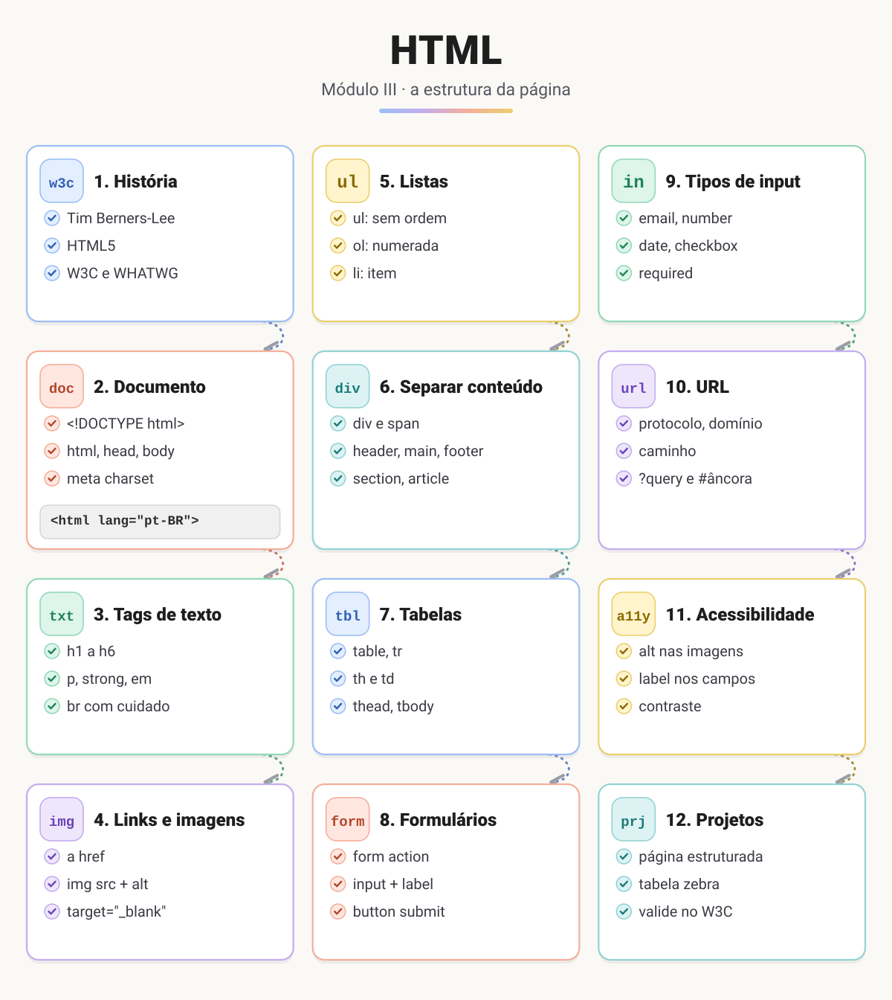
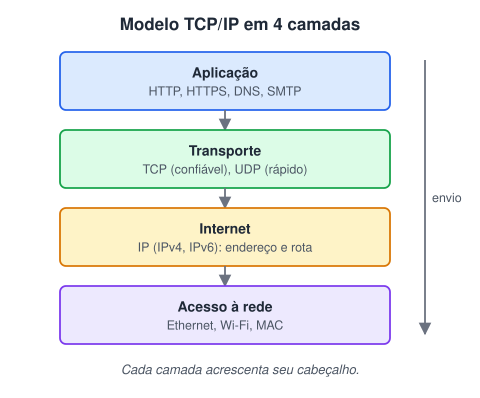
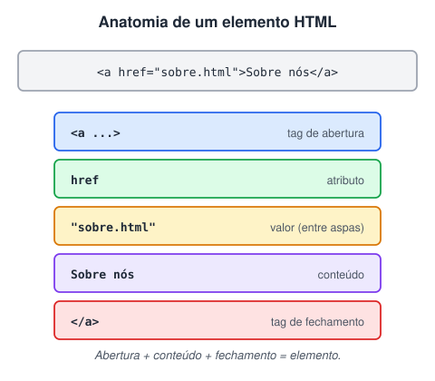

# História de criação do HTML

> 🗺️ **Nesta aula:** o que é HTML, a pilha TCP/IP por onde ele viaja, a história da linguagem até o HTML5 e as partes de um elemento HTML.

## 🧭 Cheat sheet da seção

Antes de começar, veja o mapa do módulo: é o que as próximas aulas vão explicar. Volte a ele no fim para revisar.



## De onde paramos

O módulo II terminou com algoritmos e lógica. O HTML é diferente: não descreve passos, descreve **conteúdo**. É a primeira das três camadas do front-end que você vai dominar.

## O que é HTML?

**HTML (*HyperText Markup Language*) é a linguagem de marcação que define a estrutura e o significado do conteúdo de uma página web.** Ela diz ao navegador "isto é um título", "isto é um parágrafo", "isto é um link", "isto é uma imagem".

- HTML **não é linguagem de programação**: não tem variáveis, decisões nem laços. Ela *marca* o conteúdo com **tags**.
- Cada tag tem um propósito, e o navegador a interpreta para exibir o conteúdo.
- O HTML trabalha em conjunto com o **CSS** (aparência) e o **JavaScript** (comportamento). São as três camadas do front-end.

> 💡 "Hipertexto" é texto com **links** para outros textos. Essa ideia de ligar documentos é o coração da Web.

> 💡 **Analogia:** uma página web é como uma casa. O HTML é a estrutura (paredes, portas, cômodos), o CSS é o acabamento (pintura, móveis, iluminação) e o JavaScript é a parte elétrica (interruptores e campainha, que reagem quando alguém mexe).

## O modelo TCP/IP

O HTML só pode viajar porque a internet tem regras comuns de comunicação, e o modelo TCP/IP organiza essas regras em camadas, cada uma resolvendo um problema. Pense no correio: você escreve a carta (aplicação, onde estão o HTTP e o HTML), ela é dividida e numerada para não se perder (transporte, com o TCP), recebe um endereço de destino (internet, com o IP) e segue pelos meios físicos, como cabos e sinais de Wi-Fi (acesso à rede). Cada camada só precisa conhecer a vizinha, e por isso dá para trocar o Wi-Fi por um cabo sem mudar o site. Você não precisa decorar as camadas, mas saber que elas existem explica por que a web funciona em qualquer aparelho.

O HTML viaja pela internet sobre a pilha de protocolos **TCP/IP**.



> 💡 **Analogia:** é o caminho de uma carta. Na **aplicação** você escreve o texto; no **transporte** põe no envelope e numera as folhas, para nada se perder; na **internet** escreve o endereço da cidade de destino; e no **acesso à rede** o carteiro do bairro leva o envelope de casa em casa.

| Camada | Faz | Exemplos |
| --- | --- | --- |
| Aplicação | o que o programa quer dizer | HTTP, HTTPS, DNS, SMTP |
| Transporte | entrega entre programas (portas) | TCP, UDP |
| Internet | endereço e rota entre redes | IP |
| Acesso à rede | envio dentro da rede local | Ethernet, Wi-Fi |

### Linha do tempo

- **Anos 1960**: a ARPA financia a ARPANET, uma rede de **comutação de pacotes**. Entre os nomes centrais estão J.C.R. Licklider, Robert Taylor, Leonard Kleinrock e Lawrence Roberts.
- **1970**: a ARPANET passa a usar o **NCP** (*Network Control Protocol*), que funcionava bem dentro de uma única rede, mas não interligava redes diferentes.
- **1974**: Vint Cerf e Bob Kahn publicam o desenho do **TCP**, pensado para interligar redes diferentes (*inter-net*).
- **1978**: o protocolo é dividido em dois: o **TCP**, que garante a entrega confiável e ordenada, e o **IP**, que endereça e roteia os pacotes.
- **1º de janeiro de 1983**: a ARPANET troca o NCP pelo TCP/IP. É o "nascimento" da internet como rede de redes.
- O **IPv4** (32 bits) domina até hoje. O **IPv6** (128 bits, padronizado em 1998) resolve a falta de endereços.

## Linha do tempo do HTML

| Ano | Marco |
| --- | --- |
| 1980 | Tim Berners-Lee cria o **ENQUIRE**, um programa pessoal de notas ligadas entre si |
| 1989 | Berners-Lee propõe ao CERN um sistema de hipertexto distribuído: a **World Wide Web** |
| 1990–1991 | primeiro navegador, primeiro servidor e o primeiro documento HTML, com cerca de 18 tags, baseado no **SGML** |
| 1995 | **HTML 2.0** (RFC 1866), a primeira especificação oficial, com formulários e imagens |
| 1997 | **HTML 3.2** (tabelas) e **HTML 4.0** (CSS, scripts, frames, acessibilidade) |
| 1999 | **HTML 4.01** |
| 2000 | **XHTML 1.0**: o HTML reescrito com as regras rígidas do XML |
| 2004 | navegadores criam o **WHATWG** e começam o que viraria o HTML5 |
| 2014 | **HTML5** vira recomendação oficial do W3C: tags semânticas, `<video>`, `<audio>`, `<canvas>`, novos campos de formulário |
| 2019 | W3C e WHATWG acordam um padrão único: o **HTML Living Standard**, atualizado continuamente |

> ⚠️ Não houve um "HTML 1.0" oficial: o primeiro padrão foi o HTML 2.0. E **não existe "HTML6"**: desde 2019, o HTML é um padrão vivo, sem números de versão.

## Componentes de um elemento HTML

Um elemento HTML é formado por peças que se repetem em toda a página, e reconhecê-las torna qualquer código legível. A **tag de abertura** (`<p>`) diz que algo começou; a **tag de fechamento** (`</p>`) diz que terminou, e entre elas fica o **conteúdo**. Dentro da tag de abertura podem existir **atributos**, que acrescentam informações no formato `nome="valor"`, como `href` em um link ou `alt` em uma imagem. Alguns elementos não têm conteúdo e por isso não têm fechamento, como `` e `<br>`. Chamamos tudo isso junto, da abertura ao fechamento, de elemento; e a palavra “tag” se refere só à marcação entre `< >`.



> 💡 **Analogia:** um elemento é como um pacote etiquetado. A tag de abertura é a etiqueta da frente ("frágil"), os atributos são os detalhes escritos nela ("destino: sobre.html"), o conteúdo é o que vai dentro da caixa, e a tag de fechamento é a fita que fecha o pacote.

- **Tag**: o nome entre `<` e `>`, como `<p>` ou `<a>`.
- **Atributo**: informação extra na tag de abertura, como `href`, `src`, `alt`, `id` ou `class`.
- **Valor**: o que o atributo recebe, sempre entre aspas.
- **Conteúdo**: o que fica entre a abertura e o fechamento. Pode conter outros elementos (aninhamento).
- **Elementos vazios**: não têm conteúdo nem fechamento, como ``, `<br>`, `<hr>`, `<meta>`, `<link>` e `<input>`.

```html
<!-- link: o href diz para onde ir,
     o conteúdo é o texto clicável -->
<a href="sobre.html">Sobre nós</a>

<!-- elemento vazio: a imagem não tem texto
     dentro; o alt descreve para quem não vê -->


<!-- aninhamento: feche na ordem inversa,
     como caixas dentro de caixas -->
<p>Texto com <strong>destaque</strong>.</p>
```

## 🧠 Revisão rápida

**Por que se diz que HTML não é linguagem de programação?**

Porque não tem variáveis, decisões nem laços: só marca o conteúdo com tags.

**Em qual camada do TCP/IP fica o HTTP?**

Na camada de aplicação.

**Em ``, o que é `alt` e o que é `"Gato"`?**

`alt` é o atributo; `"Gato"` é o valor dele.

> ➡️ **Próximo passo:** antes de escrever, saiba onde consultar e como escrever bem: **Principais fontes de documentação sobre HTML e boas práticas de como escrever**.

## 📌 Resumo

| Item | Em uma frase |
| --- | --- |
| HTML | marca a estrutura e o significado do conteúdo |
| HTML × CSS × JS | estrutura, aparência, comportamento |
| TCP/IP | aplicação, transporte, internet, acesso à rede |
| HTML5 / Living Standard | o padrão atual, atualizado continuamente |
| Elemento | abertura com atributos, conteúdo e fechamento |
| Elemento vazio | sem conteúdo nem fechamento (`img`, `br`) |
