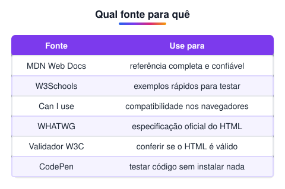

# Principais fontes de documentação sobre HTML e boas práticas de como escrever

> 🗺️ **Nesta aula:** onde consultar HTML, CSS e JavaScript, quais editores usar e as boas práticas para escrever um HTML limpo, acessível e fácil de manter.

## De onde paramos

A aula anterior apresentou o HTML e suas tags. Ninguém decora todas: o profissional sabe onde procurar e segue regras que deixam o código legível. É disso que trata esta aula.

## Documentação



> 💡 **Analogia:** pense em planejar uma viagem. A MDN é o guia completo do destino, o W3Schools é o folheto com o roteiro rápido, o Can I use avisa quais estradas estão abertas e o validador é a conferência dos documentos antes do embarque.

### MDN Web Docs (HTML, CSS, JavaScript)

A referência mais completa e confiável, mantida pela Mozilla com apoio de Google, Microsoft e outros. Tem versão em português para boa parte do conteúdo.

🔗 [HTML: HyperText Markup Language | MDN](https://developer.mozilla.org/en-US/docs/Web/HTML)

### W3Schools (HTML, CSS, JavaScript)

Bom para exemplos rápidos e para testar no navegador. Para detalhes e boas práticas, prefira a MDN.

🔗 [W3Schools Free Online Web Tutorials](https://www.w3schools.com/)

> 💡 Para saber se um recurso funciona em todos os navegadores, use o **Can I use** (caniuse.com). A especificação oficial do HTML é o **HTML Living Standard**, do WHATWG (html.spec.whatwg.org).

### Como ler uma página da MDN

Toda página de tag na MDN segue a mesma ordem: um **exemplo interativo** no topo, a lista de **atributos**, notas de **acessibilidade** e, no fim, a tabela de **compatibilidade** com os navegadores. Comece pelo exemplo, vá aos atributos que precisa e confira a compatibilidade antes de usar algo novo.

## Editores de código

Tecnicamente, dá para escrever HTML no bloco de notas, mas um editor de código torna o trabalho muito mais rápido e seguro. Ele pinta cada parte do código com uma cor (*syntax highlighting*), o que revela de longe uma aspa esquecida; sugere o fechamento de tags e completa o que você digita; e pode abrir uma pasta inteira de projeto de uma vez. O VS Code é a escolha mais usada hoje, é gratuito e tem extensões para tudo. A escolha do editor importa menos do que o hábito de conhecê-lo bem: aprenda os atalhos de copiar linha, mover linha e buscar em todo o projeto.

**VS Code**: gratuito, o mais usado hoje, com extensões para tudo (Live Server, Prettier, ESLint).

🔗 [https://code.visualstudio.com/](https://code.visualstudio.com/)

**Sublime Text**: leve e rápido.

🔗 [Sublime Text - the sophisticated text editor for code, markup and prose](https://www.sublimetext.com/)

**Eclipse**: IDE mais voltada a Java. Para web, o VS Code ou o WebStorm são escolhas mais comuns.

🔗 [Eclipse Downloads | The Eclipse Foundation](https://www.eclipse.org/downloads/)

### Testar código no navegador

O CodePen permite escrever HTML, CSS e JS e ver o resultado na hora, sem instalar nada:

🔗 [CodePen](https://codepen.io/)

## Boas práticas ao escrever HTML

HTML mal escrito costuma funcionar no navegador, porque ele tenta adivinhar o que você quis dizer, e esse é exatamente o perigo: o que parece certo hoje quebra em outro navegador ou em um leitor de tela. Quatro hábitos evitam isso. **Indente** o código para enxergar quem está dentro de quem. **Feche todas as tags** que precisam de fechamento. Use **tags semânticas** (`<header>`, `<nav>`, `<main>`) que descrevem o papel do conteúdo, em vez de `<div>` para tudo. E **valide** o código no validador oficial do W3C quando algo se comportar de forma estranha: ele aponta as falhas de estrutura que o navegador escondeu.

1. **Use tags semânticas**: escolha a tag pelo **significado**, não pela aparência. Título é `<h1>`–`<h6>`, lista é `<ul>`/`<ol>`, navegação é `<nav>`, botão é `<button>` (não uma `<div>` clicável).
2. **Indentação consistente**: cada nível de aninhamento com 2 ou 4 espaços. Ferramentas como o **Prettier** formatam sozinhas.
3. **Comentários com moderação**: `<!-- ... -->` para explicar o que não é óbvio, e não para narrar cada tag.
4. **Atributos corretos**: valores sempre entre aspas e nada de atributos obsoletos (`align`, `bgcolor`, `border` em tabela). Isso é trabalho do CSS.
5. **Valide o código** no validador do W3C (validator.w3.org).
6. **Acessibilidade** (diretrizes WCAG):
  - `alt` descritivo em imagens (vazio, `alt=""`, se a imagem for só decorativa);
  - `<label>` ligado a cada campo de formulário;
  - hierarquia de títulos sem pular níveis;
  - `lang="pt-BR"` na tag `<html>`.
7. **Separe as responsabilidades**: estrutura no HTML, estilo em arquivo `.css`, comportamento em arquivo `.js`. Evite `style="..."` e `onclick="..."` espalhados.
8. **Desempenho**: imagens otimizadas (WebP/AVIF, tamanho certo, `loading="lazy"`) e scripts com `defer`.
9. **Teste em vários navegadores e tamanhos de tela**: o modo responsivo do DevTools (`Ctrl + Shift + M`) ajuda.

```html
<!-- ✖ Evite -->
<div onclick="enviar()" style="color:red">
  <b>Enviar</b>
</div>

<!-- ✔ Prefira -->
<button type="button" class="btn-perigo" id="enviar">
  Enviar
</button>
```

## 🧠 Revisão rápida

**Qual a fonte mais confiável para consultar HTML, CSS e JavaScript?**

A MDN Web Docs, mantida pela Mozilla.

**Por que trocar `<div onclick>` por `<button>`?**

Porque o botão já é focável pelo teclado, funciona com Enter e Espaço e é anunciado como botão pelos leitores de tela.

**Para que serve o validador do W3C?**

Para encontrar tags não fechadas, atributos inválidos e outros erros de estrutura no HTML.

> ➡️ **Próximo passo:** hora de escrever o primeiro documento: **Criação de documento HTML e principais tags**.

## 📌 Resumo

| Item | Em uma frase |
| --- | --- |
| MDN | a referência oficial de fato para a web |
| Can I use | confere o suporte de um recurso nos navegadores |
| VS Code | o editor mais usado, com extensões |
| Semântica | escolha a tag pelo significado |
| Validação | validator.w3.org aponta erros de estrutura |
| Separação | HTML estrutura, CSS estilo, JS comportamento |
