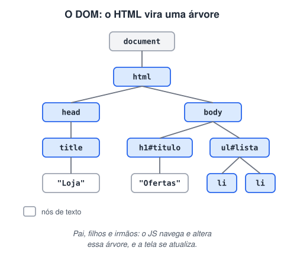

# Criação de documento HTML e principais tags

> 🗺️ **Nesta aula:** a estrutura básica de um documento HTML, as principais tags por categoria e uma primeira olhada no DOM, a árvore que o navegador monta a partir do HTML.

## De onde paramos

Você já sabe o que é uma tag e onde consultar. Agora vamos montar uma página completa, do `<!DOCTYPE>` ao `</html>`, e ver como o navegador a enxerga.

## Estrutura básica de um documento HTML

```html
<!DOCTYPE html>
<html lang="pt-BR">
  <head>
    <meta charset="utf-8">
    <meta name="viewport"
      content="width=device-width, initial-scale=1">
    <title>Minha página</title>
    <link rel="stylesheet" href="estilo.css">
  </head>
  <body>
    <h1>Olá, mundo!</h1>
    <p>Meu primeiro parágrafo.</p>
    <script src="app.js" defer></script>
  </body>
</html>
```

| Linha | Papel |
| --- | --- |
| `<!DOCTYPE html>` | avisa ao navegador que o documento é HTML5 |
| `<html lang="pt-BR">` | raiz do documento; o `lang` ajuda leitores de tela e buscadores |
| `<head>` | metadados: codificação, título, descrição, viewport, CSS; não aparece na página |
| `<meta charset="utf-8">` | permite acentos e emojis |
| `<meta name="viewport">` | faz a página se ajustar à tela do celular |
| `<body>` | tudo o que aparece na tela |

- Um documento HTML é feito de **elementos** (tags) e **texto** (conteúdo).
- Cada tag descreve o **papel** de um conteúdo na página.
- O navegador lê o HTML e **renderiza** a página na tela.

> 💡 No VS Code, digite `!` e aperte `Tab` num arquivo `.html` vazio: o Emmet gera esse esqueleto na hora.

> 💡 **Analogia:** o `head` é a ficha técnica de um livro (título, autor, idioma), que o leitor não vê na página; o `body` é o livro aberto, com tudo o que aparece na leitura.

## Principais tags

| Categoria | Tags | Para que serve |
| --- | --- | --- |
| Estrutura | `<html>`, `<head>`, `<body>` | esqueleto da página |
| Metadados | `<title>`, `<meta>`, `<link>`, `<style>`, `<script>` | informações e recursos externos |
| Títulos | `<h1>` a `<h6>` | hierarquia de títulos (um `<h1>` por página) |
| Texto | `<p>`, `<br>`, `<hr>`, `<strong>`, `<em>`, `<span>` | parágrafos, quebra de linha, ênfase |
| Links e mídia | `<a>`, ``, `<video>`, `<audio>`, `<iframe>` | navegação e multimídia |
| Listas | `<ul>`, `<ol>`, `<li>` | listas com marcadores ou numeradas |
| Tabelas | `<table>`, `<tr>`, `<th>`, `<td>` | dados tabulares |
| Formulários | `<form>`, `<input>`, `<label>`, `<button>` | entrada de dados |
| Seções | `<header>`, `<nav>`, `<main>`, `<section>`, `<footer>` | organização do layout |
| Genéricas | `<div>` (bloco), `<span>` (em linha) | agrupar quando nenhuma tag semântica serve |

### Títulos e texto na prática

```html
<h1>Receitas da vovó</h1>
<h2>Bolo de cenoura</h2>
<p>Um bolo <strong>fofinho</strong> e
  <em>fácil</em> de fazer.</p>
<hr>
<h2>Pão de queijo</h2>
<p>Rende 30 unidades.</p>
```

`<strong>` marca importância (aparece em negrito) e `<em>` marca ênfase (itálico). `<hr>` separa assuntos com uma linha horizontal.

## O DOM (Document Object Model)

Depois de ler o HTML, o navegador cria uma **representação em objetos** do documento: o **DOM**. Ele é uma **árvore**: cada elemento é um nó, com pai, filhos e irmãos.



- O JavaScript pode **ler e modificar** o DOM, e a tela se atualiza **sem recarregar a página**. Isso é o tema do módulo VII.
- Ao remover um nó, todos os seus descendentes vão junto.
- Para ver o DOM, aperte **F12** (ou clique com o botão direito → **Inspecionar**). A aba **Elements** mostra a árvore, e você pode editar ao vivo para testar.

> 💡 O DOM **não é o código-fonte**. Ele é o estado *atual* da página. Se um script adicionar um elemento, ele aparece no DOM (aba Elements), mas não no "Exibir código-fonte" (`Ctrl + U`).

### Um primeiro contato pelo console

Abra o DevTools (F12) → aba **Console** numa página que tenha `<h1 id="titulo">` e experimente:

```jsx
// por id: devolve UM elemento (ou null)
const titulo = document.getElementById("titulo");
// muda o texto na hora
titulo.innerText = "Novo título!";

// forma moderna: aceita qualquer seletor CSS
const primeiro = document.querySelector(".card");
const todos = document.querySelectorAll("ul > li");
```

O módulo VII aprofunda seleção, eventos e navegação pela árvore.

## Exercício

Monte uma página "Sobre mim" com: um título principal, dois subtítulos ("Quem sou" e "O que estudo"), um parágrafo em cada e uma linha horizontal entre eles.

<details>
<summary>Ver resposta</summary>

```html
<!DOCTYPE html>
<html lang="pt-BR">
<head>
  <meta charset="utf-8">
  <title>Sobre mim</title>
</head>
<body>
  <h1>Ana Souza</h1>
  <h2>Quem sou</h2>
  <p>Estudante de desenvolvimento web.</p>
  <hr>
  <h2>O que estudo</h2>
  <p>HTML, CSS e <strong>JavaScript</strong>.</p>
</body>
</html>
```

</details>

## 🧠 Revisão rápida

**O que fica no `<head>` e o que fica no `<body>`?**

No `head`, os metadados (título, codificação, CSS); no `body`, tudo o que aparece na tela.

**Quantos `<h1>` uma página deve ter?**

Um só, com o título principal.

**Por que um elemento criado por JavaScript não aparece no `Ctrl + U`?**

Porque o `Ctrl + U` mostra o código-fonte original; o elemento novo existe só no DOM, o estado atual da página.

> ➡️ **Próximo passo:** agora em detalhe as tags que mais aparecem: metadados, links, imagens, mídia e listas, em **Estudo aprofundado de algumas tags importantes**.

## 📌 Resumo

| Item | Em uma frase |
| --- | --- |
| `<!DOCTYPE html>` | declara o documento como HTML5 |
| `<head>` | metadados; não aparece na página |
| `<body>` | o conteúdo visível |
| `h1`–`h6` | hierarquia de títulos; um `h1` por página |
| `strong` / `em` | importância / ênfase |
| DOM | a árvore de objetos que o navegador monta |
