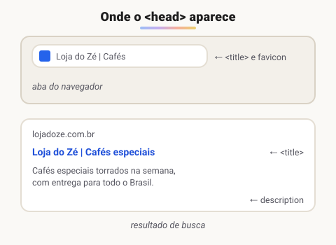

# Estudo aprofundado de algumas tags importantes

> 🗺️ **Nesta aula:** as tags que mais aparecem no dia a dia: metadados do `<head>` e SEO, links e âncoras, `<style>` e `<script>`, imagens, vídeo e áudio, quebras de linha e listas.

## De onde paramos

A aula anterior montou o esqueleto da página e listou as tags por categoria. Agora vamos a fundo nas mais usadas, com os atributos que fazem diferença.

## Tags do `<head>`: metadados e SEO

Tudo dentro do `<head>` são **metadados**: informações *sobre* a página, que não aparecem no corpo, mas são usadas pelo navegador, pelos buscadores e pelas redes sociais. Um bom `<head>` melhora o **SEO** (*Search Engine Optimization*), ou seja, como a página aparece no Google.



```html
<!DOCTYPE html>
<html lang="pt-BR">
  <head>
    <!-- 1. codificação: a PRIMEIRA tag do head -->
    <meta charset="utf-8">

    <!-- 2. viewport: sem ela, o site fica
         "miniatura" no celular -->
    <meta name="viewport"
      content="width=device-width, initial-scale=1">

    <!-- 3. título: aba e Google (até ~60 caracteres) -->
    <title>Loja do Zé | Cafés especiais</title>

    <!-- 4. descrição: texto abaixo do título
         no Google (~150 caracteres) -->
    <meta name="description"
      content="Cafés especiais torrados na semana.">

    <!-- 5. autor -->
    <meta name="author" content="Ana Souza">

    <!-- 6. favicon: o ícone da aba -->
    <link rel="icon" href="/favicon.ico">

    <!-- 7. folha de estilo externa -->
    <link rel="stylesheet" href="estilo.css">
  </head>
</html>
```

### Controlando a indexação: `meta robots`

Por padrão, os buscadores **já indexam** as páginas públicas. A tag `robots` serve para **restringir**:

```html
<!-- não mostrar no Google nem seguir os links -->
<meta name="robots" content="noindex, nofollow">
```

| Valor | Efeito |
| --- | --- |
| `index, follow` | comportamento padrão: indexa e segue os links (não precisa declarar) |
| `noindex` | **não** aparece nos resultados de busca |
| `nofollow` | não segue os links da página |

> ⚠️ `noindex` faz o **oposto** de indexar: tira a página do Google. Para ser indexado, basta **não** colocar a tag. E `<meta name="keywords">` é **ignorada pelo Google desde 2009**: o que conta é título, descrição, conteúdo de qualidade e HTML semântico.

### Redes sociais (Open Graph)

Controlam o "card" que aparece quando o link é compartilhado no WhatsApp, LinkedIn etc.:

```html
<meta property="og:title"
  content="Loja do Zé | Cafés especiais">
<meta property="og:description"
  content="Cafés torrados na semana.">
<meta property="og:image"
  content="https://lojadoze.com.br/capa.jpg">
```

## Links: a tag `<a>`

- `href` define o destino: outra página, um arquivo, uma âncora (`#secao`), um e-mail ou um telefone.
- `target="_blank"` abre em nova aba. O padrão (`_self`) abre na mesma aba.

```html
<!-- link externo em nova aba -->
<a href="https://developer.mozilla.org"
   target="_blank" rel="noopener">MDN</a>

<!-- imagem clicável -->
<a href="https://google.com">
  
</a>
```

### Links especiais: e-mail, telefone e WhatsApp

```html
<a href="mailto:contato@exemplo.com?subject=Dúvida">
  Enviar e-mail</a>
<a href="tel:+5521999990000">Ligar</a>
<a href="https://wa.me/5521999990000">
  Chamar no WhatsApp</a>
```

Sem o prefixo `mailto:`, o navegador tentaria abrir um *endereço de site*, e não o programa de e-mail.

### Âncoras: navegar dentro da página

Dê um `id` ao destino e use `#id` no `href`:

```html
<nav>
  <a href="#intro">Introdução</a>
  <a href="#final">Final</a>
</nav>

<h2 id="intro">Introdução</h2>
<p>...</p>
<h2 id="final">Final</h2>
<p>...</p>
```

Também dá para combinar com outra página: `href="sobre.html#equipe"`. Com `html { scroll-behavior: smooth; }` no CSS, a rolagem fica suave.

### A tag `<base>`

Define a URL base para **todos os links relativos** da página. É pouco usada e pode confundir, então use com cuidado.

```html
<head>
  <base href="https://www.exemplo.com.br/">
</head>
<body>
  <!-- vai para https://www.exemplo.com.br/carros -->
  <a href="carros">Carros</a>
  <!-- URL absoluta: ignora o base -->
  <a href="https://google.com">Google</a>
</body>
```

## A tag `<style>` (CSS interno)

Permite escrever CSS dentro do próprio HTML. É útil para testes, mas em projetos reais prefira um arquivo `.css` separado, ligado com `<link>`: o navegador o guarda em cache e ele pode ser reaproveitado em várias páginas.

```html
<head>
  <style>
    body { background-color: aquamarine; }
    h1   { color: blueviolet; }
    p    { color: blue; }
  </style>
</head>
```

## A tag `<script>`

Insere JavaScript, que pode alterar a página ou fazer requisições em segundo plano.

```html
<p id="teste"></p>

<script>
  document.getElementById("teste")
    .textContent = "Hello JavaScript!";
</script>

<!-- em projetos reais: arquivo externo,
     no head, com defer -->
<script src="app.js" defer></script>
```

> 💡 O script não precisa ficar no fim do `<body>`; essa era a forma antiga de esperar o HTML carregar. Hoje o recomendado é colocá-lo no `<head>` com `defer`: ele baixa em paralelo e só executa depois que o HTML foi lido.

## Imagens: ``

```html

```

- `src`: caminho da imagem, local ou URL.
- `alt`: **texto alternativo**, lido por leitores de tela e exibido se a imagem não carregar. Obrigatório, e deve ser descritivo.
- `width`/`height`: reservam o espaço e evitam que a página "pule" enquanto a imagem carrega.
- `loading="lazy"`: só carrega quando a imagem estiver perto de aparecer na tela.

### Imagem com legenda: `<figure>`

```html
<figure>
  
  <figcaption>Vendas do 1º trimestre</figcaption>
</figure>
```

## Vídeo e áudio

```html
<video width="640" controls poster="capa.jpg">
  <source src="video.webm" type="video/webm">
  <source src="video.mp4" type="video/mp4">
  Seu navegador não suporta vídeo.
</video>

<audio controls src="musica.mp3"></audio>
```

- `controls` mostra play, volume etc. Outros atributos: `autoplay` (só funciona com `muted`), `loop` e `muted`.
- O `src` precisa apontar para um **arquivo de vídeo** (.mp4, .webm). Para YouTube e similares, use o código de incorporação (`<iframe>`) que o próprio site fornece.

## Quebra de linha: `<br>`

Força uma quebra de linha **dentro** de um texto, por exemplo em endereços ou poemas.

```html
<p>Rua das Flores, 42<br>Rio de Janeiro – RJ</p>
```

> 💡 Não use `<br>` para criar espaço entre elementos. Espaçamento é papel do CSS (`margin`, `padding`, `gap`).

## Listas

- `<ul>`: lista **não ordenada**, com marcadores.
- `<ol>`: lista **ordenada**, numerada. Aceita `start="5"`, `reversed` e `type="a"`.
- `<li>`: cada item. Listas podem ser aninhadas dentro de um `<li>`.

```html
<ol>
  <li>Animais
    <ul>
      <li>Leão</li>
      <li>Tigre</li>
    </ul>
  </li>
  <li>Objetos
    <ul>
      <li>Guitarra</li>
      <li>Controle</li>
    </ul>
  </li>
</ol>
```

## Tags de conteúdo × tags de estrutura

- **Conteúdo** (mostram algo): `<h1>`–`<h6>`, `<p>`, ``, `<a>`, `<ul>`.
- **Estrutura** (agrupam outros elementos): `<div>`, `<header>`, `<nav>`, `<main>`, `<section>`, `<article>`, `<footer>`. Elas não aparecem visualmente por si só, mas organizam a página e dão significado a ela. São o tema da próxima aula.

## Exercício

Crie um cardápio com: uma imagem com legenda, uma lista ordenada de 3 pratos e, no fim, um link de WhatsApp para pedidos que abra em nova aba.

<details>
<summary>Ver resposta</summary>

```html
<h1>Cardápio do dia</h1>
<figure>
  
  <figcaption>Feijoada da casa</figcaption>
</figure>
<ol>
  <li>Feijoada</li>
  <li>Moqueca</li>
  <li>Escondidinho</li>
</ol>
<a href="https://wa.me/5521999990000"
   target="_blank" rel="noopener">
  Pedir pelo WhatsApp</a>
```

</details>

## 🧠 Revisão rápida

**Qual tag define o texto da aba do navegador?**

`<title>`, dentro do `<head>`.

**Como fazer um link rolar até um título com `id="contato"`?**

`<a href="#contato">Contato</a>`.

**Por que o `alt` é obrigatório numa imagem?**

Porque é lido por leitores de tela e aparece se a imagem não carregar; sem ele, a informação se perde.

> ➡️ **Próximo passo:** com o conteúdo pronto, falta organizá-lo em regiões. É o tema de **Tags de separação de conteúdo da página**.

## 📌 Resumo

| Item | Em uma frase |
| --- | --- |
| `meta charset` e `viewport` | acentos corretos e página ajustada ao celular |
| `title` e `description` | o que aparece na aba e no Google |
| `<a href>` | link para página, âncora, e-mail ou telefone |
| `` | imagem com texto alternativo obrigatório |
| `figure` | imagem com legenda |
| `video` / `audio` | mídia nativa com `controls` |
| `ul` / `ol` | lista com marcadores / numerada |
