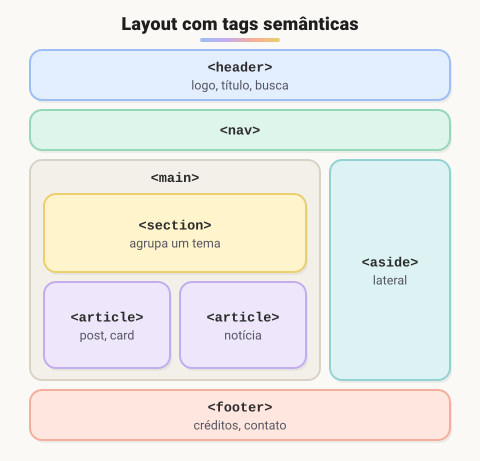
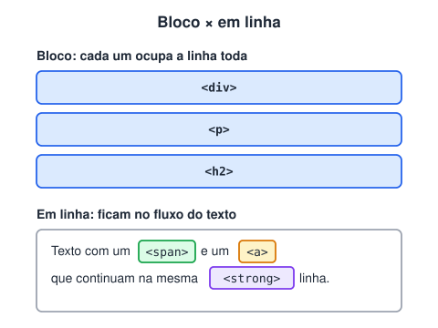

# Tags de separação de conteúdo da página

> 🗺️ **Nesta aula:** dividir a página em regiões com tags semânticas e entender a diferença entre elementos de bloco e em linha.

## De onde paramos

A aula anterior ensinou as tags de conteúdo (títulos, links, imagens, listas). Agora vamos agrupá-las em regiões com significado: cabeçalho, menu, conteúdo principal, rodapé.

## Da `<div>` às tags semânticas

Por muito tempo, as páginas eram montadas só com `<div>`: `<div id="header">`, `<div class="menu">`... Funcionava, mas o navegador, os buscadores e os leitores de tela não sabiam **o que** era cada bloco.

O HTML5 trouxe tags com **significado** (*semânticas*). Elas se comportam como uma `<div>`, mas dizem qual é o papel de cada parte:



> 💡 **Analogia:** montar a página só com `div` é como guardar tudo da mudança em caixas sem etiqueta. As tags semânticas são as etiquetas: "cozinha" (`header`), "quarto" (`main`), "garagem" (`footer`). O conteúdo é o mesmo, mas qualquer um sabe onde está cada coisa.

| Tag | Uso |
| --- | --- |
| `<header>` | cabeçalho da página ou de uma seção: logo, título, busca |
| `<nav>` | bloco de links de navegação principal |
| `<main>` | conteúdo principal; **só um** por página |
| `<section>` | agrupa conteúdo de um mesmo tema, normalmente com um título |
| `<article>` | conteúdo que faz sentido sozinho: post, notícia, card de produto, comentário |
| `<aside>` | conteúdo complementar: barra lateral, anúncios, "veja também" |
| `<footer>` | rodapé: créditos, contato, links secundários |

```html
<body>
  <!-- topo: identidade do site e menu -->
  <header>
    <h1>Blog da Ana</h1>
    <!-- nav avisa ao leitor de tela que aqui
         estão os links principais -->
    <nav>
      <a href="/">Início</a>
      <a href="/sobre">Sobre</a>
    </nav>
  </header>
  <!-- o que a pessoa veio ler -->
  <main>
    <!-- o post faz sentido sozinho:
         poderia ser compartilhado à parte -->
    <article>
      <h2>Meu primeiro post</h2>
      <p>...</p>
    </article>
  </main>
  <!-- complemento: pode sumir sem prejuízo -->
  <aside>Posts populares</aside>
  <footer>© 2026 Blog da Ana</footer>
</body>
```

> 💡 Use `<div>` quando **nenhuma** tag semântica fizer sentido, por exemplo um wrapper só para estilizar. O módulo VIII aprofunda o tema em "Principais tags semânticas do HTML".

## Elementos de bloco × em linha

Antes de pensar em layout, vale entender uma divisão básica do HTML: alguns elementos ocupam a linha inteira e empurram o próximo para baixo (blocos), e outros ficam dentro do texto, ao lado das palavras (em linha). Isso explica situações comuns: por que dois parágrafos nunca ficam lado a lado sem CSS, e por que um link no meio de uma frase não quebra a linha. Quase toda dúvida de "por que não consigo mudar a largura disso?" tem resposta aqui.

Todo elemento tem um comportamento padrão de exibição (a propriedade `display` do CSS):



> 💡 **Analogia:** elementos de bloco são como tijolos numa parede: cada um ocupa a fiada inteira e o próximo vai para baixo. Elementos em linha são como palavras numa frase: ficam lado a lado e só quebram quando a linha acaba.

### Bloco (`display: block`)

Os blocos formam a estrutura da página, como os tijolos de uma parede. Cada `div`, parágrafo ou título ocupa uma fiada inteira, mesmo que o conteúdo seja curto. Por isso a borda de uma `div` com uma palavra só vai de uma ponta a outra da página, como o exemplo abaixo deixa visível. Como o bloco é uma caixa completa, você pode definir largura, altura e espaçamentos em todos os lados.

- Começa em uma **nova linha** e ocupa **toda a largura** disponível.
- Aceita `width`, `height`, `margin` e `padding` em todas as direções.
- Exemplos: `<div>`, `<p>`, `<h1>`–`<h6>`, `<ul>`, `<ol>`, `<li>`, `<table>`, `<form>`, `<header>`, `<section>`, `<article>`, `<footer>`.

```html
<!-- a borda deixa visível que cada div
     ocupa a largura inteira da página -->
<div style="border: 1px solid black">
  Primeira div
</div>
<div style="border: 2px solid blue">
  Segunda div
</div>
<!-- resultado: uma embaixo da outra -->
```

### Em linha (`display: inline`)

Os elementos em linha acompanham o texto, como as palavras destacadas numa frase. A borda do `span` do exemplo abraça só a palavra, e o parágrafo continua em uma linha contínua. A consequência prática é a limitação: `width` e `height` são ignorados. Se você escreve `span { width: 200px; }` e nada acontece, o motivo é esse, e a solução é mudar o `display` do elemento.

- Fica **no fluxo do texto**, ao lado de outros elementos.
- Ocupa só o espaço do conteúdo. `width` e `height` **não** funcionam, e `margin`/`padding` verticais não empurram as linhas vizinhas.
- Exemplos: `<span>`, `<a>`, `<strong>`, `<em>`, `<code>`, `<label>`, `<abbr>`.

```html
<p>
  Esta linha testa o
  <!-- a borda abraça só a palavra: o span
       não quebra a linha do parágrafo -->
  <span style="border: 1px solid black">inline</span>
  dentro de um parágrafo.
</p>
```

> ⚠️ O padrão de um elemento sem estilo do navegador é `inline`; as tags estruturais e de texto (div, p, h1, ul...) é que recebem `block` da folha de estilo padrão do navegador. Já `` e `<input>` são inline **substituídos**: ficam em linha, mas aceitam largura e altura. O `<button>` não é substituído, mas se comporta como **inline-block**.

### `inline-block`: o meio-termo

Fica lado a lado como `inline`, mas aceita `width`, `height` e margens como `block`. É útil para botões e badges. Para layouts completos, use **Flexbox** e **Grid** (módulo V).

## Exercício

Monte o esqueleto de um blog usando só tags semânticas: um cabeçalho com o nome do site e um menu, uma área principal com dois artigos (cada um com título e texto), uma barra lateral e um rodapé. Nenhuma `div` é permitida.

<details>
<summary>Ver resposta</summary>

```html
<!-- esqueleto do blog, sem nenhuma div -->
<body>
  <header>
    <h1>Meu blog</h1>
    <nav>
      <a href="/">Início</a>
      <a href="/sobre">Sobre</a>
    </nav>
  </header>
  <main>
    <article>
      <h2>Primeiro post</h2>
      <p>Texto do primeiro post.</p>
    </article>
    <article>
      <h2>Segundo post</h2>
      <p>Texto do segundo post.</p>
    </article>
  </main>
  <aside>Links e categorias</aside>
  <footer>© 2026 Meu blog</footer>
</body>
```

Teste: cada bloco tem um papel claro (`header`, `nav`, `main`, `article`, `aside`, `footer`) e não sobrou nenhuma `div`.

</details>

## 🧠 Revisão rápida

**Um card de produto numa loja é `<section>` ou `<article>`?**

`<article>`: faz sentido sozinho, independente do resto da página.

**Por que `width` não funciona num `<span>`?**

Porque `span` é inline: ocupa só o espaço do conteúdo. Mude para `inline-block` ou `block` para aceitar largura.

**Quantos `<main>` uma página pode ter?**

Um só.

> ➡️ **Próximo passo:** quando os dados se cruzam em linhas e colunas, a ferramenta é outra: **Tabelas em HTML**.

## 📌 Resumo

| Item | Em uma frase |
| --- | --- |
| Semântica | a tag diz o papel da região |
| `header`, `nav`, `footer` | cabeçalho, menu, rodapé |
| `main` | conteúdo principal; um por página |
| `section` × `article` | tema da página × conteúdo independente |
| Bloco | linha inteira; aceita largura e altura |
| Em linha | no fluxo do texto; ignora largura e altura |
| `inline-block` | lado a lado, mas com tamanho |
