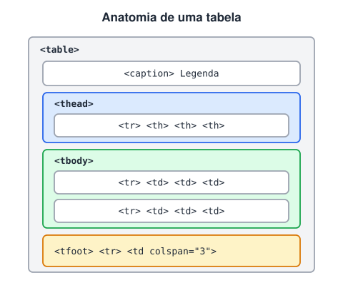

# Tabelas em HTML

> 🗺️ **Nesta aula:** montar tabelas com cabeçalho, corpo, rodapé e legenda, mesclar células com `colspan` e `rowspan`, estilizar bordas e deixar a tabela acessível.

## De onde paramos

A aula anterior organizou a página em regiões. Alguns conteúdos, porém, são naturalmente uma grade: horários, preços, comparativos. Para eles existe a tabela.

## Estrutura de uma tabela

Tabelas servem para **dados tabulares**: informações que fazem sentido em linhas e colunas, como planilhas, horários e comparativos. **Não use tabela para montar layout**; isso é trabalho do CSS (Flexbox e Grid).



| Tag | Significado |
| --- | --- |
| `<table>` | a tabela inteira |
| `<caption>` | título/legenda da tabela (primeiro filho da `<table>`) |
| `<thead>`, `<tbody>`, `<tfoot>` | cabeçalho, corpo e rodapé |
| `<tr>` | *table row*: uma linha |
| `<th>` | *table header*: célula de cabeçalho (negrito e centralizada; leitores de tela anunciam como título da coluna) |
| `<td>` | *table data*: célula de dado |

### A tabela mais simples

```html
<table>
  <tr>
    <td>Col 1</td>
    <td>Col 2</td>
    <td>Col 3</td>
  </tr>
</table>
```

`<td>` cria uma **célula**, não uma coluna. As colunas surgem do alinhamento das células de cada linha (`<tr>`).

## Bordas

Por padrão a tabela não tem bordas. O atributo `border="1"` ainda funciona, mas é **obsoleto**. O jeito certo é com CSS:

```html
<style>
  table, th, td {
    border: 1px solid rgb(121, 121, 185);
  }
  table {
    /* junta as bordas duplas em uma só */
    border-collapse: collapse;
  }
</style>
```

| Valor de `border-collapse` | Resultado |
| --- | --- |
| `separate` (padrão) | cada célula tem sua borda, com espaço entre elas (`border-spacing`) |
| `collapse` | bordas vizinhas se fundem numa linha só: o visual "planilha" |

## Mesclando células: `colspan` e `rowspan`

- `colspan="2"`: a célula ocupa **2 colunas**.
- `rowspan="2"`: a célula ocupa **2 linhas**.
- Uma célula sem conteúdo é só um `<td></td>`.

> 💡 Antes de escrever, desenhe a grade no papel e conte: cada linha precisa somar o mesmo número de colunas, contando os `colspan` e as células que "descem" de cima com `rowspan`.

## Exemplo completo, com estilo

**Código**

```html
<!DOCTYPE html>
<html lang="pt-BR">
<head>
  <meta charset="utf-8">
  <title>Tabela de clientes</title>
  <style>
    /* comentários em CSS usam barra-asterisco */
    table {
      width: 100%;
      /* necessário para border-spacing
         e empty-cells */
      border-collapse: separate;
      /* horizontal vertical */
      border-spacing: 4px 5px;
      border: 2px solid red;
      /* esconde as bordas das células vazias */
      empty-cells: hide;
    }
    th, td {
      border: 2px solid red;
      padding: 6px 10px;
    }
    thead {
      font-family: Arial, sans-serif;
      color: rgb(132, 134, 10);
    }
    tfoot {
      font-weight: bold;
      color: rgb(16, 119, 145);
      text-align: center;
    }
    caption {
      /* move a legenda para baixo */
      caption-side: bottom;
      font-style: italic;
    }
  </style>
</head>
<body>
  <table>
    <caption>Clientes cadastrados</caption>
    <thead>
      <tr>
        <th rowspan="2">Nome</th>
        <th rowspan="2">Telefone</th>
        <th colspan="2">Endereço</th>
      </tr>
      <tr>
        <th>Rua</th>
        <th>CEP</th>
      </tr>
    </thead>
    <tbody>
      <tr>
        <td>Ana</td>
        <td>21 9999-0000</td>
        <td>Rua A</td>
        <td>20000-000</td>
      </tr>
      <tr>
        <td>Bruno</td>
        <td>11 9888-1111</td>
        <td></td>
        <td></td>
      </tr>
    </tbody>
    <tfoot>
      <tr>
        <td colspan="4">
          Para mais informações, fale conosco.
        </td>
      </tr>
    </tfoot>
  </table>
</body>
</html>
```

> ⚠️ Armadilhas comuns: comentários HTML (`<!-- -->`) dentro de `<style>` quebram o CSS, porque o texto vira parte do seletor seguinte; use `/* ... */`. Um erro de digitação como `separete` faz o valor ser descartado em silêncio. E `<tfoot>` precisa de um `<tr>` em volta das células.

## Acessibilidade

- Use `<th>` para cabeçalhos, nunca um `<td>` em negrito.
- Em tabelas complexas, `scope="col"` ou `scope="row"` no `<th>` ajudam os leitores de tela.
- `<caption>` descreve a tabela para quem não a enxerga.

## Exercício

Monte uma tabela de horários com as colunas Dia, Manhã e Tarde, três linhas de dias e uma célula "Folga" que ocupe a manhã e a tarde de sábado.

<details>
<summary>Ver resposta</summary>

```html
<table>
  <caption>Horário de estudos</caption>
  <thead>
    <tr>
      <th scope="col">Dia</th>
      <th scope="col">Manhã</th>
      <th scope="col">Tarde</th>
    </tr>
  </thead>
  <tbody>
    <tr><th scope="row">Seg</th>
      <td>HTML</td><td>CSS</td></tr>
    <tr><th scope="row">Qua</th>
      <td>JS</td><td>Git</td></tr>
    <tr><th scope="row">Sáb</th>
      <td colspan="2">Folga</td></tr>
  </tbody>
</table>
```

</details>

## 🧠 Revisão rápida

**Qual a diferença entre `<th>` e `<td>`?**

`th` é célula de cabeçalho (anunciada como título); `td` é célula de dado.

**Numa tabela de 4 colunas, uma linha tem uma célula com `colspan="2"`. Quantas células mais essa linha deve ter?**

Duas: a célula mesclada vale por duas colunas, e 2 + 2 = 4.

**Posso usar tabela para dividir a página em colunas?**

Não. Tabela é para dados; layout se faz com CSS (Flexbox e Grid).

> ➡️ **Próximo passo:** uma página raramente só mostra dados; ela também recebe. A próxima aula é **Formulários em HTML**.

## 📌 Resumo

| Item | Em uma frase |
| --- | --- |
| Uso | só para dados tabulares, nunca layout |
| `tr`, `th`, `td` | linha, cabeçalho, dado |
| `thead`, `tbody`, `tfoot` | cabeçalho, corpo, rodapé |
| `caption` | título da tabela |
| `colspan` / `rowspan` | mescla colunas / linhas |
| `border-collapse` | bordas separadas ou fundidas |
