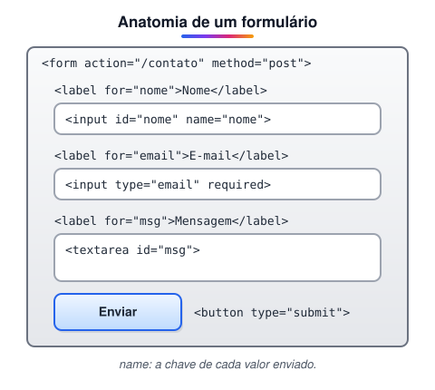

# Formulários em HTML (Adicionado pelo aluno para melhorar o estudo)

> 🗺️ **Nesta aula:** criar formulários com `<form>`, `<label>`, `<input>`, `<select>`, `<textarea>` e `<button>`, usar os tipos de campo do HTML5 e validar dados sem JavaScript.

## De onde paramos

Até aqui as páginas só mostravam conteúdo: textos, imagens, tabelas. Um formulário faz o caminho inverso: recebe dados do usuário (login, busca, cadastro, contato) e os envia para o servidor.

## A tag `<form>`



> 💡 **Analogia:** um formulário HTML é como uma ficha de papel num balcão. O `label` é o texto impresso ao lado de cada espaço, o `name` é o nome da coluna onde o atendente vai lançar a resposta, e o `action` é o guichê para onde a ficha é entregue.

```html
<form action="/contato" method="post">
  <label for="nome">Nome</label>
  <input id="nome" name="nome" required>

  <label for="email">E-mail</label>
  <input id="email" name="email"
         type="email" required>

  <button type="submit">Enviar</button>
</form>
```

| Atributo | Para que serve |
| --- | --- |
| `action` | para onde os dados vão (a URL que vai processá-los) |
| `method` | como vão: `get` (padrão) ou `post` |
| `name` (em cada campo) | a **chave** do dado enviado; campo sem `name` não é enviado |

### GET × POST

|  | GET | POST |
| --- | --- | --- |
| Onde vão os dados | na URL (`?nome=Ana`) | no corpo da requisição |
| Visível | sim: barra, histórico e logs | não aparece na URL |
| Uso | buscas e filtros | cadastros, login, pagamentos |

> ⚠️ POST não é criptografia: ele só tira os dados da URL. Quem protege a informação no caminho é o **HTTPS**. Senhas sempre com POST **e** HTTPS.

## `<label>`: o rótulo do campo

O `for` do label deve ser igual ao `id` do campo. Assim, clicar no texto foca o campo, e o leitor de tela anuncia o nome certo.

```html
<label for="cidade">Cidade</label>
<input id="cidade" name="cidade">

<!-- forma alternativa: campo dentro do label -->
<label>
  <input type="checkbox" name="aceite">
  Li e aceito os termos
</label>
```

O `placeholder` (texto de exemplo dentro do campo) **não substitui** o label: ele some quando a pessoa digita.

## Tipos de `<input>`

| `type` | Campo | Detalhe |
| --- | --- | --- |
| `text` | texto curto | o padrão |
| `email` | e-mail | valida o formato e abre teclado com @ no celular |
| `password` | senha | esconde os caracteres |
| `number` | número | aceita `min`, `max` e `step` |
| `tel` | telefone | teclado numérico no celular |
| `date` | data | abre um calendário |
| `checkbox` | caixa de marcar | várias opções independentes |
| `radio` | botão de opção | uma escolha por grupo (mesmo `name`) |
| `file` | arquivo | upload; exige `method="post"` |

```html
<fieldset>
  <legend>Forma de pagamento</legend>
  <label>
    <input type="radio" name="pag" value="pix"
           checked> Pix
  </label>
  <label>
    <input type="radio" name="pag" value="cartao">
    Cartão
  </label>
</fieldset>
```

`<fieldset>` agrupa campos relacionados e `<legend>` dá um título ao grupo. O `value` é o que é enviado, e `checked` deixa a opção marcada de início.

## Listas de opções e texto longo

```html
<label for="estado">Estado</label>
<select id="estado" name="estado">
  <option value="">Selecione</option>
  <option value="RJ">Rio de Janeiro</option>
  <option value="SP">São Paulo</option>
</select>

<label for="msg">Mensagem</label>
<textarea id="msg" name="msg" rows="4"></textarea>
```

## Botões

| `type` | Faz |
| --- | --- |
| `submit` | envia o formulário (o padrão dentro de um `<form>`) |
| `reset` | limpa os campos |
| `button` | não faz nada sozinho; usado com JavaScript |

## Validação nativa do HTML5

O navegador confere os dados antes de enviar, sem nenhuma linha de JavaScript:

```html
<input name="cep" required
       pattern="[0-9]{5}-[0-9]{3}"
       title="Formato 00000-000">
<input type="number" name="idade"
       min="18" max="120">
<input name="usuario" minlength="3"
       maxlength="20">
```

- `required`: obrigatório.
- `min`/`max`: limites numéricos ou de data.
- `minlength`/`maxlength`: tamanho do texto.
- `pattern`: uma expressão regular que o valor precisa seguir.

> 💡 A validação do navegador melhora a experiência, mas pode ser burlada. O servidor sempre valida de novo (você verá isso no módulo X, com Express).

## Exercício

Crie um formulário de cadastro com: nome (obrigatório), e-mail (obrigatório), senha com no mínimo 8 caracteres, um select de plano (Básico ou Pro) e um checkbox de aceite dos termos, enviado por POST para `/cadastro`.

<details>
<summary>Ver resposta</summary>

```html
<form action="/cadastro" method="post">
  <label for="nome">Nome</label>
  <input id="nome" name="nome" required>

  <label for="email">E-mail</label>
  <input id="email" name="email"
         type="email" required>

  <label for="senha">Senha</label>
  <input id="senha" name="senha"
         type="password" minlength="8" required>

  <label for="plano">Plano</label>
  <select id="plano" name="plano">
    <option value="basico">Básico</option>
    <option value="pro">Pro</option>
  </select>

  <label>
    <input type="checkbox" name="termos" required>
    Aceito os termos
  </label>

  <button type="submit">Cadastrar</button>
</form>
```

</details>

## 🧠 Revisão rápida

**Um campo sem `name` é enviado?**

Não. O `name` é a chave do dado; sem ele, o campo é ignorado no envio.

**Como fazer só uma opção poder ser marcada entre várias?**

Use `type="radio"` com o mesmo `name` em todas as opções.

**Um formulário de login deve usar GET ou POST?**

POST (e HTTPS): com GET, a senha ficaria visível na URL e no histórico.

> ➡️ **Próximo passo:** o `action` de um formulário é uma URL. Vale entender cada parte dela em **Estudo de URL**.

## 📌 Resumo

| Item | Em uma frase |
| --- | --- |
| `form` | agrupa os campos; `action` e `method` definem o envio |
| `label` | rótulo ligado ao campo pelo `for`/`id` |
| `name` | a chave de cada dado enviado |
| `input type` | text, email, password, number, date, checkbox, radio |
| `select` e `textarea` | lista de opções e texto longo |
| GET × POST | dados na URL × no corpo |
| Validação | `required`, `min`, `maxlength`, `pattern` |
