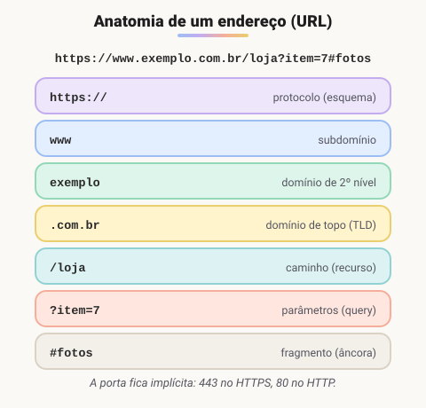

# Estudo de URL

> 🗺️ **Nesta aula:** as partes de uma URL, a diferença entre URLs absolutas e relativas e como caracteres especiais são codificados.

## De onde paramos

Links (`href`), imagens (`src`) e formulários (`action`) apontam todos para URLs. Escrever o caminho certo é o que separa um link que funciona de uma imagem quebrada.

## O que é URL?

**URL (*Uniform Resource Locator*) é o endereço completo de um recurso na web**: uma página, uma imagem, um PDF, um endpoint de API. É o que você digita na barra do navegador e o que vai no `href` de um link.



1. **Protocolo (esquema)**: como acessar o recurso. `https://` (web com criptografia **TLS**), `http://` (sem criptografia), `ftp://`, `mailto:`, `tel:`, `file://`.
2. **Domínio (host)**: o servidor. Pode ser um nome (`www.exemplo.com.br`) ou um IP (`192.0.2.1`). Lê-se de trás para frente: `.br` é o país, `.com.br` a categoria, `exemplo` o nome registrado e `www` um subdomínio.
3. **Porta** (opcional): a "porta de entrada" no servidor. Fica implícita quando é a padrão: **80** para HTTP e **443** para HTTPS. Em desenvolvimento, aparecem portas como `localhost:3000`.
4. **Caminho (path)**: onde o recurso está dentro do servidor, como `/blog/post1`.
5. **Parâmetros (query string)**: começam com `?`, no formato `chave=valor`, separados por `&`. Ex.: `/busca?q=café&pagina=2`.
6. **Fragmento (âncora)**: começa com `#` e aponta para uma parte da página (o elemento com aquele `id`). **Não é enviado ao servidor**; é tratado só pelo navegador.

> 💡 O HTTPS usa **TLS**. O "SSL" é o antecessor, já obsoleto e inseguro; o nome "certificado SSL" sobreviveu só por costume.

## URLs absolutas × relativas

Dentro do seu site, você raramente escreve a URL completa. Estando em `https://site.com/blog/post.html`:

| Tipo | Exemplo | Resultado |
| --- | --- | --- |
| Absoluta | `https://outro.com/pagina` | exatamente essa |
| Relativa à raiz | `/contato.html` | `https://site.com/contato.html` |
| Relativa à pasta | `imagem.png` | `https://site.com/blog/imagem.png` |
| Subindo uma pasta | `../index.html` | `https://site.com/index.html` |
| Só fragmento | `#comentarios` | mesma página, rola até o id |

É a mesma lógica dos caminhos no terminal: `..` sobe uma pasta e o nome sozinho parte da pasta atual.

## Caracteres especiais (URL encoding)

URLs só aceitam um conjunto limitado de caracteres. Espaços, acentos e símbolos são **codificados** com `%` seguido do código hexadecimal:

```
café com leite  →  caf%C3%A9%20com%20leite
```

No JavaScript, `encodeURIComponent("café com leite")` codifica e `decodeURIComponent(...)` decodifica. Para ler a query string da página atual:

```jsx
// em https://site.com/busca?q=cafe
const params = new URLSearchParams(location.search);
params.get("q"); // "cafe"
```

## Exercício

Os arquivos abaixo estão no mesmo site. Escreva o `href` relativo, a partir de `/blog/post.html`, para cada destino:

1. `/blog/foto.jpg`
2. `/index.html`
3. `/css/estilo.css`

<details>
<summary>Ver resposta</summary>

1. `foto.jpg` (mesma pasta)
2. `../index.html` (ou `/index.html`, a partir da raiz)
3. `../css/estilo.css` (ou `/css/estilo.css`)

</details>

## 🧠 Revisão rápida

**Qual parte da URL o servidor nunca recebe?**

O fragmento (`#...`): fica só no navegador.

**Por que `https://site.com` não mostra a porta?**

Porque usa a porta padrão do HTTPS, 443, que fica implícita.

**Em `?q=café&pagina=2`, quantos parâmetros há?**

Dois: `q` e `pagina`, separados por `&`.

> ➡️ **Próximo passo:** uma página bem endereçada também precisa funcionar para todas as pessoas. É o tema de **Acessibilidade na web**.

## 📌 Resumo

| Item | Em uma frase |
| --- | --- |
| URL | endereço completo de um recurso |
| Partes | protocolo, domínio, porta, caminho, query, fragmento |
| Absoluta × relativa | caminho completo × a partir de onde você está |
| `..` | sobe uma pasta |
| Query string | parâmetros `chave=valor` depois do `?` |
| Encoding | espaços e acentos viram `%` e um código |
