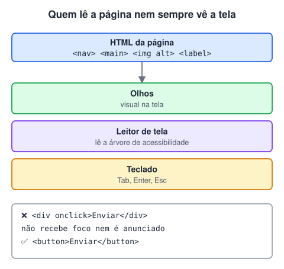

# Acessibilidade na web (Adicionado pelo aluno para melhorar o estudo)

> 🗺️ **Nesta aula:** o que é acessibilidade na web, por que ela é exigida e as seis práticas que resolvem a maior parte dos problemas: HTML semântico, texto alternativo, rótulos, teclado, contraste e ARIA.

## De onde paramos

Você já escreve páginas com tags semânticas, imagens, tabelas e formulários. Cada uma dessas tags tem um papel para quem não enxerga a tela ou não usa mouse. Esta aula junta essas peças.

## Por que importa



**Acessibilidade é fazer o site funcionar para todas as pessoas**, incluindo quem usa leitor de tela, navega só pelo teclado, tem baixa visão, daltonismo ou limitações motoras. No Brasil, a **Lei Brasileira de Inclusão (Lei 13.146/2015)** exige acessibilidade nos sites de empresas e órgãos públicos. A referência técnica mundial é a **WCAG**, publicada pelo W3C.

De quebra, um site acessível costuma ser melhor para SEO e mais fácil de usar para todo mundo.

## 1. HTML semântico primeiro

O leitor de tela entende a página pelas tags. Use a tag certa para cada função:

```html
<!-- ❌ -->
<div class="botao" onclick="salvar()">Salvar</div>

<!-- ✅ já é focável, funciona com Enter e
     Espaço e é anunciado como botão -->
<button type="button" onclick="salvar()">
  Salvar
</button>
```

- Estrutura com `<header>`, `<nav>`, `<main>`, `<footer>`.
- Títulos em ordem (`h1` → `h2` → `h3`), sem pular níveis só pela aparência.
- `<a>` para navegar e `<button>` para executar uma ação.
- `<html lang="pt-BR">`, para o leitor de tela usar a pronúncia certa.

## 2. Texto alternativo nas imagens

```html

<!-- decorativa: alt vazio, o leitor pula -->

```

Descreva **a informação** que a imagem passa, e não "imagem de...".

## 3. Formulários com rótulo

```html
<label for="email">E-mail</label>
<input id="email" type="email"
       autocomplete="email" required>
```

O `placeholder` **não substitui** o `label`: ele some quando a pessoa digita e costuma ter pouco contraste.

## 4. Teclado e foco

- Teste o site só com `Tab`, `Shift + Tab`, `Enter` e `Espaço`. Tudo que é clicável precisa ser alcançável.
- **Nunca** remova o contorno de foco sem colocar outro no lugar:

```css
/* ❌ */
:focus { outline: none; }

/* ✅ */
:focus-visible {
  outline: 3px solid #1a73e8;
  outline-offset: 2px;
}
```

## 5. Contraste e cor

- A WCAG (nível AA) pede contraste mínimo de **4,5:1** para texto normal e **3:1** para texto grande. O DevTools mostra o valor ao inspecionar uma cor.
- Não use **só a cor** para passar informação: um campo com erro deve ter também ícone ou texto, e não apenas borda vermelha.

## 6. ARIA com moderação

Atributos ARIA complementam o HTML quando não há tag nativa:

```html
<!-- botão só com ícone -->
<button aria-label="Fechar">✕</button>
<!-- anuncia a mensagem na hora -->
<div role="alert">Pagamento recusado</div>
```

Regra de ouro: **se existe uma tag HTML que faz isso, use a tag**. ARIA errado é pior que nenhum ARIA.

## Ferramentas para testar

- **Lighthouse** (DevTools → aba Lighthouse → Accessibility).
- Extensões **axe DevTools** ou **WAVE**.
- Leitores de tela: **NVDA** (Windows, gratuito) ou **VoiceOver** (macOS e iOS, `Cmd + F5`).

## Checklist rápido

| Pergunta | Se a resposta for não |
| --- | --- |
| Toda imagem tem `alt`? | escreva o texto alternativo |
| Todo campo tem `label`? | ligue com `for`/`id` |
| Dá para usar tudo só com o teclado? | troque `div` clicável por `button` ou `a` |
| O foco aparece? | defina um `:focus-visible` |
| O contraste passa de 4,5:1? | escureça o texto ou clareie o fundo |

## 🧠 Revisão rápida

**Qual o `alt` certo para uma imagem só decorativa?**

`alt=""` (vazio): o leitor de tela pula a imagem.

**Por que não remover o `outline` do foco?**

Porque quem navega pelo teclado perde a noção de onde está na página.

**Quando usar ARIA?**

Só quando não existe uma tag HTML nativa que faça o mesmo papel.

> ➡️ **Próximo passo:** hora de juntar tudo num projeto: **Projeto teste - Criando a estrutura de uma página com HTML**.

## 📌 Resumo

| Item | Em uma frase |
| --- | --- |
| Acessibilidade | o site funciona para todas as pessoas |
| Lei e norma | Lei 13.146/2015 e WCAG |
| Semântica | a tag certa é a primeira ferramenta |
| `alt` e `label` | descrevem imagens e campos |
| Teclado e foco | tudo alcançável com Tab, com foco visível |
| Contraste | mínimo de 4,5:1 para texto normal |
| ARIA | só quando não houver tag nativa |
