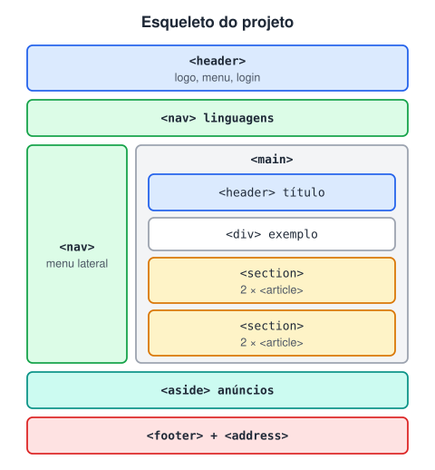

# Projeto teste - Criando a estrutura de uma página com HTML

> 🗺️ **Nesta aula:** um projeto prático que reproduz só a estrutura de uma página de documentação usando tags semânticas, sem nenhum CSS de layout.

## De onde paramos

O módulo apresentou as tags de conteúdo, as tags semânticas, tabelas, formulários, URLs e acessibilidade. Agora é hora de juntar tudo numa página real.

## Objetivo

Usar o site do **W3Schools** como referência e reproduzir **só a estrutura** da página com tags semânticas, sem se preocupar com o visual. É um ótimo exercício: antes de escrever qualquer CSS, desenhe as "caixas" e decida qual tag representa cada uma.

## Layout planejado



> 💡 **Analogia:** montar a estrutura antes do visual é como levantar as paredes de uma casa antes de pintar. Primeiro se decide onde fica a sala, a cozinha e o corredor (as tags); a cor das paredes (o CSS) vem depois e pode mudar sem derrubar nada.

| Região | Tag | Por quê |
| --- | --- | --- |
| Topo com logo e menu | `<header>` com `<nav>` | cabeçalho com a navegação principal |
| Barras de linguagens | `<nav aria-label>` | outras navegações, diferenciadas pelo rótulo |
| Conteúdo da aula | `<main>` | o principal; um por página |
| Blocos de notícias | `<section>` com `<article>` | temas, cada um com textos independentes |
| Anúncios | `<aside>` | complementar ao conteúdo |
| Créditos | `<footer>` com `<address>` | rodapé com contato |

## Projeto completo

**Código revisado**

```html
<!DOCTYPE html>
<html lang="pt-BR">
<head>
  <meta charset="utf-8">
  <meta name="viewport"
    content="width=device-width, initial-scale=1">
  <title>Projeto teste: estrutura semântica</title>
  <meta name="description"
    content="Estudo de estrutura semântica em HTML">
  <style>
    body   { background-color: aquamarine; }
    h1     { color: blueviolet; }
    p      { color: blue; }
    footer { text-align: center; }
  </style>
</head>
<body>
  <header>
    <figure>
      
      <figcaption>Logo</figcaption>
    </figure>
    <nav>
      <ul>
        <li><a href="#">Tutoriais</a></li>
        <li><a href="#">Referências</a></li>
        <li><a href="#">Exercícios</a></li>
        <li><a href="#">Vídeos</a></li>
      </ul>
    </nav>
    <a href="#">Login</a>
  </header>

  <nav aria-label="Linguagens">
    <ul>
      <li><a href="#">HTML</a></li>
      <li><a href="#">CSS</a></li>
      <li><a href="#">JavaScript</a></li>
      <li><a href="#">SQL</a></li>
    </ul>
  </nav>

  <nav aria-label="Referência de HTML">
    <ul>
      <li><a href="#">HTML por ordem alfabética</a></li>
      <li><a href="#">HTML por categoria</a></li>
      <li><a href="#">Atributos globais</a></li>
      <li><a href="#">Eventos</a></li>
    </ul>
  </nav>

  <main>
    <header>
      <h1>HTML &lt;section&gt; Tag</h1>
      <button type="button">Anterior</button>
      <button type="button">Próximo</button>
    </header>

    <div>
      <h2>Exemplo</h2>
      <p>Duas linhas de código:</p>
      <pre><code>console.log("Teste 1");
console.log("Teste 2");</code></pre>
      <p>A <abbr title="World Wide Web">WWW</abbr>
        define as boas práticas...</p>
    </div>

    <section>
      <h2>Economia</h2>
      <article>
        <h3>O aumento do preço do dólar</h3>
        <p>Moedas sempre...</p>
      </article>
      <article>
        <h3>Crescimento chinês na última década</h3>
        <p>Na China hoje...</p>
      </article>
    </section>

    <section>
      <h2>Tecnologia</h2>
      <article>
        <h3>Indústria dos games bate recorde</h3>
        <p>Videogames já se tornaram...</p>
      </article>
      <article>
        <h3>Entrevista com a produtora X</h3>
        <p>...</p>
      </article>
    </section>
  </main>

  <aside>
    <h2>Publicidade</h2>
    
  </aside>

  <footer>
    <p>Site de estudo, sem fins comerciais.</p>
    <address>
      Contato:
      <a href="mailto:contato@exemplo.com">
        Ana Souza</a><br>
      Rua das Flores, 42 – Rio de Janeiro/RJ
    </address>
  </footer>
</body>
</html>
```

> ⚠️ Erros comuns neste projeto: esquecer de fechar um `<article>` (o seguinte fica aninhado dentro dele); escrever `<section>` como texto sem escapar os sinais (use `&lt;section&gt;`); colocar código de várias linhas só em `<code>` (use `<pre><code>`); e deixar `href=""`, que recarrega a página (o placeholder usual é `#`).

## Desafio

Acrescente à página uma seção "Fale conosco" com um formulário de nome, e-mail e mensagem, usando o que você viu em "Formulários em HTML".

<details>
<summary>Ver resposta</summary>

```html
<section>
  <h2>Fale conosco</h2>
  <form action="/contato" method="post">
    <label for="nome">Nome</label>
    <input id="nome" name="nome" required>
    <label for="email">E-mail</label>
    <input id="email" name="email"
           type="email" required>
    <label for="msg">Mensagem</label>
    <textarea id="msg" name="msg"></textarea>
    <button type="submit">Enviar</button>
  </form>
</section>
```

</details>

## 🧠 Revisão rápida

**Por que as duas `<nav>` extras ganharam `aria-label`?**

Para que o leitor de tela consiga diferenciar as várias navegações da página.

**Qual a hierarquia de títulos usada no projeto?**

Um `h1` principal, `h2` nas seções e `h3` nos artigos.

> ➡️ **Próximo passo:** o último projeto do módulo adiciona um pouco de estilo a uma tabela: **Projeto teste - Tabela com efeito zebra**.

## 📌 Resumo

| Item | Em uma frase |
| --- | --- |
| Planejar | desenhar as caixas antes do código |
| `header` e `nav` | topo e menus |
| `main`, `section`, `article` | conteúdo, temas e textos independentes |
| `aside` e `footer` | complemento e rodapé |
| `aria-label` | diferencia navegações iguais |
