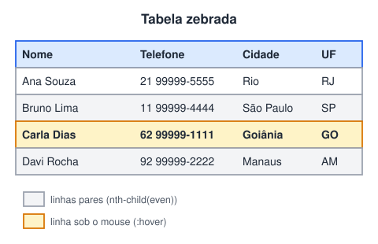

# Projeto teste - Tabela com efeito zebra

> 🗺️ **Nesta aula:** um projeto de tabela de contatos com linhas alternadas (efeito zebra), destaque ao passar o mouse e cabeçalho com células mescladas.

## De onde paramos

A aula de tabelas mostrou a estrutura e as bordas. Este projeto acrescenta um pouco de CSS para tornar a tabela mais fácil de ler, e serve de ponte para o módulo IV.

## Objetivo

Criar uma tabela de contatos estilizada com:

- **efeito zebra**: linhas alternando de cor, o que facilita a leitura;
- **destaque ao passar o mouse** (`:hover`);
- cabeçalho com células mescladas (`rowspan`/`colspan`) e legenda.



> 💡 **Analogia:** o efeito zebra funciona como o papel de formulário contínuo antigo, com faixas alternadas: o olho não "pula" de linha ao atravessar a tabela da esquerda para a direita. O `:hover` é como passar uma régua por baixo da linha que você está lendo.

## Os seletores que fazem a mágica

```css
/* 1ª, 3ª, 5ª... */
tbody tr:nth-child(odd) {
  background-color: #ffffff;
}
/* 2ª, 4ª, 6ª... */
tbody tr:nth-child(even) {
  background-color: #d8ebf7;
}
tbody tr:hover {
  background-color: lightgoldenrodyellow;
  font-weight: bold;
}
```

- `:nth-child(even)` seleciona os filhos em posição **par**, e `:nth-child(odd)`, os **ímpares**. Também aceita fórmulas: `:nth-child(3n)` pega a cada 3.
- `:hover` aplica o estilo enquanto o mouse está sobre o elemento.

> ⚠️ Se as duas regras usarem `even`, a segunda sobrescreve a primeira e o efeito some. Também evite mudar `font-size` no `:hover`: a tabela "pula" de tamanho a cada passada do mouse.

## Projeto completo

**Código revisado**

```html
<!DOCTYPE html>
<html lang="pt-BR">
<head>
  <meta charset="utf-8">
  <meta name="viewport"
    content="width=device-width, initial-scale=1">
  <title>Teste de tabela</title>
  <style>
    table {
      width: 100%;
      border: 2px solid rgb(121, 121, 185);
      border-collapse: separate;
      border-spacing: 3px;
      empty-cells: hide;
    }
    th, td {
      border: 2px solid rgb(121, 121, 185);
      padding: 6px 10px;
    }
    #legenda-tabela {
      caption-side: bottom;
      color: red;
      font-size: small;
      text-align: left;
    }
    #cabecalho-tabela {
      background-color: rgb(67, 106, 165);
      font-size: 20px;
      color: rgb(202, 183, 159);
    }
    .sub-endereco {
      text-align: left;
      font-family: monospace;
      color: rgb(179, 211, 211);
    }
    #rodape-tabela {
      background-color: rgb(37, 47, 61);
      color: white;
      text-align: center;
    }
    /* efeito zebra */
    tbody tr:nth-child(odd) {
      background-color: rgb(255, 255, 255);
    }
    tbody tr:nth-child(even) {
      background-color: rgb(216, 235, 247);
    }
    /* destaque ao passar o mouse */
    tbody tr:hover {
      background-color: lightgoldenrodyellow;
      font-weight: bold;
    }
  </style>
</head>
<body>
  <table>
    <caption id="legenda-tabela">
      Tabela de controle de clientes
    </caption>
    <thead id="cabecalho-tabela">
      <tr>
        <th rowspan="2">Nome</th>
        <th rowspan="2">Telefone</th>
        <th colspan="3">Endereço</th>
      </tr>
      <tr>
        <th class="sub-endereco">Cidade</th>
        <th class="sub-endereco">Estado</th>
        <th class="sub-endereco">CEP</th>
      </tr>
    </thead>
    <tbody>
      <tr>
        <td>Ana Souza</td><td>21 99999-5555</td>
        <td>Rio de Janeiro</td><td>RJ</td>
        <td>21544-255</td>
      </tr>
      <tr>
        <td>Bruno Lima</td><td>11 99999-4444</td>
        <td>São Paulo</td><td>SP</td>
        <td>01399-140</td>
      </tr>
      <tr>
        <td>Carla Dias</td><td>62 99999-1111</td>
        <td>Goiânia</td><td>GO</td>
        <td>74899-444</td>
      </tr>
      <tr>
        <td>Davi Rocha</td><td>92 99999-2222</td>
        <td></td><td></td><td>69012-488</td>
      </tr>
    </tbody>
    <tfoot id="rodape-tabela">
      <tr>
        <td colspan="5">
          Para mais informações, fale conosco.
        </td>
      </tr>
    </tfoot>
  </table>
</body>
</html>
```

## Desafio

Faça a primeira coluna (Nome) ficar em negrito em todas as linhas, sem mexer no HTML.

<details>
<summary>Ver resposta</summary>

```css
tbody td:first-child {
  font-weight: bold;
}
```

`:first-child` pega o primeiro filho de cada linha, ou seja, a célula do nome.

</details>

## 🧠 Revisão rápida

**Qual seletor pega as linhas pares?**

`tr:nth-child(even)` (ou `:nth-child(2n)`).

**Por que a borda foi aplicada em `th, td` e não em `tr`?**

Porque, no modelo `separate`, borda em `tr` não tem efeito.

> ➡️ **Próximo passo:** fim do módulo III. O módulo IV é todo sobre aparência, começando pela **História de criação do CSS**.

## 📌 Resumo

| Item | Em uma frase |
| --- | --- |
| Efeito zebra | `nth-child(odd)` e `nth-child(even)` |
| Destaque | `tr:hover` muda a linha sob o mouse |
| `caption-side` | coloca a legenda embaixo |
| `rowspan`/`colspan` | cabeçalho com células mescladas |
| `:first-child` | seleciona o primeiro filho |
