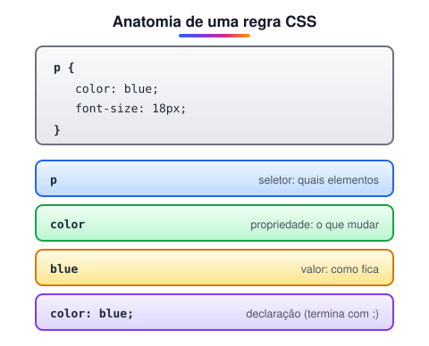

# História de criação do CSS

> 🗺️ **Nesta aula:** o que é CSS, como uma regra é escrita, por que se chama "cascata" e como a linguagem evoluiu até hoje.

## De onde paramos

O módulo III terminou com páginas bem estruturadas, mas com a aparência padrão do navegador. O CSS é a segunda camada do front-end: ele decide como cada coisa aparece.

## O que é CSS?

**CSS (*Cascading Style Sheets*, ou folhas de estilo em cascata) é a linguagem que define a aparência dos documentos HTML**: cores, fontes, tamanhos, espaçamentos, layout, efeitos e animações.

- O CSS **separa a apresentação do conteúdo**. O HTML diz *o que* é cada coisa; o CSS diz *como* ela aparece.
- Um único arquivo `.css` pode estilizar **todas** as páginas de um site. Mudou ali, mudou em todo lugar.
- O mesmo HTML pode ter visuais completamente diferentes, por exemplo tema claro e escuro, ou versão para impressão.

### Como uma regra funciona

O CSS é feito de **regras**. Cada uma tem um **seletor** (quais elementos) e um bloco de **declarações** (propriedade e valor):



```css
/* todos os parágrafos ficam azuis e com 18px */
p {
  color: blue;
  font-size: 18px;
}
```

Cada declaração termina com `;`, e comentários em CSS são escritos entre `/*` e `*/`.

### Por que "cascata"?

Porque várias regras podem tentar estilizar o mesmo elemento, e o navegador tem um algoritmo para decidir quem vence: importância, especificidade e ordem. Isso é detalhado nas próximas aulas.

## Linha do tempo

| Ano | Marco |
| --- | --- |
| 1990–1993 | as primeiras páginas eram quase só texto; cada navegador exibia do seu jeito |
| 1994 | **Håkon Wium Lie**, no CERN com Tim Berners-Lee, propõe o CSS; **Bert Bos** se junta ao projeto |
| 1996 | **CSS1** vira recomendação do W3C: fontes, cores, margens, alinhamento |
| 1998 | **CSS2**: posicionamento (`position`), `z-index`, mídia de impressão |
| 1999 | começam os rascunhos do "CSS3", dividido em **módulos** independentes |
| 2011 | **CSS 2.1** finalmente vira recomendação |
| 2010–hoje | Flexbox, Grid, transições, animações e variáveis avançam cada um no seu ritmo |

> 💡 Não existe mais uma "versão" única do CSS. Depois do CSS 2.1, a linguagem passou a evoluir em **módulos com níveis próprios** (Selectors Level 4, Color Level 5...). "CSS3" virou apelido para "CSS moderno", e não há "CSS4" oficial. Recursos como `:has()`, *container queries* e aninhamento chegam aos navegadores à medida que os módulos amadurecem.

> ⚠️ **Antes do CSS**, a aparência era definida no próprio HTML, com `<font color="red">`, `<center>` e `bgcolor`. Esse estilo misturado ao conteúdo é obsoleto e não deve ser usado.

## 🧠 Revisão rápida

**Em `h1 { color: red; }`, o que é seletor, propriedade e valor?**

Seletor: `h1`; propriedade: `color`; valor: `red`.

**O que significa "cascata" no nome CSS?**

Que várias regras podem atingir o mesmo elemento, e um algoritmo (importância, especificidade e ordem) decide qual vence.

**Existe CSS4?**

Não oficialmente: desde o CSS 2.1, cada módulo evolui com seu próprio nível.

> ➡️ **Próximo passo:** onde escrever o CSS para ele chegar ao HTML? Veja **Como aplicar o CSS no nosso HTML**.

## 📌 Resumo

| Item | Em uma frase |
| --- | --- |
| CSS | define a aparência do HTML |
| Regra | seletor e bloco de declarações |
| Declaração | `propriedade: valor;` |
| Cascata | o algoritmo que decide qual regra vence |
| CSS moderno | módulos independentes, sem versão única |
