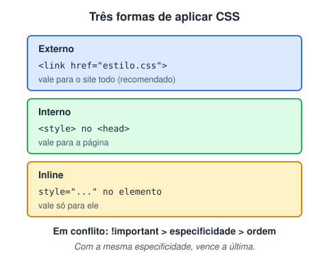

# Como aplicar o CSS no nosso HTML

> 🗺️ **Nesta aula:** as três formas de aplicar CSS (externo, interno e inline), quem vence quando há conflito e para que servem o reset e o normalize.

## De onde paramos

A aula anterior mostrou como uma regra CSS é escrita. Agora, onde ela mora: dentro do elemento, dentro da página ou num arquivo à parte.

## Três formas de usar o CSS



> 💡 **Analogia:** pense num uniforme escolar. O CSS externo é o regulamento da escola, que vale para todas as turmas; o interno é uma regra combinada só naquela sala; o inline é um bilhete preso na mochila de um único aluno. Quanto mais perto do aluno, mais força a regra tem, mas manter bilhetes em cada mochila dá muito trabalho.

### 1. Inline: direto no elemento

```html
<p style="font-size: 80px;">
  Teste de formatação no elemento.
</p>
```

Vale só para aquele elemento e tem prioridade altíssima. Evite: mistura estilo com conteúdo e é difícil de manter. Use apenas em testes rápidos ou quando o valor é gerado por JavaScript.

### 2. Interno: tag `<style>` no `<head>`

```html
<head>
  <style>
    /* vale para os parágrafos DESTA página */
    p {
      color: rgb(214, 178, 125);
      background-color: black;
      font-size: 25px;
    }
  </style>
</head>
```

É útil para testes e para páginas únicas.

### 3. Externo: arquivo `.css` ligado com `<link>` (o recomendado)

```html
<head>
  <link rel="stylesheet" href="estilo.css">
</head>
```

```css
/* estilo.css */
p {
  font-size: 25px;
  background-color: black;
}
```

Vantagens do CSS externo:

- **um arquivo** para o site inteiro, o que facilita a manutenção;
- o navegador guarda o arquivo em **cache**, então as próximas páginas carregam mais rápido;
- separa responsabilidades: HTML para estrutura, CSS para aparência.

## Quem vence quando há conflito?

1. `!important` vence declarações normais. Use só em último caso.
2. **Especificidade**: estilo inline > `#id` > `.classe` / `[atributo]` / `:pseudo-classe` > `elemento`.
3. **Ordem**: com a mesma especificidade, vence a regra que aparece **por último**.

> ⚠️ Entre o CSS **interno** e o **externo** não existe prioridade fixa: vale a **ordem**. Se o `<link>` vier depois do `<style>`, o arquivo externo vence. E um comentário `<!-- ... -->` dentro de `<style>` **quebra o CSS**: lá dentro, comente com `/* ... */`.

## Reset e normalize

Cada navegador aplica estilos padrão (*user agent stylesheet*): margens no `<body>`, tamanhos de `<h1>`, marcadores de lista... Isso causa pequenas diferenças entre navegadores. Há duas abordagens:

- **Reset**: **zera** quase tudo. Você parte do nada e estiliza do seu jeito. O mais famoso é o de Eric Meyer.
- **Normalize**: **mantém** os padrões úteis e só corrige as inconsistências entre navegadores.

O Normalize.css:

🔗 [Normalize.css: Make browsers render all elements more consistently.](https://necolas.github.io/normalize.css/)

Valores padrão de cada elemento no navegador:

🔗 [CSS Default Browser Values for HTML Elements](https://www.w3schools.com/cssref/css_default_values.php)

### Reset de Eric Meyer (v2.0, domínio público)

Salve como `reset.css` e carregue **antes** do seu CSS:

**Código**

```css
/* meyerweb.com/eric/tools/css/reset v2.0 */
html, body, div, span, applet, object, iframe,
h1, h2, h3, h4, h5, h6, p, blockquote, pre,
a, abbr, acronym, address, big, cite, code,
del, dfn, em, img, ins, kbd, q, s, samp,
small, strike, strong, sub, sup, tt, var,
b, u, i, center,
dl, dt, dd, ol, ul, li,
fieldset, form, label, legend,
table, caption, tbody, tfoot, thead, tr, th, td,
article, aside, canvas, details, embed,
figure, figcaption, footer, header, hgroup,
menu, nav, output, ruby, section, summary,
time, mark, audio, video {
  margin: 0;
  padding: 0;
  border: 0;
  font-size: 100%;
  font: inherit;
  vertical-align: baseline;
}
article, aside, details, figcaption, figure,
footer, header, hgroup, menu, nav, section {
  display: block;
}
body { line-height: 1; }
ol, ul { list-style: none; }
blockquote, q { quotes: none; }
blockquote:before, blockquote:after,
q:before, q:after { content: ''; content: none; }
table { border-collapse: collapse; border-spacing: 0; }
```

### Reset moderno mínimo

Na prática, muitos projetos hoje usam só um punhado de regras:

```css
*, *::before, *::after { box-sizing: border-box; }
* { margin: 0; }
body { line-height: 1.5; }
img, picture, video, svg {
  display: block;
  max-width: 100%;
}
input, button, textarea, select { font: inherit; }
```

## 🧠 Revisão rápida

**Qual forma de aplicar CSS é a recomendada, e por quê?**

A externa: um arquivo para o site todo, guardado em cache e separado do HTML.

**Uma regra no `<style>` e outra no arquivo externo têm a mesma especificidade. Qual vence?**

A que vier por último no documento.

**Qual a diferença entre reset e normalize?**

O reset zera os estilos do navegador; o normalize mantém os úteis e só corrige diferenças entre navegadores.

> ➡️ **Próximo passo:** ver a cascata acontecendo em três páginas reais: **Testando as propriedades de estilização com um teste prático**.

## 📌 Resumo

| Item | Em uma frase |
| --- | --- |
| Inline | `style=""` no elemento; evite |
| Interno | `<style>` no head; testes e páginas únicas |
| Externo | arquivo `.css` com `<link>`; o recomendado |
| Conflito | `!important`, depois especificidade, depois ordem |
| Reset × normalize | zera tudo × corrige diferenças |
