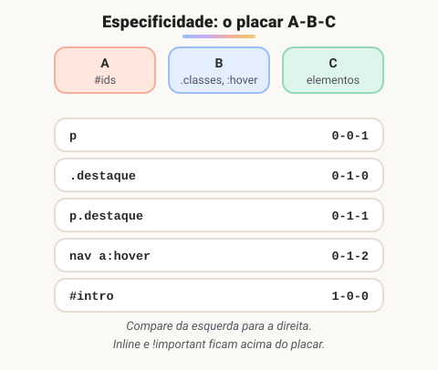

# Seletores e especificidade do CSS

> 🗺️ **Nesta aula:** os seletores do CSS (elemento, classe, id, combinadores, atributo, pseudo-classe e pseudo-elemento) e a especificidade, a regra que decide qual seletor vence.

## De onde paramos

No teste prático, você viu regras vencendo e perdendo. O motivo quase sempre é a especificidade do seletor. Esta aula explica os seletores e o placar que decide os conflitos.

## O que são seletores?

**Seletores são padrões que dizem a quais elementos uma regra CSS se aplica.** Quanto melhor você domina os seletores, menos classes e ids precisa espalhar pelo HTML.

## Seletores mais usados

| Seletor | Exemplo | Seleciona |
| --- | --- | --- |
| Universal | `*` | todos os elementos |
| Elemento | `p` | todos os `<p>` |
| Classe | `.destaque` | elementos com `class="destaque"` |
| ID | `#logo` | o elemento com `id="logo"` (único) |
| Agrupamento | `h1, h2, h3` | todos os h1, h2 e h3 |
| Descendente | `ul li` | `<li>` em **qualquer nível** dentro de `<ul>` |
| Filho direto | `div > p` | `<p>` filho **imediato** de `<div>` |
| Irmão adjacente | `h2 + p` | o `<p>` logo após um `<h2>` |
| Irmãos seguintes | `h2 ~ p` | todos os `<p>` depois de um `<h2>` |
| Atributo | `[type="email"]` | elementos com aquele atributo e valor |
| Pseudo-classe | `a:hover` | elementos em um **estado** ou **posição** |
| Pseudo-elemento | `.btn::before` | uma **parte** de um elemento |

```css
/* elemento */
p { color: blue; }

/* classe */
.destaque { font-weight: bold; }

/* id */
#logo { width: 200px; }

/* descendente × filho direto */
ul li   { list-style-type: square; }
div > p { margin-top: 10px; }

/* atributo: tem, começa com, termina com */
[type]          { border: 1px solid gray; }
a[href^="https"] { color: green; }
img[src$=".svg"] { width: 32px; }

/* pseudo-classes */
a:hover           { color: red; }
input:focus       { outline: 2px solid royalblue; }
li:nth-child(odd) { background: #f5f5f5; }

/* pseudo-elemento (precisa de content) */
.obrigatorio::after { content: " *"; color: red; }
```

> ⚠️ `[class="botao"]` só casa quando o atributo é **exatamente** `"botao"`; `class="botao grande"` fica de fora. Para classes, use `.botao`. E um `::before` sem seletor na frente se aplica a **todos** os elementos da página.

## Especificidade: quem vence o conflito

Quando duas regras estilizam a mesma propriedade do mesmo elemento, vence a **mais específica**. Pense num placar de três colunas:



| Coluna | O que conta |
| --- | --- |
| **A**: IDs | `#id` |
| **B**: classes | `.classe`, `[atributo]`, `:pseudo-classe` |
| **C**: elementos | `elemento`, `::pseudo-elemento` |

- `*`, `>`, `+` e `~` valem **zero**.
- Acima do placar estão o estilo **inline** e, acima dele, o `!important`.
- Em caso de **empate**, vence a regra que vem **por último** no código.

```html
<p id="intro" class="destaque">Olá</p>
```

```css
p          { color: black; } /* 0-0-1 */
.destaque  { color: blue;  } /* 0-1-0: vence */
p.destaque { color: green; } /* 0-1-1: vence */
#intro     { color: red;   } /* 1-0-0: vence todos */
```

O texto fica vermelho: o id ganha de qualquer quantidade de classes.

> 💡 **Evite** `!important` **e IDs no CSS.** Eles criam "guerras de especificidade" difíceis de manter. Prefira classes, com especificidade baixa e previsível.

## Exercício

Calcule a especificidade e diga qual cor o link recebe:

```css
nav a          { color: gray; }
.menu a        { color: blue; }
nav .menu a    { color: green; }
```

```html
<nav><ul class="menu"><li>
  <a href="#">Início</a>
</li></ul></nav>
```

<details>
<summary>Ver resposta</summary>

`nav a` = 0-0-2; `.menu a` = 0-1-1; `nav .menu a` = 0-1-2. O link fica **verde**.

</details>

## 🧠 Revisão rápida

**Qual a diferença entre `ul li` e `ul > li`?**

`ul li` pega `li` em qualquer nível; `ul > li`, só os filhos diretos.

**Qual a especificidade de `a:hover`?**

0-1-1: uma pseudo-classe (B) e um elemento (C).

**Duas regras com especificidade 0-1-0 definem a mesma cor. Qual vence?**

A que aparece por último.

> ➡️ **Próximo passo:** as pseudo-classes e os pseudo-elementos merecem uma aula só deles: **Pseudo-classes e pseudo-elementos**.

## 📌 Resumo

| Item | Em uma frase |
| --- | --- |
| Elemento, classe, id | `p`, `.classe`, `#id` |
| Combinadores | espaço, `>`, `+`, `~` |
| Atributo | `[type="email"]`, `^=`, `$=` |
| Especificidade | placar A (ids), B (classes), C (elementos) |
| Desempate | vence a última regra |
| Boa prática | prefira classes; evite ids e `!important` |
