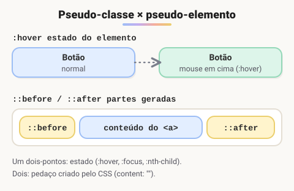

# Pseudo-classes e pseudo-elementos (Adicionado pelo aluno para melhorar o estudo)

> 🗺️ **Nesta aula:** pseudo-classes de estado, de posição e lógicas, e os pseudo-elementos que estilizam partes de um elemento ou criam enfeites.

## De onde paramos

A aula de seletores apresentou `:hover` e `::after` de passagem. Eles são tão usados que merecem um olhar detalhado.

## A diferença em uma linha



- **Pseudo-classe** (`:`) seleciona um elemento **em um estado ou posição**: com o mouse em cima, focado, o primeiro da lista...
- **Pseudo-elemento** (`::`) estiliza **uma parte** do elemento ou cria um conteúdo extra: a primeira letra, um enfeite antes ou depois.

## Pseudo-classes de estado

```css
/* mouse em cima */
a:hover { color: #e63946; }
/* sendo clicado */
button:active { transform: scale(.97); }
input:focus { border-color: #1a73e8; }
/* foco vindo do teclado */
button:focus-visible {
  outline: 3px solid #1a73e8;
}
a:visited { color: purple; }
input:disabled { opacity: .5; }
input:checked + label { font-weight: bold; }
input:invalid { border-color: crimson; }
```

Para links, a ordem recomendada é **LVHA**: `:link`, `:visited`, `:hover`, `:active`. Com especificidade igual, a última regra vence.

## Pseudo-classes de posição

```css
li:first-child { font-weight: bold; }
li:last-child  { border-bottom: none; }
/* o 2º item */
li:nth-child(2) { color: red; }
/* linhas pares (zebra) */
tr:nth-child(even) { background: #f4f4f4; }
/* 1º, 4º, 7º... */
li:nth-child(3n+1) { color: teal; }
p:first-of-type { font-size: 1.2rem; }
```

> 💡 `:nth-child` conta **todos os irmãos**, de qualquer tag; `:nth-of-type` conta só os da mesma tag. Numa `div` com um `h2` e dois `p`, o primeiro parágrafo é `p:nth-child(2)`, mas é `p:nth-of-type(1)`.

## Pseudo-classes lógicas

```css
button:not(.primario) { background: transparent; }
/* atalho para listas de seletores */
:is(h1, h2, h3) { line-height: 1.2; }
/* o card que CONTÉM uma imagem */
.card:has(img) { padding-top: 0; }
```

`:has()`, o "seletor pai", funciona em todos os navegadores modernos desde 2023.

## Pseudo-elementos

```css
.obrigatorio::after {
  /* content é obrigatório, mesmo vazio */
  content: " *";
  color: crimson;
}

blockquote::before { content: "“"; font-size: 3rem; }

/* letra capitular */
p::first-letter { font-size: 2em; float: left; }
p::first-line { font-variant: small-caps; }
/* texto selecionado */
::selection { background: #ffd166; }
input::placeholder { color: #999; }
/* o marcador da lista */
li::marker { color: #1a73e8; }
```

`::before` e `::after` são **decorativos**: leitores de tela nem sempre leem o `content`, então não coloque ali texto importante. Eles também não funcionam em elementos sem conteúdo interno, como `` e `<input>`.

## Exemplo: sublinhado animado

```css
.menu a {
  position: relative;
  text-decoration: none;
}
.menu a::after {
  content: "";
  position: absolute;
  left: 0;
  bottom: -4px;
  width: 100%;
  height: 2px;
  background: currentColor;
  transform: scaleX(0);
  transition: transform .25s;
}
.menu a:hover::after { transform: scaleX(1); }
```

## Exercício

Numa lista de tarefas, risque o texto dos itens cujo checkbox está marcado, sem JavaScript. O HTML de cada item é `<li><input type="checkbox"> <span>Estudar</span></li>`.

<details>
<summary>Ver resposta</summary>

```css
input:checked + span {
  text-decoration: line-through;
  opacity: .6;
}
```

`:checked` pega o checkbox marcado, e `+ span`, o texto logo depois dele.

</details>

## 🧠 Revisão rápida

**Qual a diferença entre `:hover` e `::before`?**

`:hover` é pseudo-classe (um estado); `::before` é pseudo-elemento (uma parte criada antes do conteúdo).

**Por que um `::after` pode não aparecer?**

Porque falta a propriedade `content` (mesmo vazia), ou porque o elemento não tem conteúdo interno, como `img`.

**Como selecionar todos os botões que não têm a classe `primario`?**

`button:not(.primario)`.

> ➡️ **Próximo passo:** hora de treinar seletores jogando, em **Links com desafios CSS**.

## 📌 Resumo

| Item | Em uma frase |
| --- | --- |
| Pseudo-classe `:` | estado ou posição (`:hover`, `:nth-child`) |
| Pseudo-elemento `::` | parte do elemento (`::before`, `::first-letter`) |
| LVHA | ordem dos estados de link |
| `:not`, `:is`, `:has` | negação, lista e "seletor pai" |
| `content` | obrigatório em `::before` e `::after` |
