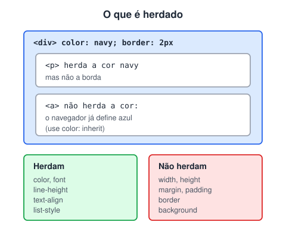

# Herança de características no CSS

> 🗺️ **Nesta aula:** quais propriedades passam do elemento pai para os filhos, por que o estilo do navegador interrompe a herança e como controlá-la com `inherit`, `initial`, `unset` e `revert`.

## De onde paramos

A especificidade decide entre regras que miram o mesmo elemento. A herança é outra fonte de estilo: o valor que vem do pai quando nenhuma regra fala do filho.

## O que é herança?

**Herança é quando um elemento filho recebe automaticamente o valor de uma propriedade do pai, sem precisar declarar de novo.** Por exemplo: defina `font-family` no `body` e todo o texto da página passa a usar essa fonte.

**Nem toda propriedade é herdada.** A regra geral é que as propriedades de **texto** herdam e as de **caixa** (tamanho, espaçamento, borda, fundo) não herdam.



> 💡 **Analogia:** a herança do CSS é como a de uma família. Os filhos herdam o sotaque e o sobrenome (cor, fonte, alinhamento), mas não herdam a altura nem a casa dos pais (tamanho, margem, borda, fundo). E se a escola dá um uniforme ao filho (o estilo do navegador), ele usa o uniforme, e não a roupa que vem de casa.

```css
body {
  /* todos os textos herdam */
  font-family: Arial, sans-serif;
  color: #333;
  line-height: 1.5;
}

/* os filhos ficam centralizados */
.container { text-align: center; }
/* os <li> herdam o marcador */
ul { list-style: square; }
```

### Cuidado: o estilo padrão do navegador interrompe a herança

O navegador já aplica estilos em alguns elementos, e eles **vencem a herança**:

- `<a>` tem cor azul própria, então não herda o `color` do pai;
- `<h1>`–`<h6>` têm `font-size` relativo (`2em`, `1.5em`...), calculado **a partir** do tamanho herdado;
- `<button>` e `<input>` **não herdam a fonte** por padrão.

```css
body { font-size: 16px; }
/* h1 NÃO fica com 16px:
   o navegador define 2em, que dá 32px */
/* p fica com 16px (herdado) */
```

> ⚠️ O `<h1>` não herda os 16px direto: o navegador define `h1 { font-size: 2em }`, então ele fica com o **dobro** (32px). Só herda os 16px se você definir `h1 { font-size: inherit; }`.

## Controlando a herança: palavras-chave globais

Elas funcionam em **qualquer** propriedade:

| Valor | Efeito |
| --- | --- |
| `inherit` | força a herdar o valor do pai, mesmo em propriedades que normalmente não herdam |
| `initial` | volta ao valor **inicial da especificação** (`color: initial` é preto; `display: initial` é `inline`) |
| `unset` | se a propriedade herda, age como `inherit`; senão, como `initial` |
| `revert` | volta ao estilo **padrão do navegador** para aquele elemento |

```css
/* links e botões com a cor e a fonte do texto */
a      { color: inherit; }
button { font: inherit; }

/* zerar tudo de um componente e recomeçar */
.widget { all: unset; }
```

> 💡 `initial` costuma confundir: `display: initial` dá `inline`, mesmo numa `<div>`, porque esse é o valor inicial da *especificação*, e não o padrão do navegador. Para "voltar ao normal do navegador", use `revert`.

## Exercício

Faça todos os links de um rodapé escuro ficarem com a mesma cor branca do texto, sem repetir a cor.

<details>
<summary>Ver resposta</summary>

```css
footer {
  background: #111;
  color: white;
}
footer a { color: inherit; }
```

O `inherit` faz o link pegar a cor do `footer`, vencendo o azul padrão do navegador.

</details>

## 🧠 Revisão rápida

**A borda de uma `div` passa para os parágrafos dentro dela?**

Não: propriedades de caixa (borda, margem, fundo) não são herdadas.

**Por que o link não fica com a cor do parágrafo onde está?**

Porque o navegador define uma cor própria para `a`, que vence a herança. Use `color: inherit`.

**Qual palavra-chave volta ao estilo padrão do navegador?**

`revert`.

> ➡️ **Próximo passo:** `16px`, `2em`, `1rem`... as medidas do CSS têm regras próprias: **Unidades de medidas usadas no CSS**.

## 📌 Resumo

| Item | Em uma frase |
| --- | --- |
| Herança | o filho recebe o valor do pai |
| Herdam | propriedades de texto (cor, fonte, alinhamento) |
| Não herdam | propriedades de caixa (tamanho, margem, borda, fundo) |
| Estilo do navegador | vence a herança (links, títulos, botões) |
| `inherit` / `revert` | força herdar / volta ao padrão do navegador |
