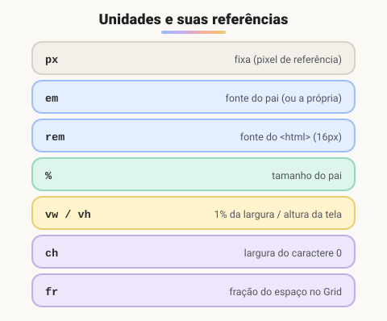

# Unidades de medidas usadas no CSS

> 🗺️ **Nesta aula:** unidades absolutas e relativas (`px`, `em`, `rem`, `%`, `vw`, `vh`), quando usar cada uma e as funções `calc`, `clamp` e `min`.

## De onde paramos

A aula de herança mostrou um `h1` com `2em` virando 32px. Isso só faz sentido entendendo as unidades: algumas são fixas, outras dependem do contexto.

## Absolutas × relativas

- **Absolutas**: têm tamanho fixo e não mudam com o contexto. Na tela, a única que importa é o `px`. As outras (`cm`, `mm`, `in`, `pt`) fazem sentido para impressão.
- **Relativas**: dependem de outra coisa, como o tamanho da fonte, o elemento pai ou a janela. São a base de um layout **responsivo** e **acessível**.



> 💡 **Analogia:** `px` é como dizer "uma mesa de 2 metros": não muda. As unidades relativas são como receitas: "uma xícara para cada pessoa" (`em`, que segue o pai), "metade da mesa" (`%`) ou "um décimo da sala" (`vw`). Se a sala ou o número de pessoas muda, a medida acompanha.

Artigo do W3C sobre unidades (em português):

🔗 [CSS: em, px, pt, cm, in...](https://www.w3.org/Style/Examples/007/units.pt_BR.html)

## As principais unidades

### `px`: pixel

Unidade fixa. Ótima para bordas, sombras e detalhes que não devem escalar.

```css
.container {
  width: 300px;
  border: 1px solid #ccc;
}
```

O `px` do CSS **não é** um ponto físico da tela: é um "pixel de referência" (1/96 de polegada a uma distância normal de leitura). Em telas de alta densidade, 1px do CSS ocupa 2 ou 3 pixels físicos.

### `em`: relativo à fonte

- Em `font-size`, `1em` = tamanho da fonte do **pai**.
- Em **outras propriedades** (padding, margin, width), `1em` = tamanho da fonte do **próprio elemento**.

```css
.pai { font-size: 20px; }
.filho {
  /* 20 × 1.2 = 24px (usa o pai) */
  font-size: 1.2em;
  /* 24px (usa a própria fonte, agora 24px) */
  padding: 1em;
}
```

> ⚠️ O `em` se **acumula** em elementos aninhados: uma lista dentro de outra lista com `font-size: 1.2em` fica 1,2 × 1,2 = 1,44 vez maior. Para fontes, o `rem` costuma ser mais previsível.

### `rem`: relativo à raiz

`1rem` = `font-size` do elemento `<html>`, que por padrão é **16px**. Não acumula, então é previsível e respeita a configuração de fonte do usuário no navegador, o que é ótimo para acessibilidade.

```css
.container {
  /* 16 × 1.2 = 19,2px */
  font-size: 1.2rem;
  /* 32px */
  margin: 2rem;
}
```

> 💡 Evite fixar `html { font-size: 16px; }`: isso ignora quem aumentou a fonte padrão do navegador por dificuldade de visão. Deixe o padrão ou use `100%`.

### `%`: relativo ao pai

- Em `width`, é uma porcentagem da largura do pai.
- Em `font-size`, é uma porcentagem da fonte do pai (como o `em`).
- Atenção: `padding` e `margin` em `%` são calculados sobre a **largura** do pai, inclusive os verticais.

### `vw`, `vh`, `vmin`, `vmax`: relativos à janela

- `1vw` = 1% da **largura** da janela; `1vh` = 1% da **altura**.
- `vmin` / `vmax` = 1% da **menor** / **maior** dimensão da janela.

```css
/* ocupa a tela inteira */
.hero { height: 100vh; }
.titulo { font-size: 5vmin; }
```

No celular, `100vh` pode ficar maior que a área visível por causa da barra de endereço. As unidades `dvh`, `svh` e `lvh` resolvem isso: `height: 100dvh`.

## Outras unidades úteis

| Unidade | Referência | Uso típico |
| --- | --- | --- |
| `ch` | largura do caractere "0" | limitar linhas de texto: `max-width: 65ch` |
| `fr` | fração do espaço livre (só no Grid) | `grid-template-columns: 1fr 2fr` |
| `deg` | graus | rotação, gradientes: `rotate(45deg)` |
| `s` / `ms` | tempo | transições: `transition: .3s` |

### Funções de cálculo

```css
/* mistura unidades */
.sidebar { width: calc(100% - 250px); }
/* mínimo, ideal, máximo */
h1 { font-size: clamp(1.5rem, 4vw, 3rem); }
/* o menor dos dois */
.card { width: min(100%, 600px); }
```

## Qual unidade usar?

| Para | Use |
| --- | --- |
| tamanho de fonte | `rem` |
| espaços ligados ao texto (padding de botão) | `em` ou `rem` |
| larguras de layout | `%`, `fr` ou `max-width` em `rem` |
| bordas e sombras | `px` |
| seções de tela cheia | `vh` / `dvh` |

## Exercício

O `<html>` tem a fonte padrão. Um `.card` tem `font-size: 1.25rem` e um `.card p` tem `font-size: 0.8em` e `padding: 1em`. Quantos pixels têm a fonte e o padding do parágrafo?

<details>
<summary>Ver resposta</summary>

`.card`: 16 × 1,25 = 20px. Fonte do `p`: 20 × 0,8 = **16px**. Padding do `p`: 1em da própria fonte = **16px**.

</details>

## 🧠 Revisão rápida

**Qual a diferença entre `em` e `rem`?**

`em` é relativo à fonte do pai (ou do próprio elemento) e se acumula; `rem` é relativo à fonte do `<html>` e não acumula.

**`100vw` vale quanto numa janela de 1200px de largura?**

1200px: `1vw` é 1% da largura.

**O que faz `clamp(1rem, 3vw, 2rem)`?**

Usa 3vw, mas nunca menos que 1rem nem mais que 2rem.

> ➡️ **Próximo passo:** com as medidas entendidas, veja como cada elemento ocupa espaço na página: o **Box model**.

## 📌 Resumo

| Item | Em uma frase |
| --- | --- |
| `px` | fixo; para bordas e detalhes |
| `em` | relativo à fonte do pai; acumula |
| `rem` | relativo à raiz; ideal para fontes |
| `%` | relativo ao pai |
| `vw` / `vh` | relativo à janela |
| `calc`, `clamp`, `min` | cálculos e limites |
