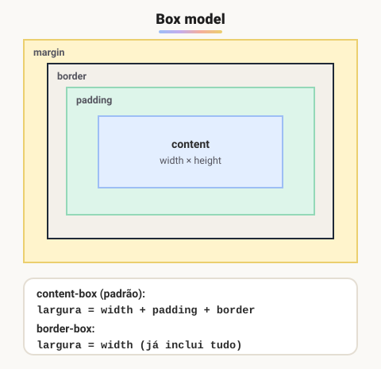

# Box model

> 🗺️ **Nesta aula:** as quatro camadas de toda caixa CSS (content, padding, border e margin), como o tamanho final é calculado e a diferença entre `content-box` e `border-box`.

## De onde paramos

Você já sabe medir (unidades) e sabe que há elementos de bloco e em linha. Agora vamos ver o que compõe cada caixa e por que um `width: 200px` às vezes vira 242px na tela.

## O que é o box model?

**No CSS, todo elemento é uma caixa retangular.** O *box model* (modelo de caixa) descreve as quatro camadas dessa caixa, de dentro para fora:



1. **Content (conteúdo)**: onde ficam o texto, as imagens e os filhos. Controlado por `width` e `height`.
2. **Padding (preenchimento)**: espaço **interno** entre o conteúdo e a borda. Recebe a cor de fundo do elemento.
3. **Border (borda)**: a linha em volta do padding.
4. **Margin (margem)**: espaço **externo**, transparente, que afasta o elemento dos vizinhos.

## Calculando o tamanho: `box-sizing`

Por padrão (`box-sizing: content-box`), o `width` vale **só para o conteúdo**. Padding e borda são **somados** por fora:

```css
.box {
  width: 200px;
  padding: 20px;
  border: 1px solid black;
  margin: 10px;
}
/* largura visível = 200 + 20 + 20 + 1 + 1
                   = 242px
   espaço ocupado  = 242 + 10 + 10 = 262px */
```

Com `box-sizing: border-box`, o `width` passa a incluir padding e borda: a caixa tem **exatamente** 200px, e o conteúdo encolhe para caber. É muito mais intuitivo, e por isso quase todo projeto começa com:

```css
*, *::before, *::after {
  box-sizing: border-box;
}
```

> ⚠️ A margem **não** faz parte do tamanho da caixa: ela é espaço externo. O tamanho da caixa é conteúdo, padding e borda (em `content-box`).

## Valores para largura e altura

| Valor | Efeito |
| --- | --- |
| `auto` (padrão) | blocos ocupam toda a largura disponível; a altura se ajusta ao conteúdo |
| `200px`, `50%`, `20rem` | tamanho fixo ou relativo |
| `min-width` / `max-width` | limites: `max-width: 1200px` impede que fique largo demais |
| `fit-content`, `min-content`, `max-content` | tamanho baseado no conteúdo |

### Centralizar um bloco horizontalmente

```css
.container {
  max-width: 960px;
  /* auto nas laterais divide o espaço que sobra */
  margin: 0 auto;
}
```

`auto` em `width` não centraliza nada: quem centraliza um bloco é `margin-left` e `margin-right: auto`, e só funciona se ele tiver largura menor que a do pai.

## Caixas de bloco × em linha

|  | `block` | `inline` | `inline-block` |
| --- | --- | --- | --- |
| Quebra de linha | começa em nova linha | fica no fluxo do texto | fica no fluxo do texto |
| `width` / `height` | ✔ | ✖ ignorados | ✔ |
| Margem e padding verticais | empurram os vizinhos | aparecem, mas **não** empurram as linhas | empurram |
| Exemplos | `div`, `p`, `h1` | `span`, `a`, `strong` | botões, badges |

``, `<input>` e `<button>` são inline, mas são elementos **substituídos**: aceitam `width` e `height` normalmente.

> 💡 **Veja o box model ao vivo:** no DevTools (F12), selecione um elemento. No fim do painel **Styles** (ou na aba **Computed**) aparece um diagrama com os valores reais de margin, border, padding e content.

## Exercício

Com `content-box`, uma caixa tem `width: 300px`, `padding: 15px`, `border: 5px solid` e `margin: 20px`. Qual a largura visível? E se a caixa usar `border-box`?

<details>
<summary>Ver resposta</summary>

`content-box`: 300 + 15 + 15 + 5 + 5 = **340px** visíveis. Com `border-box`: **300px** visíveis, e o conteúdo fica com 300 − 30 − 10 = 260px. A margem fica de fora nos dois casos.

</details>

## 🧠 Revisão rápida

**Qual camada recebe a cor de fundo: padding ou margin?**

O padding (e o conteúdo); a margem é sempre transparente.

**O que muda com `box-sizing: border-box`?**

O `width` passa a incluir padding e borda, então a caixa tem exatamente o tamanho declarado.

**Como centralizar um bloco de 800px de largura?**

`margin: 0 auto;`

> ➡️ **Próximo passo:** cada camada da caixa tem propriedades próprias, com atalhos úteis: **Propriedade Margin e padding/ Bordas**.

## 📌 Resumo

| Item | Em uma frase |
| --- | --- |
| Content | o conteúdo; `width` e `height` |
| Padding | espaço interno, com fundo |
| Border | a linha em volta |
| Margin | espaço externo, transparente |
| `content-box` | padding e borda somam ao `width` |
| `border-box` | o `width` já inclui tudo |
