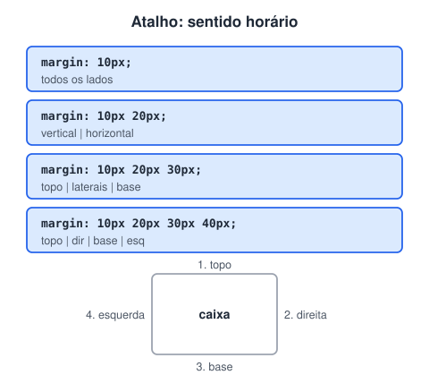
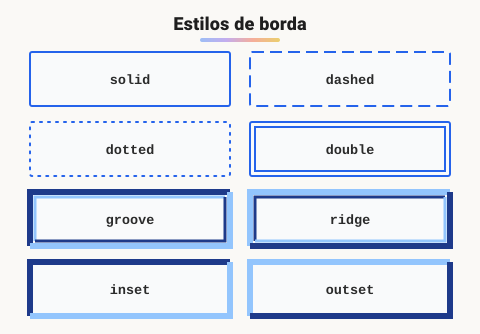

# Propriedade Margin e padding/ Bordas

> 🗺️ **Nesta aula:** margin, padding e bordas em detalhe: atalhos no sentido horário, colapso de margens, estilos de borda, cantos arredondados, sombra e outline.

## De onde paramos

O box model apresentou as quatro camadas da caixa. Agora, as propriedades de cada uma e os atalhos que economizam linhas.

## Margin: espaço externo

- Cria uma área **transparente** em volta do elemento, afastando-o dos vizinhos.
- Aceita valores **negativos**, que aproximam ou sobrepõem elementos, e `auto`, que centraliza blocos com largura definida.
- Unidades: `px`, `%` (sobre a **largura** do pai), `em`, `rem`...

```css
/* 10px nos 4 lados */
.box1 { margin: 10px; }

.box2 {
  margin-top: 20px;
  margin-right: 25px;
  margin-bottom: 30px;
  margin-left: 15px;
}
/* o mesmo que: margin: 20px 25px 30px 15px; */
```

### Atalhos (*shorthand*)



### Margin collapse (colapso de margens)

As margens **verticais** de dois blocos vizinhos não se somam: prevalece a **maior**.

```css
h2 { margin-bottom: 20px; }
p  { margin-top: 30px; }
/* espaço entre o h2 e o p = 30px (não 50px) */
```

Isso não acontece em itens de Flexbox ou Grid, nem com margens horizontais.

## Padding: espaço interno

- Fica **entre o conteúdo e a borda** e recebe a cor de fundo do elemento.
- Não aceita valores negativos.
- Usa os mesmos atalhos do `margin`: `padding: 10px 20px;`.

```css
.box3 { padding: 10px; }

.box4 {
  /* topo, direita, base, esquerda */
  padding: 20px 25px 30px 15px;
}
```

> ⚠️ No padrão (`box-sizing: content-box`), o padding **aumenta** o tamanho visível da caixa e empurra os vizinhos. Só com `box-sizing: border-box` ele fica "por dentro" do `width`.

## Bordas

A borda tem três partes: **largura**, **estilo** e **cor**. O estilo é obrigatório; sem ele a borda não aparece.



```css
/* forma curta: largura estilo cor */
.box { border: 1px solid black; }

/* propriedades separadas */
.box {
  border-width: 2px;
  border-style: dashed;
  border-color: #ff0000;
}

/* um lado só */
.aviso { border-left: 4px solid orange; }

/* larguras diferentes (sentido horário) */
.box {
  border-style: solid;
  border-width: 1px 2px 3px 4px;
}
```

### Cantos arredondados e sombra

```css
.card {
  /* 50% vira um círculo, se for quadrado */
  border-radius: 12px;
  /* x y desfoque cor */
  box-shadow: 0 4px 12px rgb(0 0 0 / 15%);
}
```

> 💡 `outline` **×** `border`**:** o `outline` é parecido com a borda, mas **não ocupa espaço** no box model. O navegador o usa para mostrar o foco do teclado. Nunca remova o outline (`outline: none`) sem colocar outro indicador de foco.

## Exercício

Crie um card com 24px de espaço interno, borda cinza de 1px, cantos de 8px, sombra suave e 16px de distância vertical para o próximo card.

<details>
<summary>Ver resposta</summary>

```css
.card {
  padding: 24px;
  border: 1px solid #d1d5db;
  border-radius: 8px;
  box-shadow: 0 2px 8px rgb(0 0 0 / 10%);
  margin-bottom: 16px;
}
```

</details>

## 🧠 Revisão rápida

**O que significa `margin: 10px 20px`?**

10px em cima e embaixo, 20px nas laterais.

**Um `h2` com margem inferior de 20px fica acima de um `p` com margem superior de 30px. Qual o espaço entre eles?**

30px: as margens verticais colapsam e vale a maior.

**Por que `border: 2px red` não mostra borda nenhuma?**

Porque falta o estilo (`solid`, `dashed`...), que é obrigatório.

> ➡️ **Próximo passo:** bordas, fundos e textos precisam de cor. Veja todas as formas de escrevê-la em **Usando cores no CSS**.

## 📌 Resumo

| Item | Em uma frase |
| --- | --- |
| `margin` | espaço externo; aceita negativo e `auto` |
| `padding` | espaço interno, com fundo |
| Atalho | 1 a 4 valores, no sentido horário a partir do topo |
| Colapso | margens verticais vizinhas: vale a maior |
| `border` | largura, estilo e cor |
| `border-radius` e `box-shadow` | cantos arredondados e sombra |
