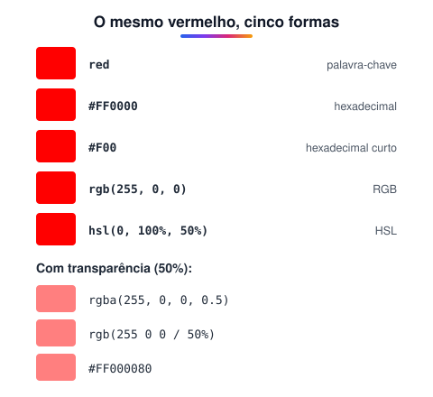

# Usando cores no CSS

> 🗺️ **Nesta aula:** as formas de escrever cor no CSS (nome, hexadecimal, RGB e HSL), transparência, variáveis de cor e contraste.

## De onde paramos

Bordas e fundos da aula anterior usavam cores como `black` e `#d1d5db`. Aqui você aprende a ler e escrever qualquer cor.

## Formas de escrever cor

Todas as formas abaixo produzem **o mesmo vermelho**:



> 💡 **Analogia:** o RGB é como misturar três lanternas coloridas (vermelha, verde e azul) numa parede escura: cada uma com brilho de 0 a 255, e as três no máximo dão branco. O HSL é como escolher tinta numa loja: primeiro a cor no mostruário circular (matiz), depois o quanto ela é viva (saturação) e por fim o quanto de branco ou preto entra (luminosidade).

### Palavras-chave

O CSS tem cerca de 140 cores com nome: `red`, `tomato`, `aquamarine`, `rebeccapurple`... São boas para testes. Há também valores especiais: `transparent` e `currentColor` (a cor do texto atual).

### Hexadecimal

- `#` seguido de 6 dígitos hexadecimais (0–9, A–F): dois para o vermelho, dois para o verde e dois para o azul.
- Cada par vai de `00` (0) a `FF` (255).
- **Forma curta**: `#F00` = `#FF0000`, quando cada par tem dígitos repetidos.
- **Com transparência**: 8 dígitos, `#FF000080`. O último par é o alfa (`80` ≈ 50%).

```css
.alerta { background-color: #FF0000; }
/* cinza-escuro, forma curta de #333333 */
.texto { color: #333; }
```

### RGB e RGBA

- Mistura de **R**ed, **G**reen e **B**lue, de 0 a 255 cada.
- O quarto valor (alfa) define a opacidade, de 0 (transparente) a 1 (opaco).

```css
.a { background-color: rgb(255, 0, 0); }
/* 50% de opacidade */
.b { background-color: rgba(255, 0, 0, 0.5); }
/* sintaxe moderna: espaços e alfa após a barra */
.c { background-color: rgb(255 0 0 / 50%); }
```

### HSL e HSLA

Descreve a cor de um jeito mais humano:

- **H (*hue*, matiz)**: a posição no círculo de cores, de 0° a 360°. 0° é vermelho, 120° é verde e 240° é azul.
- **S (*saturation*, saturação)**: de 0% (cinza) a 100% (cor viva).
- **L (*lightness*, luminosidade)**: de 0% (preto) a 50% (cor pura) a 100% (branco).

```css
/* vermelho puro */
.a { background-color: hsl(0, 100%, 50%); }
/* com 50% de opacidade */
.b { background-color: hsla(0, 100%, 50%, 0.5); }
.c { background-color: hsl(0 100% 50% / .5); }
```

> 💡 **Por que o HSL é útil:** para criar variações de uma mesma cor, basta mexer na luminosidade. `hsl(220 90% 50%)` é o botão, `hsl(220 90% 40%)` o *hover* e `hsl(220 90% 95%)` o fundo suave. Com hexadecimal, você teria de calcular cada código.

## Transparência: `rgba` × `opacity`

```css
/* só o FUNDO fica translúcido */
.a { background-color: rgb(0 0 0 / 50%); }
/* o elemento INTEIRO, incluindo texto e filhos */
.b { opacity: .5; }
```

## Variáveis de cor (custom properties)

Defina a paleta uma vez e reutilize em todo o site:

```css
:root {
  --cor-primaria: #2563eb;
  --cor-texto: #1f2937;
}

.botao { background-color: var(--cor-primaria); }
body   { color: var(--cor-texto); }
```

> ⚠️ **Contraste:** a combinação texto/fundo precisa de contraste suficiente para ser lida por todos. As diretrizes WCAG pedem uma razão mínima de **4,5:1** para texto normal. O DevTools mostra essa razão ao inspecionar uma cor no painel Styles.

## Exercício

Escreva o azul puro em hexadecimal, em RGB e em HSL, e um azul com 30% de opacidade.

<details>
<summary>Ver resposta</summary>

```css
.a { color: #0000FF; }
.b { color: rgb(0 0 255); }
.c { color: hsl(240 100% 50%); }
.d { color: rgb(0 0 255 / 30%); }
```

</details>

## 🧠 Revisão rápida

**O que significa cada par de `#1A2B3C`?**

`1A` é o vermelho, `2B` o verde e `3C` o azul, cada um de 00 a FF.

**Qual a diferença entre `rgba(0,0,0,.5)` no fundo e `opacity: .5`?**

A primeira deixa só o fundo translúcido; a segunda deixa o elemento inteiro, incluindo o texto.

**Em HSL, o que acontece com `l` = 100%?**

A cor vira branco, qualquer que seja o matiz.

> ➡️ **Próximo passo:** fundo não é só cor: dá para usar imagens e gradientes, em **Background (Fundo da página)**.

## 📌 Resumo

| Item | Em uma frase |
| --- | --- |
| Nome | `red`, `tomato`; bom para testes |
| Hexadecimal | `#RRGGBB`, com alfa em 8 dígitos |
| RGB | `rgb(255 0 0 / 50%)` |
| HSL | matiz, saturação e luminosidade |
| `opacity` | transparência do elemento inteiro |
| Variáveis | `--cor` em `:root`, usada com `var()` |
| Contraste | mínimo de 4,5:1 para texto |
