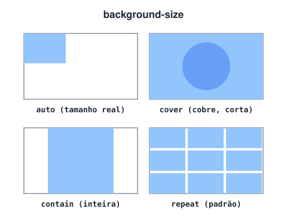

# Background (Fundo da página)

> 🗺️ **Nesta aula:** fundos com cor, imagem e gradiente, e as propriedades que controlam repetição, tamanho e posição da imagem.

## De onde paramos

A aula de cores mostrou como pintar o fundo com `background-color`. Agora vamos usar imagens e gradientes, que deixam banners e seções muito mais vivos.

## Propriedades de fundo

Qualquer elemento pode ter um fundo com cor, imagem, gradiente, ou tudo junto.

### `background-color`

```css
body { background-color: aquamarine; }
```

- A cor preenche a área do conteúdo e do padding, ou seja, até a borda.
- A imagem de fundo é desenhada **por cima** da cor. A cor aparece onde a imagem não cobre e serve de reserva enquanto a imagem carrega.

> 💡 O fundo do `<body>` "vaza" para a janela inteira do navegador. É uma regra especial; para os outros elementos, o fundo fica só dentro da caixa.

### `background-image`

```css
.hero {
  /* caminho relativo ao arquivo .css */
  background-image: url("img/fundo.jpg");
}
```

Por padrão a imagem **se repete** nos dois eixos até cobrir o elemento.

> ⚠️ Não aponte para imagens de outros sites (*hotlinking*): o link pode quebrar a qualquer momento e consome a banda do outro site. Salve a imagem no seu projeto e aponte para ela.

### `background-repeat`, `background-size` e `background-position`



| Propriedade | Valores comuns |
| --- | --- |
| `background-repeat` | `repeat` (padrão), `repeat-x`, `repeat-y`, `no-repeat` |
| `background-size` | `auto` (padrão), `cover`, `contain`, `200px 100px`, `50%` |
| `background-position` | `center`, `top right`, `50% 30%` |
| `background-attachment` | `scroll` (padrão), `fixed` (efeito *parallax*) |

- `cover`: a imagem cobre **toda** a área, mantendo a proporção. Pode cortar bordas. É o mais usado em banners.
- `contain`: a imagem aparece **inteira**, mantendo a proporção. Pode sobrar espaço.

```css
.banner {
  height: 60vh;
  /* reserva enquanto a imagem carrega */
  background-color: #1f2937;
  background-image: url("img/praia.jpg");
  background-size: cover;
  background-position: center;
  background-repeat: no-repeat;
}

/* forma curta equivalente */
.banner {
  background: #1f2937 url("img/praia.jpg")
    center / cover no-repeat;
}
```

> 💡 Para testar posicionamento, aplique o fundo num elemento próprio (como uma `<div class="banner">`), e não no `body` com largura e altura fixas, o que encolheria a página inteira.

## Gradientes

Gradientes são **imagens geradas pelo CSS**, então se usam com `background-image` (ou `background`):

```css
.linear {
  background: linear-gradient(to right,
    #2563eb, #7c3aed);
}
.radial {
  background: radial-gradient(circle,
    #fde047, #f97316);
}

/* texto legível sobre foto: gradiente escuro
   por cima da imagem */
.hero {
  background:
    linear-gradient(rgb(0 0 0 / 60%),
                    rgb(0 0 0 / 20%)),
    url("img/praia.jpg") center / cover;
}
```

> 💡 **Acessibilidade:** texto sobre imagem precisa de contraste suficiente; uma camada escura (como acima) ou uma sombra no texto ajudam. Imagens de **conteúdo** vão no HTML com ``; o `background-image` é só para decoração.

## Exercício

Crie um banner de 400px de altura com a imagem `img/cidade.jpg` cobrindo tudo, centralizada, sem repetir, e um degradê escuro por cima para o título branco ficar legível.

<details>
<summary>Ver resposta</summary>

```css
.banner {
  height: 400px;
  color: white;
  background:
    linear-gradient(rgb(0 0 0 / 50%),
                    rgb(0 0 0 / 50%)),
    url("img/cidade.jpg") center / cover
    no-repeat;
}
```

</details>

## 🧠 Revisão rápida

**Qual a diferença entre `cover` e `contain`?**

`cover` cobre toda a área e pode cortar a imagem; `contain` mostra a imagem inteira e pode sobrar espaço.

**Por que definir uma `background-color` junto com a imagem?**

Para servir de reserva enquanto a imagem carrega ou se ela falhar.

**Imagem de produto numa loja deve ser `background-image` ou ``?**

``: é conteúdo, e precisa de texto alternativo.

> ➡️ **Próximo passo:** para fechar o módulo, deixe o estilo reutilizável e com movimento: **Variáveis CSS, transições e animações**.

## 📌 Resumo

| Item | Em uma frase |
| --- | --- |
| `background-color` | cor de fundo, até a borda |
| `background-image` | imagem por cima da cor; repete por padrão |
| `cover` / `contain` | cobre e corta / inteira |
| `background-position` | onde a imagem fica |
| Gradiente | imagem gerada pelo CSS |
| Atalho `background` | cor, imagem, posição, tamanho e repetição |
