# Variáveis CSS, transições e animações (Adicionado pelo aluno para melhorar o estudo)

> 🗺️ **Nesta aula:** variáveis CSS para reaproveitar valores, transições para suavizar mudanças de estado e animações com `@keyframes`, respeitando quem prefere menos movimento.

## De onde paramos

A aula de cores mostrou uma variável `--cor-primaria` de passagem, e a de pseudo-classes usou `transition` no sublinhado animado. Esta aula explica as duas ferramentas a fundo e fecha o módulo IV.

## Variáveis CSS (custom properties)

**Variáveis guardam um valor para reutilizar no CSS inteiro.** Mude em um lugar, e o site todo muda.

```css
/* :root = o <html>: valem para a página toda */
:root {
  --cor-primaria: #1a73e8;
  --cor-texto: #222;
  --raio: 8px;
  --espaco: 1rem;
}

.botao {
  background: var(--cor-primaria);
  border-radius: var(--raio);
  padding: var(--espaco) calc(var(--espaco) * 2);
}

/* valor padrão se a variável não existir */
.alerta { color: var(--cor-alerta, crimson); }
```

Elas seguem a **cascata**: dá para redefinir em um trecho da página.

```css
.tema-escuro {
  --cor-texto: #eee;
  --cor-fundo: #121212;
}
```

E dá para trocar pelo JavaScript (módulo VII):

```jsx
document.documentElement.style
  .setProperty("--cor-primaria", "tomato");
```

## Transições: suavizar mudanças

Uma **transição** anima a passagem entre dois estados, como normal → `:hover`.

```css
.botao {
  background: var(--cor-primaria);
  transition: background-color .2s ease,
              transform .2s ease;
}
.botao:hover {
  background: #1558b0;
  transform: translateY(-2px);
}
```

Formato: `transition: propriedade duração curva atraso`. Curvas comuns: `ease` (padrão), `linear`, `ease-in`, `ease-out` e `cubic-bezier(...)`.

> 💡 Prefira animar `transform` e `opacity`: o navegador faz isso na GPU, sem recalcular o layout. Animar `width`, `height`, `top` ou `margin` pode deixar a página travando. Evite também `transition: all`, que anima coisas que você não pretendia.

### As transformações mais usadas

| Função | Faz |
| --- | --- |
| `translate(x, y)` | move |
| `scale(1.1)` | aumenta ou diminui |
| `rotate(45deg)` | gira |
| `skew(10deg)` | inclina |

## Animações com `@keyframes`

Para movimentos que rodam sozinhos ou têm várias etapas:

```css
@keyframes aparecer {
  from { opacity: 0; transform: translateY(20px); }
  to   { opacity: 1; transform: translateY(0); }
}

@keyframes girar {
  to { transform: rotate(360deg); }
}

.card    { animation: aparecer .4s ease-out both; }
.loading { animation: girar 1s linear infinite; }
```

Propriedades de `animation`:

| Propriedade | Exemplo | Faz |
| --- | --- | --- |
| `animation-name` | `aparecer` | qual `@keyframes` usar |
| `animation-duration` | `.4s` | duração |
| `animation-timing-function` | `ease-out` | curva |
| `animation-delay` | `.1s` | espera antes de começar |
| `animation-iteration-count` | `infinite` | quantas vezes |
| `animation-direction` | `alternate` | ida e volta |
| `animation-fill-mode` | `both` | mantém o primeiro/último quadro |



## Respeite quem prefere menos movimento

Algumas pessoas sentem tontura com animações. O sistema operacional permite pedir "reduzir movimento", e o CSS consegue ler isso:

```css
@media (prefers-reduced-motion: reduce) {
  *, *::before, *::after {
    animation-duration: .01ms !important;
    animation-iteration-count: 1 !important;
    transition-duration: .01ms !important;
  }
}
```

## Exercício

Crie um botão que, ao passar o mouse, cresça 5% e escureça a cor em 0,2 s, usando uma variável para a cor.

<details>
<summary>Ver resposta</summary>

```css
:root { --cor-botao: hsl(220 90% 50%); }

.botao {
  background: var(--cor-botao);
  color: white;
  transition: transform .2s, background .2s;
}
.botao:hover {
  transform: scale(1.05);
  background: hsl(220 90% 40%);
}
```

</details>

## 🧠 Revisão rápida

**Onde declarar variáveis que valem para a página toda?**

Em `:root`.

**Qual a diferença entre transição e animação?**

A transição anima a mudança entre dois estados (como o `:hover`); a animação com `@keyframes` roda sozinha e pode ter várias etapas.

**Quais propriedades animam com melhor desempenho?**

`transform` e `opacity`.

> ➡️ **Próximo passo:** fim do módulo IV. O módulo V organiza os elementos na tela, começando por **Media queries**.

## 📌 Resumo

| Item | Em uma frase |
| --- | --- |
| Variável | `--nome` em `:root`, usada com `var()` |
| Transição | anima a mudança entre estados |
| `transform` | move, escala, gira e inclina |
| `@keyframes` | animação com etapas |
| `animation` | nome, duração, curva, repetição |
| Movimento reduzido | `prefers-reduced-motion` |
