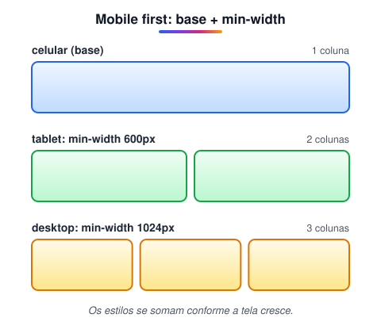

# Media queries

> 🗺️ **Nesta aula:** como aplicar estilos diferentes para cada tamanho de tela com media queries, a estratégia mobile first e as condições mais usadas (largura, orientação, impressão, modo escuro).

## De onde paramos

O módulo IV ensinou a estilizar elementos: cores, fundos, caixas e unidades. Mas o mesmo site é aberto num celular de 360px e num monitor de 1920px. Este módulo trata da **página como um todo**, e começa pelo que permite que ela se adapte a qualquer tela.

## O que são media queries?

**Media queries são regras condicionais do CSS: "aplique estes estilos só se a tela/dispositivo tiver tal característica".** São a base do **design responsivo**, aquele em que o mesmo site se adapta ao celular, ao tablet e ao desktop.

```css
@media (condição) {
  /* regras que só valem quando
     a condição for verdadeira */
}
```

> ⚠️ **Sem a meta viewport, media queries não funcionam direito no celular.** O navegador móvel finge ter cerca de 980px de largura e encolhe a página. Sempre inclua no `<head>`: `<meta name="viewport" content="width=device-width, initial-scale=1">`

## Mobile first

A abordagem recomendada é escrever primeiro o CSS do **celular** (sem media query) e ir **acrescentando** regras para telas maiores com `min-width`:



> 💡 **Analogia:** media queries funcionam como a mesa extensível de uma sala de jantar. Para duas pessoas (celular), ela fica fechada; quando chegam mais convidados (tela maior), você puxa as abas e acrescenta lugares. Mobile first é começar pela mesa fechada e só abrir quando houver espaço.

```css
/* base: celular */
.cards { display: grid; grid-template-columns: 1fr; }

@media (min-width: 600px) {
  .cards { grid-template-columns: 1fr 1fr; }
}

@media (min-width: 1024px) {
  .cards { grid-template-columns: repeat(3, 1fr); }
}
```

Por que começar pelo celular? Porque o layout de uma coluna é o mais simples; as telas maiores só **acrescentam** colunas e espaço. O caminho inverso obriga a desfazer estilos.

Breakpoints comuns (não são regra, ajuste ao seu conteúdo): **600px**, **768px**, **1024px**, **1280px**.

## Tipos de condição

### Largura da tela

```css
/* de 768px para cima */
@media (min-width: 768px) { }
/* até 767px */
@media (max-width: 767px) { }

/* sintaxe nova (Level 4), já suportada */
@media (width >= 768px) { }
@media (600px <= width < 1024px) { }
```

### Orientação

```css
/* paisagem: mais largo que alto */
@media (orientation: landscape) {
  .header { display: none; }
}
```

### Densidade de pixels (telas Retina)

```css
@media (min-resolution: 2dppx) {
  .logo { background-image: url("logo@2x.png"); }
}
```

> 💡 Para imagens em várias resoluções, o mais prático hoje é o HTML: ``. O navegador escolhe sozinho.

### Impressão

```css
@media print {
  .header, .footer, nav { display: none; }
  body { color: black; background: white; }
}
```

### Preferências do usuário

```css
/* sistema em modo escuro */
@media (prefers-color-scheme: dark) {
  body { background: #111; color: #eee; }
}
/* usuário pediu menos animação */
@media (prefers-reduced-motion: reduce) {
  * { animation: none !important;
      transition: none !important; }
}
```

### Combinando condições

```css
/* E */
@media (min-width: 768px) and (orientation: landscape) { }
/* OU: vírgula */
@media (max-width: 600px), print { }
/* NÃO */
@media not print { }
```

> ⚠️ **Correção:** em media queries, o "ou" tradicional é a **vírgula**, não a palavra `or`. O `or` só existe na sintaxe nova (Level 4), dentro de parênteses.

## Projeto: cores que mudam com o tamanho da janela

**Código revisado**

```html
<!-- index.html -->
<!DOCTYPE html>
<html lang="pt-BR">
<head>
  <meta charset="utf-8">
  <meta name="viewport"
    content="width=device-width, initial-scale=1">
  <title>Exemplo de media queries</title>
  <link rel="stylesheet" href="style.css">
</head>
<body>
  <h1>Teste</h1>
  <p>As cores mudam conforme a largura da janela.</p>
</body>
</html>
```

```css
/* style.css */
/* acima de 800px */
body { background-color: red; }
p, h1 { color: white; }

/* de 401 a 800px */
@media (max-width: 800px) {
  body { background-color: blue; }
}

/* até 400px */
@media (max-width: 400px) {
  body { background-color: lightgreen; }
}
```

> ⚠️ **Bugs corrigidos:** o verde nunca aparecia, porque a regra de `max-width: 400px` vinha **antes** da de `max-width: 800px`; numa tela de 350px as duas valem, e a última (azul) vencia. Com `max-width`, ordene da **maior para a menor** largura; com `min-width` (mobile first), da **menor para a maior**. O `@charset` vinha depois de um comentário e era ignorado (salvar em UTF-8 basta), havia um `</head>` duplicado e faltava a meta viewport.

## Exercício

Faça um `nav` com 4 links que fiquem um embaixo do outro no celular e em linha a partir de 768px.

<details>
<summary>Ver resposta</summary>

```css
nav { display: flex; flex-direction: column; }

@media (min-width: 768px) {
  nav { flex-direction: row; gap: 16px; }
}
```

A base (celular) é a coluna; a media query só troca a direção nas telas maiores.

</details>

## 🧠 Revisão rápida

**O que é mobile first?**

Escrever primeiro o CSS do celular, sem media query, e acrescentar regras para telas maiores com `min-width`.

**Sem a meta viewport, o que acontece no celular?**

O navegador finge ter cerca de 980px de largura e encolhe a página; as media queries de celular não disparam.

**Como escrever "OU" entre duas condições na sintaxe tradicional?**

Com vírgula: `@media (max-width: 600px), print`.

> ➡️ **Próximo passo:** para mudar o layout entre telas, é preciso entender como cada caixa se comporta. Isso começa no **Atributo Display**.

## 📌 Resumo

| Item | Em uma frase |
| --- | --- |
| Media query | estilos que só valem sob uma condição |
| Meta viewport | obrigatória para o responsivo funcionar no celular |
| Mobile first | base para celular e `min-width` para crescer |
| Ordem | `min-width` do menor ao maior; `max-width` do maior ao menor |
| Condições | largura, orientação, resolução, print, preferências |
| E / OU / NÃO | `and` / vírgula / `not` |
