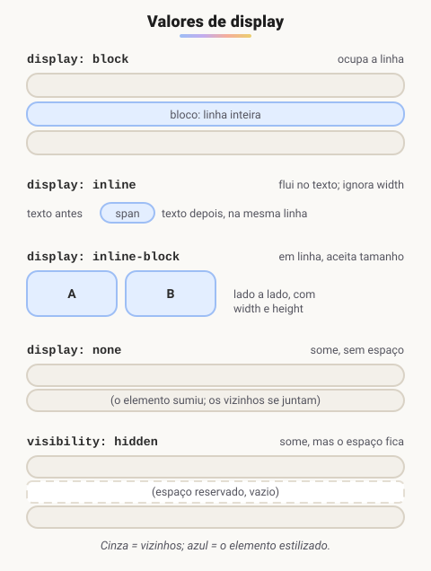

# Atributo Display

> 🗺️ **Nesta aula:** os valores de `display` (block, inline, inline-block, none, flex, grid) e as três formas de esconder um elemento.

## De onde paramos

A aula de media queries mostrou como mudar estilos conforme a tela. Muitas dessas mudanças são justamente trocar o `display`: esconder o menu no celular, transformar uma lista em linha, ligar o Flexbox. Esta é a propriedade que decide como cada caixa entra no layout.

## O que é `display`?

**A propriedade** `display` **define como uma caixa participa do layout**: se ocupa a linha inteira, se fica no fluxo do texto, se some, ou se vira um contêiner flex ou grid para os filhos.



| Valor | Comportamento |
| --- | --- |
| `block` | nova linha, largura total, aceita `width`/`height` |
| `inline` | no fluxo do texto; **ignora** `width`/`height` e margens verticais |
| `inline-block` | no fluxo do texto, mas aceita `width`, `height` e margens |
| `none` | não aparece e não ocupa espaço |
| `flex` | vira um contêiner Flexbox (layout em uma dimensão) |
| `grid` | vira um contêiner Grid (layout em duas dimensões) |
| `inline-flex` / `inline-grid` | contêiner flex/grid que fica em linha |

Cada tag já nasce com um `display` padrão: `div`, `p`, `h1` e `ul` são `block`; `span`, `a`, `strong` e `img` são `inline`. O CSS pode trocar isso:

```css
span   { display: inline; }
div    { display: block; }
button { display: inline-block;
         width: 100px; height: 40px; }
.hidden-element { display: none; }
```

## Esconder elementos: `display` × `visibility` × `opacity`

| Propriedade | Ocupa espaço? | Clicável? | Leitor de tela lê? |
| --- | --- | --- | --- |
| `display: none` | não | não | não |
| `visibility: hidden` | sim | não | não |
| `opacity: 0` | sim | sim | sim |

Nos três casos o elemento não aparece; a diferença está no espaço, no clique e na acessibilidade.

```css
/* some de vez */
.a { display: none; }
/* fica um "buraco" do tamanho dele */
.b { visibility: hidden; }
/* valor padrão */
.c { visibility: visible; }
```

> 💡 Para esconder algo **só visualmente**, mantendo para leitores de tela (ex.: um texto "Pular para o conteúdo"), use a classe utilitária `.sr-only`, presente no Bootstrap e no Tailwind, em vez de `display: none`.

## Projeto de exemplo

**Código revisado**

```html
<!-- index.html -->
<!DOCTYPE html>
<html lang="pt-BR">
<head>
  <meta charset="UTF-8">
  <meta name="viewport"
    content="width=device-width, initial-scale=1.0">
  <title>Exemplos de uso de display</title>
  <link rel="stylesheet" href="style.css">
</head>
<body>
  <p class="ex1">Parágrafo 1</p>
  <p class="ex2">Parágrafo 2</p>
  <p class="ex3">Parágrafo 3</p>
  <p class="ex4">Parágrafo 4</p>
  <p class="ex5">Parágrafo 5</p>
  <p class="ex6">Teste</p>
</body>
</html>
```

```css
/* style.css */
p {
  border: 1px solid red;
  background-color: pink;
  margin: 10px;
}

/* some e não ocupa espaço */
p.ex1 { display: none; }

/* some, mas o espaço continua reservado */
p.ex2 { visibility: hidden; }

/* em linha: outros elementos ficam ao lado */
p.ex3 { display: inline; }

/* bloco (já é o padrão do <p>) */
p.ex4 { display: block; }

/* em linha, mas aceita largura e altura */
p.ex5, p.ex6 {
  display: inline-block;
  width: 200px;
  height: 200px;
  border: 2px solid black;
}
```

> ⚠️ **Bugs corrigidos:** `maring: 10px` virou `margin` (com o erro de digitação, a propriedade era ignorada). O comentário aninhado `/*/* ... */*/` sobre o `.ex2` não é suportado pelo CSS: fechava no primeiro `*/` e o resto estragava o seletor, descartando a regra `visibility: hidden`. As regras idênticas de `.ex5` e `.ex6` foram agrupadas, e a meta `X-UA-Compatible` (para o Internet Explorer, descontinuado) foi removida. Nas anotações, os exemplos de CSS também estavam marcados como HTML.

## 🧠 Revisão rápida

**Por que `width: 200px` não funciona num `span`?**

Porque o `span` é `inline`, e elementos inline ignoram largura e altura. Use `inline-block` ou `block`.

**Qual a diferença entre `display: none` e `visibility: hidden`?**

O primeiro some e libera o espaço; o segundo some, mas o espaço continua reservado.

**Qual o `display` padrão de uma `div`?**

`block`.

> ➡️ **Próximo passo:** além de decidir o tipo de caixa, dá para tirá-la do fluxo e colocá-la em um ponto exato: **Posicionamento de elementos**.

## 📌 Resumo

| Valor | Em uma frase |
| --- | --- |
| `block` | ocupa a linha inteira |
| `inline` | flui no texto, ignora largura e altura |
| `inline-block` | em linha, mas aceita tamanho |
| `none` | some sem ocupar espaço |
| `flex` / `grid` | transforma em contêiner de layout |
| `visibility: hidden` | some, mas o espaço fica |
