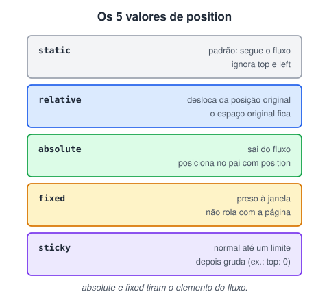

# Posicionamento de elementos

> 🗺️ **Nesta aula:** os cinco valores de `position` (static, relative, absolute, fixed e sticky), como `top`/`left` funcionam em cada um e quando usar cada valor.

## De onde paramos

O `display` decide o tipo de caixa, mas a caixa continua no fluxo normal, uma depois da outra. Às vezes é preciso um selo no canto de um card, um menu que não sai do topo ou um cabeçalho que gruda ao rolar. Isso é trabalho do `position`.

## A propriedade `position`

Controla **como** um elemento é posicionado e **em relação a quê** as propriedades `top`, `right`, `bottom` e `left` funcionam.



> 💡 **Analogia:** imagine pessoas numa fila. `static` é ficar no seu lugar; `relative` é dar um passo para o lado sem perder o lugar na fila; `absolute` é sair da fila e ficar num ponto exato da sala onde está o "responsável" (o pai posicionado); `fixed` é um aviso colado no vidro da janela, que não se move quando a sala gira; `sticky` é andar com a fila até encostar na parede e parar ali.

### 1. `static` (padrão)

Fluxo normal do documento. **Ignora** `top`, `left`, `right`, `bottom` e `z-index`. Útil para desfazer um posicionamento aplicado antes.

### 2. `relative`

Desloca o elemento **a partir da posição onde ele estaria**. O espaço original **continua reservado**: os vizinhos não se mexem.

```css
.elemento {
  position: relative;
  top: 20px;  /* desce 20px */
  left: 10px;  /* vai 10px para a direita */
}
```

Também é muito usado **sem** deslocamento, apenas para servir de referência a filhos com `absolute`.

### 3. `absolute`

**Sai do fluxo**: os vizinhos agem como se ele não existisse. É posicionado em relação ao **ancestral posicionado mais próximo** (qualquer `position` diferente de `static`). Se não houver nenhum, usa a página inteira.

```css
/* referência */
.card { position: relative; }
/* canto superior direito do card */
.selo {
  position: absolute;
  top: 8px;
  right: 8px;
}
```

### 4. `fixed`

Sai do fluxo e fica **preso à janela** do navegador: não se move ao rolar a página. É usado em menus fixos, botões flutuantes e banners de cookies.

```css
.menu {
  position: fixed;
  top: 0;
  left: 0;
  right: 0;
}
```

> 💡 Como o elemento fixo sai do fluxo, o conteúdo fica **por baixo** dele. Compense com um `padding-top` no `body` igual à altura do menu.

### 5. `sticky`

Comporta-se como `relative` até a rolagem atingir o limite definido; a partir daí, **gruda** como se fosse `fixed`, mas só enquanto o elemento pai estiver visível. É ideal para cabeçalhos de tabela e menus que grudam no topo.

```css
.cabecalho {
  position: sticky;
  /* obrigatório: sem limite, sticky não faz nada */
  top: 0;
}
```

> ⚠️ **Correções:** o nome do valor é `sticky` (o título dizia "Stick"). O `sticky` **exige** pelo menos um limite (`top`, `bottom`...); no `fixed` e no `absolute` isso é opcional. E o `sticky` não funciona se algum ancestral tiver `overflow: hidden`, `auto` ou `scroll`.

## Comparando

| Valor | Sai do fluxo? | Referência de `top`/`left` |
| --- | --- | --- |
| `static` | não | (ignora) |
| `relative` | não | a própria posição original |
| `absolute` | sim | o ancestral posicionado mais próximo |
| `fixed` | sim | a janela do navegador |
| `sticky` | não | a janela, ao atingir o limite |

## `overflow`: rolagem dentro de um elemento

Quando o conteúdo é maior que a caixa, `overflow` decide o que fazer: `visible` (vaza, o padrão), `hidden` (corta), `scroll` (barras sempre) ou `auto` (barras só quando precisa). Use `overflow-x` e `overflow-y` para cada eixo. Mais detalhes na aula "Ordem de pilha de elementos".

```css
.caixa {
  height: 200px;
  overflow-y: auto;
}
```

## Projeto de exemplo

**Código revisado (texto de preenchimento resumido)**

```html
<!DOCTYPE html>
<html lang="pt-BR">
<head>
  <meta charset="UTF-8">
  <meta name="viewport"
    content="width=device-width, initial-scale=1.0">
  <title>Trabalhando com posicionamentos</title>
  <link rel="stylesheet" href="style.css">
</head>
<body>
  <div id="relativo">
    <p>Posição relativa: obedece às coordenadas.</p>
  </div>

  <div id="fixo">
    <p>Div fixa: não sai do lugar ao rolar.</p>
  </div>

  <div id="referencia">
    <div id="absoluto">
      <p>Posição absoluta (em relação à vermelha).</p>
    </div>
  </div>

  <div id="sticky">
    <p>Esta div testa o comportamento sticky.</p>
  </div>

  <!-- vários parágrafos para gerar rolagem -->
  <p>Lorem ipsum dolor sit amet...</p>
</body>
</html>
```

```css
#relativo {
  position: relative;
  left: 30px;
  width: 300px;
  border: 3px solid #73ad21;
}

#fixo {
  position: fixed;
  top: 0;
  right: 0;
  width: 300px;
  border: 5px solid #a3ad21;
  background: white;
}

/* o "pai" que serve de referência ao absoluto */
#referencia {
  position: relative;
  width: 600px;
  height: 200px;
  border: 3px solid red;
}

#absoluto {
  position: absolute;
  top: 50px;
  right: 150px;
  width: 300px;
  height: 70px;
  border: 3px solid blue;
}

#sticky {
  position: sticky;
  /* faltava: sem isso o sticky não gruda */
  top: 0;
  background-color: pink;
  border: 2px solid #4caf50;
  width: 600px;
}

p {
  font-size: 20px;
  text-align: center;
}
```

> ⚠️ **Bugs corrigidos no projeto:** o `#sticky` não tinha `top`, então **nunca grudava**; ele também tinha `overflow-y: scroll` e altura fixa, o que o transformava numa caixa com rolagem própria. O documento terminava com `<body>` em vez de `</body>`. E os IDs foram padronizados em minúsculas, porque IDs diferenciam maiúsculas de minúsculas.

## 🧠 Revisão rápida

**Um `.selo` com `position: absolute` foi parar no canto da página, e não no canto do card. Por quê?**

Porque nenhum ancestral está posicionado. Coloque `position: relative` no card.

**Qual a diferença entre `fixed` e `sticky`?**

O `fixed` fica sempre preso à janela; o `sticky` segue o fluxo até atingir o limite e só então gruda.

**O `relative` libera o espaço original do elemento?**

Não: o espaço continua reservado e os vizinhos não se mexem.

> ➡️ **Próximo passo:** posicionar exige saber o tamanho real das caixas, e ele depende de como o padding e a borda são somados: **Tamanho de caixa (mexendo no box)**.

## 📌 Resumo

| Valor | Em uma frase |
| --- | --- |
| `static` | fluxo normal; ignora coordenadas |
| `relative` | desloca da posição original; espaço fica |
| `absolute` | sai do fluxo; ancorado no pai posicionado |
| `fixed` | preso à janela; não rola |
| `sticky` | normal até o limite, depois gruda |
| `overflow` | o que fazer com o conteúdo que não cabe |
