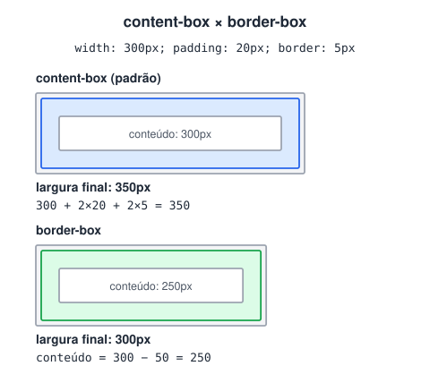

# Tamanho de caixa (mexendo no box)

> 🗺️ **Nesta aula:** como o navegador calcula a largura e a altura finais de uma caixa e por que quase todo projeto usa `box-sizing: border-box`.

## De onde paramos

Para posicionar e alinhar elementos, é preciso saber o tamanho real de cada caixa. No módulo IV você viu o box model (conteúdo, padding, borda e margem). Agora a pergunta é: quando escrevo `width: 300px`, a caixa fica com 300px mesmo?

## Como o navegador calcula o tamanho de uma caixa

Por padrão, `width` e `height` valem **só para o conteúdo**. O padding e a borda são **somados** por fora:

- Largura final = `width` + padding esquerdo + padding direito + borda esquerda + borda direita
- Altura final = `height` + padding de cima + padding de baixo + borda de cima + borda de baixo

```css
.elemento {
  width: 200px;
  height: 100px;
  padding: 10px;
  border: 1px solid black;
}
/* largura final: 200 + 10 + 10 + 1 + 1 = 222px
   altura final:  100 + 10 + 10 + 1 + 1 = 122px */
```

A margem fica de fora: ela afasta a caixa dos vizinhos, mas não faz parte do tamanho dela.

## A propriedade `box-sizing`



> 💡 **Analogia:** pense numa mala de viagem. Em `content-box`, o tamanho informado é só o espaço interno, e as rodinhas e o estofamento (padding e borda) aumentam a mala por fora; ela pode não caber no bagageiro. Em `border-box`, o tamanho informado é a mala por fora, já com tudo: ela sempre cabe, e é o espaço interno que fica menor.

### `content-box` (padrão)

O `width` é só o conteúdo. Padding e borda são **acrescentados**, então a caixa fica maior que o `width` declarado.

### `border-box`

O `width` é a caixa **inteira**, incluindo padding e borda. O conteúdo encolhe para caber. É muito mais previsível: se você diz `width: 50%`, a caixa tem 50%, ponto.

```css
/* aplicado a tudo, incluindo pseudo-elementos:
   a forma mais comum hoje */
*, *::before, *::after {
  box-sizing: border-box;
}
```

> 💡 Exemplo clássico do problema: duas colunas com `width: 50%` e `padding: 20px` **não cabem lado a lado** em `content-box` (passam de 100%). Em `border-box`, cabem.

## Projeto de exemplo

**Código revisado**

```html
<!-- index.html -->
<!DOCTYPE html>
<html lang="pt-BR">
<head>
  <meta charset="UTF-8">
  <meta name="viewport"
    content="width=device-width, initial-scale=1.0">
  <title>Exemplo de tamanho de caixa</title>
  <link rel="stylesheet" href="style.css">
</head>
<body>
  <div class="container">
    <h1>Tamanho de caixa</h1>
    <div class="box box-1">
      <p>Com padding e borda.</p>
    </div>
    <div class="box box-2">
      <p>Sem padding, com borda.</p>
    </div>
    <div class="box box-3">
      <p>Com padding, sem borda.</p>
    </div>
    <div class="box box-4">
      <p>Sem padding e sem borda.</p>
    </div>
  </div>
</body>
</html>
```

```css
/* style.css */
.container {
  max-width: 800px;
  margin: 0 auto;
  padding: 20px;
}

.box {
  /* as 4 caixas têm exatamente 300 × 150 */
  box-sizing: border-box;
  width: 300px;
  height: 150px;
  margin-bottom: 20px;
  /* fundo para enxergar o tamanho */
  background: #e0f2fe;
}

.box-1 { padding: 20px; border: 1px solid black; }
.box-2 { border: 1px solid black; }
.box-3 { padding: 20px; }
/* .box-4: sem padding e sem borda */
```

**Experimente:** troque `border-box` por `content-box` e compare. Agora a `.box-1` passa a ter 342 × 192 px.

> ⚠️ **Correções:** o HTML carregava `estilo.css`, mas o arquivo se chamava `style.css`, então o CSS não era aplicado. O `lang="en"` virou `pt-BR`. As quatro classes repetidas foram unificadas numa classe `.box`, e um fundo foi adicionado para enxergar a diferença de tamanho.

## Exercício

Uma caixa tem `width: 400px`, `padding: 15px` e `border: 5px`. Qual a largura final em `content-box`? E em `border-box`? Quanto sobra para o conteúdo no segundo caso?

<details>
<summary>Ver resposta</summary>

- `content-box`: 400 + 2 × 15 + 2 × 5 = **440px**.
- `border-box`: a caixa tem **400px**; o conteúdo fica com 400 − 30 − 10 = **360px**.

</details>

## 🧠 Revisão rápida

**A margem entra na largura final da caixa?**

Não. Ela afasta a caixa dos vizinhos, mas fica fora do tamanho.

**Por que `border-box` é mais previsível?**

Porque o `width` declarado é o tamanho real da caixa, já com padding e borda.

> ➡️ **Próximo passo:** com display, position e tamanho dominados, dá para montar uma página inteira: **Montagem de Layout da página**.

## 📌 Resumo

| Item | Em uma frase |
| --- | --- |
| `content-box` | padrão: padding e borda somam ao `width` |
| `border-box` | o `width` já inclui padding e borda |
| Largura final | width + paddings + bordas (em content-box) |
| Margem | fora do tamanho da caixa |
| Boa prática | `*, *::before, *::after { box-sizing: border-box; }` |
