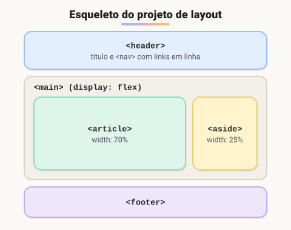

# Montagem de Layout da página

> 🗺️ **Nesta aula:** o passo a passo para planejar e montar o layout de uma página, e um projeto completo com cabeçalho, conteúdo, barra lateral e rodapé.

## De onde paramos

Você já tem as peças: media queries, `display`, `position` e `box-sizing`. Agora é hora de juntá-las numa página real. Esta aula mostra o método; as próximas detalham as duas ferramentas de layout, Flexbox e Grid.

## O que é o layout?

**O layout é a forma como os elementos são organizados visualmente na página.** Um bom layout guia o olhar, deixa claro o que é mais importante e facilita a navegação, em qualquer tamanho de tela.

## Passo a passo para montar um layout

1. **Esboce antes de codar.** Papel, Figma ou Excalidraw: desenhe as caixas principais (cabeçalho, menu, conteúdo, barra lateral, rodapé).
2. **Escreva o HTML semântico.** Cada caixa vira uma tag com significado: `<header>`, `<nav>`, `<main>`, `<article>`, `<aside>`, `<footer>`.
3. **Use classes para estilizar.** Elas são reutilizáveis e têm especificidade baixa. Deixe os IDs para âncoras e JavaScript.
4. **Monte a estrutura com Flexbox ou Grid.** Flexbox para uma dimensão (uma linha ou uma coluna); Grid para duas (linhas e colunas).
5. **Comece pelo celular** e adapte para telas maiores com media queries.
6. **Teste em vários tamanhos.** O modo responsivo do DevTools (`Ctrl + Shift + M`) simula vários aparelhos.

> ⚠️ **Correção:** a recomendação de "usar IDs para os elementos principais" é antiga. Hoje o padrão é usar **tags semânticas com classes**. IDs têm especificidade muito alta, o que dificulta sobrescrever estilos, e só podem aparecer uma vez por página.

## Projeto: um layout clássico



**Código revisado**

```html
<!-- index.html -->
<!DOCTYPE html>
<html lang="pt-BR">
<head>
  <meta charset="UTF-8">
  <meta name="viewport"
    content="width=device-width, initial-scale=1.0">
  <title>Meu layout</title>
  <link rel="stylesheet" href="style.css">
</head>
<body>
  <header class="cabecalho">
    <h1>Meu site</h1>
    <nav class="menu">
      <ul>
        <li><a href="#">Home</a></li>
        <li><a href="#">Sobre</a></li>
        <li><a href="#">Produtos</a></li>
        <li><a href="#">Contato</a></li>
      </ul>
    </nav>
  </header>

  <main class="conteudo">
    <article>
      <h2>Seja bem-vindo ao meu site!</h2>
      <p>Lorem ipsum dolor sit amet...</p>
    </article>

    <aside>
      <h3>Informações adicionais</h3>
      <ul>
        <li>Endereço: Rua Principal, 123</li>
        <li>Telefone: (99) 99999-1234</li>
        <li>E-mail: contato@meusite.com</li>
      </ul>
    </aside>
  </main>

  <footer class="rodape">
    <p>&copy; 2023 Meu site.</p>
  </footer>
</body>
</html>
```

```css
/* style.css */
* { box-sizing: border-box; }

body {
  font-family: Arial, sans-serif;
  margin: 0;
}

.cabecalho {
  background-color: #333;
  color: white;
  padding: 20px;
}
.cabecalho h1 { margin: 0; }

/* links lado a lado */
.menu ul {
  display: flex;
  gap: 16px;
  list-style: none;
  margin: 10px 0 0;
  padding: 0;
}
.menu a {
  color: white;
  text-decoration: none;
}

.conteudo {
  display: flex;
  gap: 5%;
  padding: 20px;
}
.conteudo article { flex: 0 0 70%; }
.conteudo aside {
  flex: 0 0 25%;
  background-color: #f2f2f2;
  padding: 10px;
}

.rodape {
  background-color: #333;
  color: white;
  padding: 10px;
  text-align: center;
}

/* no celular: conteúdo e aside empilhados */
@media (max-width: 700px) {
  .conteudo { flex-direction: column; }
}
```

> ⚠️ **Ajustes no projeto:** o `<section>` que envolvia o conteúdo virou `<main>`, porque é o conteúdo principal da página. O e-mail de exemplo tinha acento antes do `@`, o que a maioria dos servidores e formulários não aceita, e virou `contato@meusite.com`. Os links do menu passaram de `display: inline` com `margin-right` para Flexbox com `gap`, que não deixa margem sobrando no último item. E uma media query faz o `aside` descer para baixo do artigo em telas pequenas.

## 🧠 Revisão rápida

**Por que preferir classes a IDs para estilizar o layout?**

Porque classes são reutilizáveis e têm especificidade baixa; IDs são únicos e difíceis de sobrescrever.

**Quando usar Flexbox e quando usar Grid?**

Flexbox para uma dimensão (linha ou coluna); Grid para duas (linhas e colunas ao mesmo tempo).

**No projeto, o que faz o `aside` descer no celular?**

A media query que troca `.conteudo` para `flex-direction: column` abaixo de 700px.

> ➡️ **Próximo passo:** o projeto usou `display: flex` duas vezes. Hora de entender o Flexbox de verdade: **Layout com Flexbox**.

## 📌 Resumo

| Etapa | Em uma frase |
| --- | --- |
| Esboço | desenhe as caixas antes de codar |
| HTML semântico | header, nav, main, article, aside, footer |
| Classes | estilo reutilizável e de baixa especificidade |
| Flexbox / Grid | uma dimensão / duas dimensões |
| Mobile first | comece pelo celular e cresça com media queries |
| Teste | modo responsivo do DevTools |
