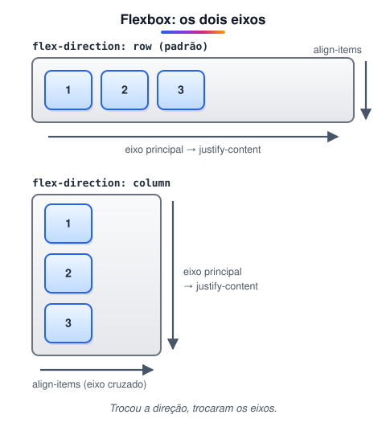
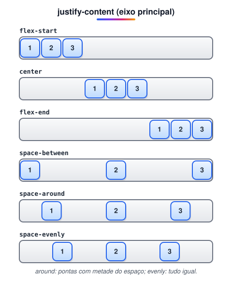
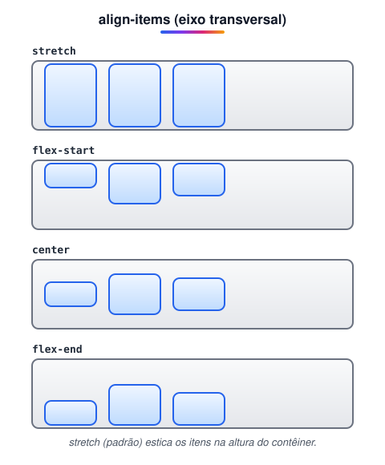

# Layout com Flexbox

> 🗺️ **Nesta aula:** o modelo Flexbox: contêiner e itens, os dois eixos, as propriedades de alinhamento e distribuição e um layout de página completo.

## De onde paramos

O projeto da aula anterior usou `display: flex` para colocar o menu em linha e o conteúdo ao lado da barra lateral. Agora vamos entender o que cada propriedade do Flexbox faz.

## O que é Flexbox?

**Flexbox é um modelo de layout em uma dimensão: ele organiza itens em uma linha OU em uma coluna, distribuindo o espaço e alinhando-os.** Antes dele, centralizar algo verticalmente ou fazer colunas de mesma altura exigia gambiarras com `float` e `position`.

São dois papéis:

- **Contêiner flex**: o pai, com `display: flex`.
- **Itens flex**: os **filhos diretos** dele (os netos não são afetados).

```css
.container { display: flex; }
```

## Os dois eixos

Tudo no Flexbox gira em torno de dois eixos:



> 💡 **Analogia:** o contêiner flex é uma prateleira e os itens são potes de tempero. O eixo principal é o comprimento da prateleira, onde os potes ficam um ao lado do outro; `justify-content` decide se eles se juntam num canto, no meio ou se espalham. O eixo transversal é a altura da prateleira; `align-items` decide se os potes encostam embaixo, no meio ou em cima. Virar a prateleira na vertical (`column`) troca os papéis.

> ⚠️ **Correção:** `justify-content` **não** é "alinhamento horizontal", e `align-items` **não** é "vertical". Eles atuam no eixo **principal** e no **transversal**, respectivamente. Com `flex-direction: column`, os papéis se invertem: `justify-content` passa a alinhar na vertical.

## Propriedades do contêiner

### `flex-direction`: a direção do eixo principal

```css
/* → esquerda para a direita (padrão) */
.container { flex-direction: row; }
/* ← direita para a esquerda */
.container { flex-direction: row-reverse; }
/* ↓ de cima para baixo */
.container { flex-direction: column; }
/* ↑ de baixo para cima */
.container { flex-direction: column-reverse; }
```

### `flex-wrap`: quebrar ou não a linha

```css
/* tudo numa linha, encolhendo (padrão) */
.container { flex-wrap: nowrap; }
/* quebra para a próxima linha quando não cabe */
.container { flex-wrap: wrap; }
/* quebra para cima */
.container { flex-wrap: wrap-reverse; }
```

### `justify-content`: distribuição no eixo principal



### `align-items`: alinhamento no eixo transversal



Há também `baseline`, que alinha os itens pela linha de base do texto (útil quando os itens têm fontes de tamanhos diferentes).

### `gap`: espaço entre os itens

```css
.container {
  display: flex;
  /* ou gap: 16px 24px; (linhas, colunas) */
  gap: 16px;
}
```

Prefira `gap` a margens nos itens: ele só aplica espaço **entre** os itens, nunca nas pontas.

### `align-content`

Só tem efeito com `flex-wrap: wrap` e **várias linhas**: distribui as linhas no eixo transversal (aceita os mesmos valores do `justify-content`).

## Propriedades dos itens

| Propriedade | Para que serve |
| --- | --- |
| `flex-grow` | quanto o item **cresce** para ocupar o espaço livre (0 = não cresce) |
| `flex-shrink` | quanto ele **encolhe** quando falta espaço (0 = não encolhe) |
| `flex-basis` | tamanho inicial antes de crescer ou encolher |
| `flex` | atalho: `flex: 1` cresce igual aos irmãos; `flex: 0 0 200px` fica fixo em 200px |
| `align-self` | sobrescreve o `align-items` só para aquele item |
| `order` | muda a ordem **visual** (leitores de tela seguem a ordem do HTML) |

```css
/* largura fixa */
.sidebar { flex: 0 0 250px; }
/* ocupa todo o resto */
.main { flex: 1; }
```

### Como o `flex-grow` divide o espaço

Num contêiner de 600px com três itens de 100px, sobram 300px. Com `flex-grow: 1`, `2` e `1`, a sobra é dividida em 4 partes de 75px: os itens ficam com 175px, 250px e 175px.

### Centralizar qualquer coisa

```css
.pai {
  display: flex;
  justify-content: center;
  align-items: center;
  min-height: 100vh;
}
```

## Projeto: layout de página com Flexbox

**Código**

```html
<!-- index.html -->
<!DOCTYPE html>
<html lang="pt-BR">
<head>
  <meta charset="UTF-8">
  <meta name="viewport"
    content="width=device-width, initial-scale=1.0">
  <title>Layout com Flexbox</title>
  <link rel="stylesheet" href="style.css">
</head>
<body>
  <div class="container">
    <header class="header">
      <h1>Menu superior</h1>
      <nav>
        <ul>
          <li><a href="#">Home</a></li>
          <li><a href="#">Sobre</a></li>
          <li><a href="#">Contato</a></li>
        </ul>
      </nav>
    </header>
    <div class="content">
      <aside class="sidebar">
        <h2>Menu lateral</h2>
        <ul>
          <li><a href="#">Item 1</a></li>
          <li><a href="#">Item 2</a></li>
          <li><a href="#">Item 3</a></li>
        </ul>
      </aside>
      <main class="main">
        <h2>Conteúdo principal</h2>
        <p>Lorem ipsum dolor sit amet.</p>
      </main>
    </div>
    <footer class="footer">
      <p>Rodapé</p>
    </footer>
  </div>
</body>
</html>
```

```css
/* style.css */
body { margin: 0; }

.container {
  display: flex;
  /* header, content e footer empilhados */
  flex-direction: column;
  /* no mínimo a altura da tela */
  min-height: 100vh;
}

.header { background-color: #ccc; padding: 20px; }

.content {
  /* sidebar e main lado a lado */
  display: flex;
  /* ocupa toda a altura que sobrar */
  flex: 1;
}

.sidebar {
  /* largura fixa de 200px */
  flex: 0 0 200px;
  background-color: #f2f2f2;
  padding: 20px;
}

.main {
  /* ocupa o restante da largura */
  flex: 1;
  background-color: #e0e0e0;
  padding: 20px;
}

.footer { background-color: #999; padding: 20px; }

ul { list-style: none; padding: 0; }
ul li a { text-decoration: none; color: #333; }
ul li a:hover { color: #ff0000; }
```

> 💡 **Ajustes:** `height: 100vh` virou `min-height: 100vh`, assim a página pode crescer se o conteúdo for maior que a tela. A sidebar usa `flex: 0 0 200px` para não encolher. E os títulos internos passaram de `<h1>` para `<h2>`, para manter um único `<h1>` por página.

## Exercício

Faça uma barra de navegação com o logo à esquerda e os links à direita, todos centralizados na vertical.

<details>
<summary>Ver resposta</summary>

```css
.barra {
  display: flex;
  justify-content: space-between;
  align-items: center;
  padding: 12px 20px;
}
.barra ul { display: flex; gap: 16px; }
```

O `space-between` empurra o logo e a lista para as pontas; o `align-items: center` centraliza na vertical.

</details>

## 🧠 Revisão rápida

**Com `flex-direction: column`, qual propriedade alinha os itens na horizontal?**

`align-items`, porque o eixo transversal passou a ser o horizontal.

**O que `flex: 1` faz num item?**

Faz o item crescer para ocupar o espaço livre, dividindo-o igualmente com os irmãos que também têm `flex: 1`.

**Por que preferir `gap` a margens nos itens?**

Porque o `gap` só põe espaço entre os itens, nunca nas pontas.

> ➡️ **Próximo passo:** quando o layout precisa de linhas **e** colunas ao mesmo tempo, a ferramenta é outra: **Layout com Grid**.

## 📌 Resumo

| Propriedade | Em uma frase |
| --- | --- |
| `display: flex` | transforma o pai em contêiner flex |
| `flex-direction` | define o eixo principal |
| `justify-content` | distribui no eixo principal |
| `align-items` | alinha no eixo transversal |
| `flex-wrap` | permite quebrar em várias linhas |
| `gap` | espaço só entre os itens |
| `flex` | crescer, encolher e tamanho base de um item |
