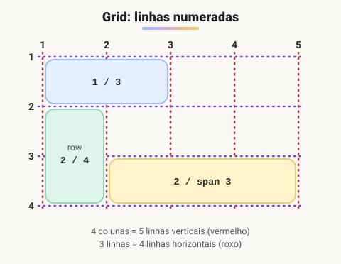
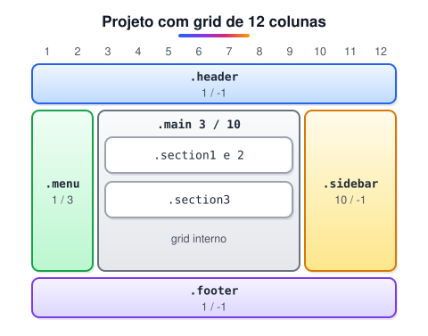

# Layout com Grid

> 🗺️ **Nesta aula:** o CSS Grid: criar a malha de linhas e colunas, a unidade `fr`, posicionar itens pelas linhas, desenhar o layout com `grid-template-areas` e um projeto de 12 colunas.

## De onde paramos

O Flexbox resolve uma direção por vez. Quando a página tem linhas **e** colunas ao mesmo tempo (cabeçalho em cima, três colunas no meio, rodapé embaixo), o Grid é a ferramenta certa.

## O que é CSS Grid?

**Grid é um modelo de layout em duas dimensões: você define linhas E colunas ao mesmo tempo e posiciona cada item nessa malha.** Enquanto o Flexbox organiza itens em uma linha ou coluna, o Grid controla a página inteira como uma tabela flexível.

| Use Flexbox quando... | Use Grid quando... |
| --- | --- |
| os itens seguem **uma direção** (menu, barra de botões) | o layout tem **linhas e colunas** (página, galeria, dashboard) |
| o tamanho vem do **conteúdo** | o tamanho vem da **estrutura** que você definiu |

Eles se combinam: é comum usar Grid na página e Flexbox dentro de cada bloco.

## Criando a malha

```css
.container {
  display: grid;
  /* 3 colunas */
  grid-template-columns: 200px 1fr 1fr;
  /* 3 linhas */
  grid-template-rows: auto 1fr auto;
  /* espaço entre células */
  gap: 16px;
}
```

### A unidade `fr`

`fr` (fração) divide o **espaço livre**. Em `1fr 2fr`, a segunda coluna fica com o dobro da primeira. É melhor que porcentagem porque já desconta o `gap`.

### `repeat()` e `minmax()`

```css
/* 12 colunas iguais */
grid-template-columns: repeat(12, 1fr);

/* galeria responsiva sem media query:
   quantas colunas de no mínimo 200px couberem */
grid-template-columns:
  repeat(auto-fit, minmax(200px, 1fr));
```

## Posicionando itens pelas linhas

As linhas da grade são numeradas a partir de 1. Uma grade de 4 colunas tem **5 linhas verticais**. Para posicionar um item, dizemos onde ele começa e onde termina:



```css
/* da linha 1 até a 3: ocupa 2 colunas */
.item-a { grid-column: 1 / 3; }
/* da linha horizontal 2 até a 4: 2 linhas */
.item-b { grid-row: 2 / 4; }
/* começa na 2 e ocupa 3 colunas */
.item-c { grid-column: 2 / span 3; }
/* -1 = a última linha: largura total */
.item-d { grid-column: 1 / -1; }
```

## `grid-template-areas`: o layout desenhado com nomes

Em vez de números, você nomeia as áreas e "desenha" o layout em texto:

```css
.pagina {
  display: grid;
  grid-template-columns: 200px 1fr 250px;
  grid-template-areas:
    "header header  header"
    "menu   main    sidebar"
    "footer footer  footer";
  gap: 16px;
}
.header  { grid-area: header; }
.menu    { grid-area: menu; }
.main    { grid-area: main; }
.sidebar { grid-area: sidebar; }
.footer  { grid-area: footer; }

/* no celular, basta redesenhar */
@media (max-width: 700px) {
  .pagina {
    grid-template-columns: 1fr;
    grid-template-areas:
      "header" "menu" "main" "sidebar" "footer";
  }
}
```

## Alinhamento

| Propriedade | Atua em |
| --- | --- |
| `justify-items` / `align-items` | todos os itens dentro das células (horizontal / vertical) |
| `justify-self` / `align-self` | um item só |
| `justify-content` / `align-content` | a grade inteira dentro do contêiner, quando sobra espaço |
| `place-items: center` | atalho para `align-items` e `justify-items` |

## Projeto: layout com grid de 12 colunas



**Código revisado**

```html
<!-- index.html -->
<!DOCTYPE html>
<html lang="pt-BR">
<head>
  <meta charset="UTF-8">
  <meta name="viewport"
    content="width=device-width, initial-scale=1.0">
  <title>Layout com Grid</title>
  <link rel="stylesheet" href="style.css">
</head>
<body>
  <div class="container">
    <header class="header">Cabeçalho</header>
    <nav class="menu">Menu</nav>
    <main class="main">
      <section class="section1">Seção 1</section>
      <section class="section2">Seção 2</section>
      <section class="section3">Seção 3</section>
    </main>
    <aside class="sidebar">Barra lateral</aside>
    <footer class="footer">Rodapé</footer>
  </div>
</body>
</html>
```

```css
/* style.css */
* { box-sizing: border-box; }

.container {
  display: grid;
  grid-template-columns: repeat(12, 1fr);
  gap: 10px;
  padding: 10px;
}

.container > * { padding: 16px; border-radius: 6px; }

.header  { grid-column: 1 / -1; background: #dbeafe; }
.menu    { grid-column: 1 / 3;  background: #dcfce7; }
.main    { grid-column: 3 / 10; background: #fef9c3; }
.sidebar { grid-column: 10 / -1; background: #f3f4f6; }
.footer  { grid-column: 1 / -1; background: #dbeafe; }

/* grid dentro do grid */
.main {
  display: grid;
  grid-template-columns: repeat(3, 1fr);
  gap: 10px;
}
.section1 { grid-column: 1 / 3; background: #fee2e2; }
.section2 { background: #e5e7eb; }
.section3 { grid-column: 1 / -1; background: #ede9fe; }

/* celular: tudo em uma coluna */
@media (max-width: 700px) {
  .container > *,
  .main > * { grid-column: 1 / -1; }
}
```

> ⚠️ **Correções no projeto original:** `grid-column: 4 / 4` na `section3` é inválido (começo e fim na mesma linha); o navegador descartava o valor, e agora ela usa `1 / -1`. A `sidebar` (9 / 13) se sobrepunha ao `main` (5 / 13); com as colunas redistribuídas (menu 1/3, main 3/10, sidebar 10/-1), nada se sobrepõe. E `grid-gap` é o nome antigo: o atual é `gap`, que também funciona no Flexbox.

## Exercício

Monte uma galeria de cards que mostre quantas colunas de pelo menos 180px couberem, com 12px de espaço, sem usar media query.

<details>
<summary>Ver resposta</summary>

```css
.galeria {
  display: grid;
  grid-template-columns:
    repeat(auto-fit, minmax(180px, 1fr));
  gap: 12px;
}
```

O `auto-fit` cria quantas colunas couberem, e o `minmax` garante que nenhuma fique menor que 180px.

</details>

## 🧠 Revisão rápida

**Uma grade de 3 colunas tem quantas linhas verticais?**

Quatro: a numeração é das linhas, não das células.

**O que significa `grid-column: 1 / -1`?**

Ocupar da primeira à última linha: a largura total da grade.

**Qual a vantagem de `fr` sobre porcentagem?**

O `fr` divide só o espaço livre, já descontando o `gap`.

> ➡️ **Próximo passo:** quando elementos se sobrepõem, quem fica na frente? E o que fazer quando o conteúdo não cabe? Veja em **Ordem de pilha de elementos**.

## 📌 Resumo

| Item | Em uma frase |
| --- | --- |
| `display: grid` | cria a malha de linhas e colunas |
| `grid-template-columns` | define as colunas (ex.: `repeat(12, 1fr)`) |
| `fr` | fração do espaço livre |
| `grid-column` / `grid-row` | posiciona pelos números das linhas |
| `grid-template-areas` | desenha o layout com nomes |
| `auto-fit` e `minmax` | grade responsiva sem media query |
