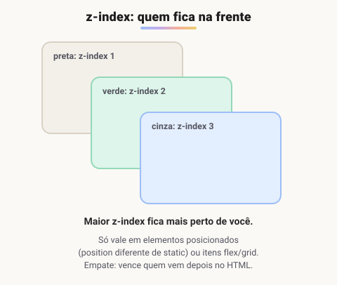
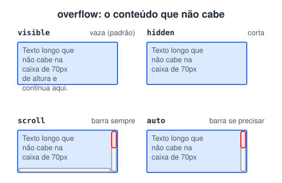

# Ordem de pilha de elementos

> 🗺️ **Nesta aula:** quem fica na frente quando elementos se sobrepõem (`z-index` e contexto de empilhamento) e o que fazer com o conteúdo que não cabe na caixa (`overflow`).

## De onde paramos

Com `position: absolute` e com Grid, dois elementos podem ocupar o mesmo lugar. A página, então, ganha uma terceira dimensão: a profundidade. E caixas de tamanho fixo levantam outra questão: o que acontece com o texto que não cabe nelas?

## Ordem de pilha (`z-index`)

A página tem três dimensões: largura (x), altura (y) e **profundidade (z)**. Quando dois elementos ocupam o mesmo lugar, o `z-index` decide **quem fica na frente**: o valor maior fica por cima.



### Regras importantes

1. **Só funciona em elementos posicionados** (`position` diferente de `static`) **ou em itens de Flexbox/Grid**. Num `<div>` comum, `z-index` não faz nada.
2. **Sem z-index, vale a ordem do HTML**: quem vem depois aparece na frente.
3. **Empate**: com o mesmo z-index, também vence quem vem depois.
4. **Aceita negativos**: `z-index: -1` manda o elemento para trás do conteúdo normal do pai.

### Contexto de empilhamento (o motivo do "meu z-index: 9999 não funciona")

Um elemento com `position` e `z-index`, `opacity` menor que 1, `transform` ou `filter` cria um **contexto de empilhamento**. Os filhos dele só disputam posição **entre si**, nunca com elementos de fora.

```css
.pai-a { position: relative; z-index: 1; }
.pai-b { position: relative; z-index: 2; }

.pai-a .modal { position: absolute; z-index: 9999; }
/* o modal continua ATRÁS do .pai-b:
   está "preso" no contexto do .pai-a */
```

A solução é subir o z-index do **ancestral** ou mover o elemento (por exemplo, colocar o modal direto no `<body>`).

## Transbordamento (`overflow`)

Quando o conteúdo é maior que a caixa (que tem altura ou largura fixa), o `overflow` define o que acontece com o excesso:



| Valor | Comportamento |
| --- | --- |
| `visible` | padrão: o conteúdo vaza para fora da caixa |
| `hidden` | corta o excesso (ainda dá para rolar via JavaScript) |
| `clip` | corta e **proíbe** qualquer rolagem |
| `scroll` | mostra barras de rolagem sempre, mesmo sem necessidade |
| `auto` | mostra barras **só quando precisa**, e costuma ser a melhor escolha |

Também dá para controlar cada eixo: `overflow-x` e `overflow-y`.

```css
/* rolagem lateral em tabelas no celular */
.tabela-larga { overflow-x: auto; }

/* "Um texto muito lo..." */
.texto-curto {
  white-space: nowrap;
  overflow: hidden;
  text-overflow: ellipsis;
}
```

## Projeto

**Código revisado**

```html
<!-- index.html -->
<!DOCTYPE html>
<html lang="pt-BR">
<head>
  <meta charset="UTF-8">
  <meta name="viewport"
    content="width=device-width, initial-scale=1.0">
  <title>Ordem de pilha e overflow</title>
  <link rel="stylesheet" href="style.css">
</head>
<body>
  <div class="palco">
    <div class="caixa preta">Preta (1)</div>
    <div class="caixa verde">Verde (2)</div>
    <div class="caixa cinza">Cinza (3)</div>
  </div>

  <div class="texto">
    Lorem ipsum dolor sit amet, consectetur
    adipiscing elit. Nullam eu dui eget justo
    convallis eleifend. Sed vitae arcu vel nunc.
  </div>
</body>
</html>
```

```css
/* style.css */
.palco {
  position: relative;
  height: 220px;
}

.caixa {
  position: absolute;
  width: 150px;
  height: 100px;
  padding: 8px;
  color: white;
}
.preta { background: black;
         top: 0; left: 0; z-index: 1; }
.verde { background: green;
         top: 40px; left: 60px; z-index: 2; }
.cinza { background: gray;
         top: 80px; left: 120px; z-index: 3; }

.texto {
  width: 200px;
  height: 80px;
  border: 2px solid red;
  /* troque por visible, hidden, clip e scroll */
  overflow: auto;
}
```

**Experimente:** dê `z-index: 10` à preta e veja ela passar para a frente.

> ⚠️ **Correção:** as anotações diziam que o `z-index` só funciona com `position`. Ele **também funciona em itens flex e grid**, mesmo sem `position`. O `lang="en"` do projeto também virou `pt-BR`.

## 🧠 Revisão rápida

**Duas caixas sem `z-index` se sobrepõem. Qual fica na frente?**

A que vem depois no HTML.

**Por que um modal com `z-index: 9999` pode ficar atrás de outro elemento?**

Porque está dentro de um contexto de empilhamento de um ancestral com z-index menor.

**Qual valor de `overflow` mostra barra de rolagem só quando é necessário?**

`auto`.

> ➡️ **Próximo passo:** o layout está pronto; agora o conteúdo de texto. Começamos pela tipografia: **Fontes**.

## 📌 Resumo

| Item | Em uma frase |
| --- | --- |
| `z-index` | maior valor fica na frente |
| Requisito | elemento posicionado ou item flex/grid |
| Empate | vence quem vem depois no HTML |
| Contexto de empilhamento | filhos só competem entre si |
| `overflow` | visible, hidden, clip, scroll ou auto |
| `text-overflow: ellipsis` | corta com reticências |
