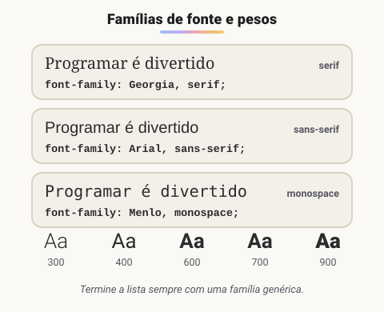

# Fontes

> 🗺️ **Nesta aula:** escolher e carregar fontes (famílias genéricas, Google Fonts, `@font-face`) e controlar tamanho, peso, estilo e altura da linha.

## De onde paramos

Com o layout montado, falta cuidar do que mais aparece numa página: o texto. A tipografia define boa parte da "cara" de um site e, principalmente, a facilidade de leitura.

## Tipografia na web

O CSS tem um grupo de propriedades `font-*` para controlar a aparência do texto.



> 💡 **Analogia:** a fonte é a "voz" do texto. Serifada soa como um livro impresso ou um jornal; sem serifa soa como uma placa de aeroporto, limpa e direta; monoespaçada soa como uma máquina de escrever. A lista do `font-family` é como pedir um prato com substitutos: "se não tiver Inter, serve Arial; se não tiver nenhuma, qualquer sem serifa".

## `font-family`

Recebe uma **lista de fontes em ordem de preferência**. O navegador usa a primeira que estiver disponível; por isso, a lista termina sempre com uma **família genérica**.

```css
body {
  font-family: "Inter", Arial, Helvetica, sans-serif;
}
```

| Família genérica | Característica | Uso típico |
| --- | --- | --- |
| `serif` | tem "pezinhos" (serifas) | textos longos, sites editoriais |
| `sans-serif` | sem serifas | interfaces e a maioria dos sites |
| `monospace` | todos os caracteres com a mesma largura | código |
| `cursive` / `fantasy` | decorativas | títulos pontuais |
| `system-ui` | a fonte do sistema do usuário | interfaces com cara de app nativo |

Nomes com espaço vão entre aspas: `"Times New Roman"`.

## Usando fontes externas

### Google Fonts (o jeito mais rápido)

1. Escolha a fonte em fonts.google.com e os pesos que vai usar.
2. Copie os `<link>` para o `<head>`:

```html
<link rel="preconnect"
  href="https://fonts.googleapis.com">
<link rel="preconnect"
  href="https://fonts.gstatic.com" crossorigin>
<link rel="stylesheet"
  href="https://fonts.googleapis.com/css2?family=Inter:wght@400;700&display=swap">
```

3. Use no CSS: `font-family: "Inter", sans-serif;`

### `@font-face` (arquivos próprios)

```css
@font-face {
  font-family: "MinhaFonte";
  src: url("fontes/minha-fonte.woff2")
       format("woff2");
  font-weight: 400;
  /* mostra uma fonte reserva enquanto carrega */
  font-display: swap;
}
```

Prefira o formato **WOFF2**: é o mais leve e é aceito por todos os navegadores atuais.

## Tamanho, peso, estilo e espaçamento

```css
p {
  /* rem respeita o tamanho que o usuário configurou */
  font-size: 1rem;
  /* 100 a 900; normal = 400, bold = 700 */
  font-weight: 400;
  /* normal | italic | oblique */
  font-style: italic;
  /* sem unidade = multiplica o font-size */
  line-height: 1.5;
  /* espaço entre letras */
  letter-spacing: 0.02em;
}
```

- `line-height` **entre 1.4 e 1.6** deixa textos longos bem mais fáceis de ler.
- Um `font-weight` só aparece de verdade se a fonte tiver aquele peso. Caso contrário, o navegador "força" um negrito artificial.

### O atalho `font`

```css
/* estilo peso tamanho/altura-da-linha família */
h1 { font: italic 700 2rem/1.2 "Inter", sans-serif; }
```

O tamanho e a família são **obrigatórios** no atalho, e as propriedades omitidas voltam ao valor padrão.

## Boas práticas

- Use no máximo **duas famílias**: uma para títulos e outra para texto.
- Carregue **só os pesos que usa**: cada peso é um arquivo a mais para baixar.
- Defina a fonte no `body` e deixe a herança fazer o resto.

## 🧠 Revisão rápida

**Por que terminar o `font-family` com uma família genérica?**

Para que o navegador tenha uma opção caso nenhuma das fontes listadas esteja disponível.

**Qual formato de arquivo de fonte preferir?**

WOFF2, o mais leve e aceito por todos os navegadores atuais.

**O que significa `line-height: 1.5` sem unidade?**

Que a altura da linha é 1,5 vez o tamanho da fonte do próprio elemento.

> ➡️ **Próximo passo:** com a fonte escolhida, falta posicionar o texto dentro das caixas: **Alinhamento de Texto**.

## 📌 Resumo

| Item | Em uma frase |
| --- | --- |
| `font-family` | lista de fontes em ordem de preferência |
| Família genérica | serif, sans-serif ou monospace no fim da lista |
| Google Fonts | fontes prontas via `<link>` |
| `@font-face` | carrega arquivos de fonte próprios (WOFF2) |
| `font-size` em rem | respeita o tamanho escolhido pelo usuário |
| `line-height` | de 1.4 a 1.6 para textos longos |
