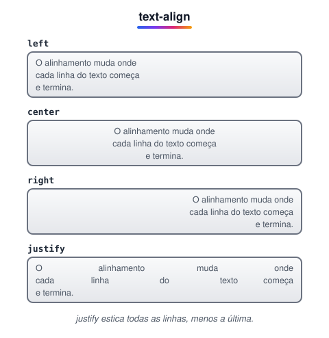

# Alinhamento de Texto

> 🗺️ **Nesta aula:** alinhar texto na horizontal (`text-align`) e na vertical (`vertical-align`), decorar com sublinhados e transformar maiúsculas e minúsculas.

## De onde paramos

A aula anterior escolheu a fonte e o tamanho. Agora o texto precisa ser posicionado dentro da caixa e, às vezes, decorado: links sem sublinhado, títulos em maiúsculas, um ícone alinhado ao meio da frase.

## Alinhamento horizontal: `text-align`

Alinha o **conteúdo em linha** (texto, imagens, links) dentro de um elemento de bloco.



> 💡 **Analogia:** é o mesmo botão de alinhamento de um editor de texto como o Word: esquerda, centro, direita e justificado. Ele mexe nas palavras dentro da folha, não na folha em cima da mesa; para mover a "folha" (a caixa), usa-se margem, Flexbox ou Grid.

```css
/* esquerda (padrão em português) */
p { text-align: left; }
/* centralizado */
p { text-align: center; }
/* direita */
p { text-align: right; }
/* justificado */
p { text-align: justify; }
```

Os valores `start` e `end` são a versão "inteligente" de left e right: eles se adaptam a idiomas escritos da direita para a esquerda, como árabe e hebraico.

> 💡 `text-align: center` centraliza o **conteúdo** de um bloco, não o bloco em si. Para centralizar uma caixa na página use `margin: 0 auto` (com largura definida) ou Flexbox/Grid.

## Alinhamento vertical: `vertical-align`

**Só funciona em elementos inline, inline-block e células de tabela.** Num `<div>` ou `<p>` comum ele não tem efeito; para isso, use Flexbox ou Grid.

| Valor | O que faz |
| --- | --- |
| `baseline` | alinha pela linha de base do texto (padrão) |
| `top` / `bottom` | alinha pelo topo / pela base da linha inteira |
| `middle` | alinha o meio do elemento com o meio das letras minúsculas |
| `text-top` / `text-bottom` | alinha pelo topo / pela base da fonte do pai |
| `sub` | desce o elemento como **subscrito** (o "2" em H₂O) |
| `super` | sobe o elemento como **sobrescrito** (o "2" em x²) |

```css
/* ícone alinhado ao meio do texto */
img.icone { vertical-align: middle; }
/* conteúdo da célula no topo */
td { vertical-align: top; }
```

## Decoração de texto: `text-decoration`

Ela é composta por várias partes, e o **estilo só aparece se houver uma linha definida**:

```css
a {
  /* none | underline | overline | line-through */
  text-decoration-line: underline;
  /* solid | double | dotted | dashed | wavy */
  text-decoration-style: dashed;
  text-decoration-color: tomato;
  text-decoration-thickness: 2px;
}

/* atalho */
a { text-decoration: underline dashed tomato; }

/* o uso mais comum: tirar o sublinhado dos links */
nav a { text-decoration: none; }
```

| Estilo | Aparência |
| --- | --- |
| `solid` | linha contínua |
| `double` | linha dupla |
| `dotted` | **pontilhada** (pontos) |
| `dashed` | **tracejada** (traços) |
| `wavy` | ondulada |

## Outras propriedades úteis

```css
/* uppercase | lowercase | capitalize */
h2 { text-transform: uppercase; }
/* recuo da primeira linha */
p { text-indent: 2em; }
/* sombra: x y desfoque cor */
h1 { text-shadow: 2px 2px 4px rgba(0,0,0,.3); }
```

> ⚠️ **Correções:** `vertical-align: justify` não existe (`justify` é valor de `text-align`). As descrições de `sub` e `super` estavam trocadas: `sub` desce (subscrito) e `super` sobe (sobrescrito). Faltava avisar que `vertical-align` só funciona em elementos inline e células de tabela, o motivo de ele "não funcionar" em divs. `dashed` é **tracejada**, não pontilhada (pontilhada é `dotted`). E `text-decoration-style` sozinho não tem efeito: precisa de uma `text-decoration-line`.

## 🧠 Revisão rápida

**Como centralizar uma `div` de 300px na página?**

Com `margin: 0 auto` (ou Flexbox/Grid no pai); `text-align: center` centraliza só o conteúdo.

**Por que `vertical-align: middle` não funciona numa `div`?**

Porque só vale para elementos inline, inline-block e células de tabela.

**Como tirar o sublinhado de um link?**

`text-decoration: none`.

> ➡️ **Próximo passo:** listas aparecem em quase todo site (menus, características, passos). Veja como estilizá-las em **Formatação de listas**.

## 📌 Resumo

| Propriedade | Em uma frase |
| --- | --- |
| `text-align` | alinha o conteúdo em linha na horizontal |
| `vertical-align` | alinha elementos inline e células na vertical |
| `text-decoration` | sublinhado, riscado, cor e estilo da linha |
| `text-transform` | maiúsculas, minúsculas ou capitalizado |
| `text-indent` | recuo da primeira linha |
| `text-shadow` | sombra no texto |
