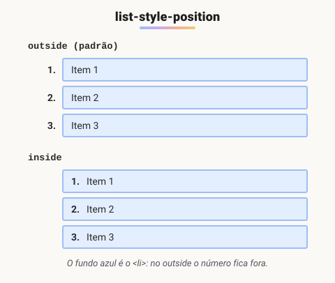

# Formatação de listas

> 🗺️ **Nesta aula:** mudar o tipo e a posição dos marcadores de listas, usar imagens e emojis como marcadores e zerar o estilo para fazer menus.

## De onde paramos

As aulas de fonte e alinhamento trataram do texto corrido. As listas têm um elemento a mais: o marcador. Ele pode virar número romano, ícone, emoji ou sumir de vez, como nos menus de navegação.

## Estilizando listas

As listas `<ul>` (não ordenada) e `<ol>` (ordenada) vêm com marcadores, recuo e margens padrão. O CSS permite mudar o tipo de marcador, a posição dele ou trocar por uma imagem.

## `list-style-type`: o tipo de marcador

| Valor | Marcador | Normalmente em |
| --- | --- | --- |
| `disc` | ● círculo cheio (padrão do `ul`) | `ul` |
| `circle` | ○ círculo vazado | `ul` |
| `square` | ■ quadrado **cheio** | `ul` |
| `decimal` | 1, 2, 3 (padrão do `ol`) | `ol` |
| `decimal-leading-zero` | 01, 02, 03 | `ol` |
| `lower-alpha` / `upper-alpha` | a, b, c / A, B, C | `ol` |
| `lower-roman` / `upper-roman` | i, ii, iii / I, II, III | `ol` |
| `none` | sem marcador | menus de navegação |

## `list-style-position`: onde fica o marcador



Com `outside`, as linhas quebradas ficam alinhadas com o texto, o que é melhor para leitura. Use `inside` quando o item tiver fundo ou borda e você quiser o marcador dentro deles.

## `list-style-image` e o atalho

```css
ul { list-style-image: url("icone-check.svg"); }

/* atalho: tipo posição imagem */
ul { list-style: square inside; }

/* zerar tudo, muito usado em menus */
nav ul {
  list-style: none;
  margin: 0;
  padding: 0;
}
```

## `::marker`: estilizando só o marcador

```css
li::marker {
  color: #2563eb;
  font-weight: bold;
}

/* marcador com qualquer texto ou emoji */
.tarefas li::marker { content: "✅ "; }
```

`::marker` aceita poucas propriedades (cor, fonte, `content`), mas resolve a maior parte dos casos sem gambiarras.

## Projeto

**Código revisado**

```html
<!-- index.html -->
<!DOCTYPE html>
<html lang="pt-BR">
<head>
  <meta charset="UTF-8">
  <meta name="viewport"
    content="width=device-width, initial-scale=1.0">
  <title>Formatação de listas</title>
  <link rel="stylesheet" href="style.css">
</head>
<body>
  <h2>Lista não ordenada</h2>
  <ul class="quadrado">
    <li>Item 1</li>
    <li>Item 2</li>
    <li>Item 3</li>
  </ul>

  <h2>Lista ordenada com romanos</h2>
  <ol class="romanos">
    <li>Item 1</li>
    <li>Item 2</li>
    <li>Item 3</li>
  </ol>

  <h2>Marcador personalizado</h2>
  <ul class="tarefas">
    <li>Estudar CSS</li>
    <li>Fazer o projeto</li>
  </ul>
</body>
</html>
```

```css
/* style.css */
.quadrado { list-style: square inside; }
.quadrado li {
  background: #dbeafe;
  margin-bottom: 4px;
}

.romanos { list-style-type: upper-roman; }
.romanos li::marker {
  color: #7c3aed;
  font-weight: bold;
}

.tarefas { list-style: none; padding-left: 0; }
.tarefas li::before { content: "✅ "; }
```

> ⚠️ **Correções:** `square` é um quadrado **cheio**, não "vazado" (o vazado é o `circle`). O `lang="en"` do projeto virou `pt-BR`.

## 🧠 Revisão rápida

**Como tirar os marcadores e o recuo de uma lista de menu?**

`list-style: none; margin: 0; padding: 0;`

**Qual a diferença entre `outside` e `inside`?**

No `outside` o marcador fica fora da caixa do item; no `inside`, dentro, junto do texto.

**Como deixar só os números de uma lista ordenada em roxo?**

Com `li::marker { color: purple; }`.

> ➡️ **Próximo passo:** para fechar o módulo, um projeto que junta HTML e CSS num formulário estilizado: **Projeto exemplo de criação de formulários**.

## 📌 Resumo

| Propriedade | Em uma frase |
| --- | --- |
| `list-style-type` | tipo do marcador (disc, square, decimal, roman...) |
| `list-style-position` | marcador fora (outside) ou dentro (inside) |
| `list-style-image` | imagem como marcador |
| `list-style: none` | sem marcador, comum em menus |
| `::marker` | estiliza só o marcador |
