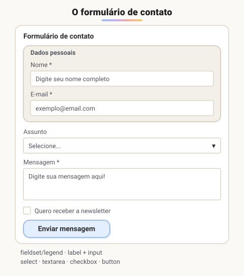

# Projeto exemplo de criação de formulários

> 🗺️ **Nesta aula:** um projeto completo de formulário de contato, com agrupamento de campos, validação nativa e estilo com CSS, revisando tudo do módulo.

## De onde paramos

No módulo III você viu as tags de formulário (`form`, `label`, `input`, `select`, `textarea`). Agora, com o CSS do módulo IV e o layout do módulo V, dá para transformar esses campos num formulário bonito e fácil de usar.

## Revisão rápida das peças

| Peça | Papel |
| --- | --- |
| `<form action method>` | para onde e como os dados vão (`get` na URL, `post` no corpo) |
| `name` | a "chave" do valor enviado; sem ele, o campo não é enviado |
| `<label for>` | rótulo ligado ao `id` do campo |
| `type` do input | email, password, number, tel, date, checkbox, radio... |
| `required`, `minlength`, `pattern` | validação nativa antes do envio |
| `<fieldset>` e `<legend>` | agrupam campos relacionados, com título |

> ⚠️ A validação do navegador melhora a experiência, mas **não é segurança**: qualquer pessoa consegue desativá-la. O servidor sempre precisa validar os dados de novo.

## Estilizando formulários

```css
/* campos ocupam a largura toda e herdam a fonte */
input, select, textarea {
  width: 100%;
  padding: 8px;
  font: inherit;
  box-sizing: border-box;
}

/* foco visível: essencial para quem usa teclado */
input:focus, textarea:focus {
  outline: 2px solid #2563eb;
}

/* reage à validação, depois que o usuário digitou */
input:invalid:not(:placeholder-shown) {
  border-color: red;
}
input:valid { border-color: green; }
```

- `font: inherit` é importante: por padrão, campos de formulário **não herdam** a fonte da página.
- Nunca remova o `outline` do foco sem colocar outro destaque no lugar.

## Projeto: formulário de contato



> 💡 **Analogia:** o `fieldset` é como uma moldura num formulário de papel com o título "Dados pessoais" no canto: ele junta os campos que andam juntos. A validação do navegador é o atendente que confere a ficha no balcão antes de aceitá-la; o servidor é o setor que confere tudo de novo, porque não dá para confiar só no balcão.

**Código revisado**

```html
<!-- index.html -->
<!DOCTYPE html>
<html lang="pt-BR">
<head>
  <meta charset="UTF-8">
  <meta name="viewport"
    content="width=device-width, initial-scale=1.0">
  <title>Formulário de contato</title>
  <link rel="stylesheet" href="style.css">
</head>
<body>
  <h1>Formulário de contato:</h1>

  <form action="/contato" method="post">
    <fieldset>
      <legend>Dados pessoais</legend>

      <div class="campo">
        <label for="nome" class="obrigatorio">
          Nome:</label>
        <input type="text" id="nome" name="nome"
          placeholder="Digite seu nome completo"
          required>
      </div>

      <div class="campo">
        <label for="email" class="obrigatorio">
          E-mail:</label>
        <input type="email" id="email" name="email"
          placeholder="exemplo@email.com" required>
      </div>
    </fieldset>

    <div class="campo">
      <label for="assunto">Assunto:</label>
      <select id="assunto" name="assunto">
        <option value="" disabled selected>
          Selecione...</option>
        <option value="duvida">Dúvida</option>
        <option value="elogio">Elogio</option>
        <option value="sugestao">Sugestão</option>
      </select>
    </div>

    <div class="campo">
      <label for="mensagem" class="obrigatorio">
        Mensagem:</label>
      <textarea id="mensagem" name="mensagem"
        rows="6" required
        placeholder="Digite sua mensagem aqui!">
      </textarea>
    </div>

    <div class="campo">
      <input type="checkbox" id="newsletter"
        name="newsletter">
      <label for="newsletter">
        Desejo receber a newsletter</label>
    </div>

    <button type="submit">Enviar mensagem</button>
  </form>
</body>
</html>
```

```css
/* style.css */
body {
  font-family: Arial, sans-serif;
  max-width: 720px;
  margin: 20px auto;
  padding: 0 16px;
}

h1 { text-shadow: 2px 2px 3px #7db8b8; }

fieldset {
  background: #eee;
  border: 3px solid #aaa;
  margin-bottom: 16px;
}
legend {
  font-weight: bold;
  color: #043a3a;
  text-transform: uppercase;
}

.campo { margin: 12px 0; }
.campo label {
  display: inline-block;
  min-width: 100px;
  font-weight: bold;
}

.obrigatorio { color: #eb6363; }
.obrigatorio::after { content: "*"; }

input[type="text"], input[type="email"],
select, textarea {
  width: 100%;
  padding: 6px;
  box-sizing: border-box;
  font: inherit;
}

button { padding: 8px 16px; cursor: pointer; }
```

> ⚠️ **Correções no projeto original:** `title>` estava sem o `<` de abertura, o que quebrava o título da aba. `label for="Email"` não se ligava ao campo `id="email"`, porque `for`/`id` diferenciam maiúsculas de minúsculas. O título da página dizia "tabelas", herdado da aula anterior. A primeira opção vazia do `<select>` virou "Selecione..." desabilitada, o `<input type="submit">` virou `<button type="submit">`, e os campos ganharam `name` (sem ele, o valor nem é enviado) e `required` nos obrigatórios.

## Exercício

Acrescente ao formulário um campo de telefone opcional que aceite só o formato `(11) 91234-5678`.

<details>
<summary>Ver resposta</summary>

```html
<div class="campo">
  <label for="telefone">Telefone:</label>
  <input type="tel" id="telefone" name="telefone"
    placeholder="(11) 91234-5678"
    pattern="\(\d{2}\) \d{5}-\d{4}">
</div>
```

O `type="tel"` abre o teclado numérico no celular, e o `pattern` valida o formato. Sem `required`, o campo pode ficar vazio.

</details>

## 🧠 Revisão rápida

**Um campo sem `name` é enviado?**

Não: o `name` é a chave do valor na requisição.

**Por que usar `font: inherit` nos campos?**

Porque campos de formulário não herdam a fonte da página por padrão.

**A validação com `required` e `pattern` protege o servidor?**

Não: ela melhora a experiência, mas o servidor precisa validar de novo.

> ➡️ **Próximo passo:** fim do módulo V. Antes do JavaScript, uma ferramenta indispensável para guardar e compartilhar todo esse código: o Git, a partir da **Introdução** do módulo VI.

## 📌 Resumo

| Item | Em uma frase |
| --- | --- |
| `fieldset` e `legend` | agrupam e dão título a campos relacionados |
| `name` | obrigatório para o campo ser enviado |
| Validação nativa | required, minlength, pattern, type |
| `:invalid` / `:valid` | CSS que reage à validação |
| `font: inherit` | campos herdam a fonte da página |
| Foco visível | nunca remova o outline sem substituto |
