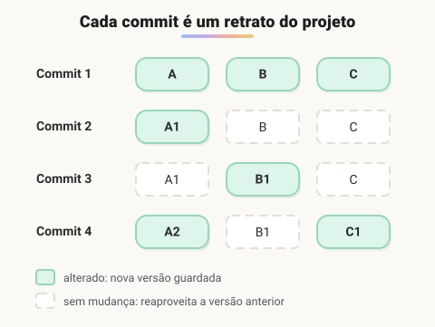

# Introdução

> 🗺️ **Nesta aula:** o que é o Git, como ele guarda o histórico, a configuração inicial e o fluxo básico `status → add → commit → log`.

## De onde paramos

Nos módulos III a V você escreveu muitos arquivos HTML e CSS. Imagine perder uma versão que funcionava, ou duas pessoas editando o mesmo arquivo ao mesmo tempo. O Git resolve isso, e é a ferramenta que todo time usa, inclusive para os projetos de JavaScript e Node dos próximos módulos.

## O que é Git

**Git é um sistema de controle de versão distribuído: ele registra cada alteração dos arquivos de um projeto, para que você possa ver o histórico, voltar no tempo e trabalhar em equipe sem um sobrescrever o trabalho do outro.** Foi criado em 2005 por Linus Torvalds para o desenvolvimento do kernel Linux e hoje é o padrão da indústria.

Os conceitos centrais:

- **Repositório**: a pasta do projeto mais a pasta oculta `.git`, onde fica todo o histórico.
- **Commit**: um "retrato" do projeto em um momento, com autor, data, mensagem e um identificador único (hash).
- **Branch**: uma linha de desenvolvimento independente. A principal costuma se chamar `main`.
- **Remoto**: uma cópia do repositório em um servidor (GitHub, GitLab, Bitbucket), usada para compartilhar o código com `push` e `pull`.

### Por que "distribuído"?

Cada pessoa tem uma **cópia completa** do repositório, com todo o histórico, no próprio computador. Isso permite trabalhar offline, fazer commits sem internet e recuperar o projeto mesmo se o servidor sair do ar.

> 💡 **Git ≠ GitHub.** Git é a ferramenta que roda no seu computador. GitHub é um site que hospeda repositórios Git e adiciona recursos de colaboração (pull requests, issues, Actions).

## Como o Git guarda o histórico



> 💡 **Analogia:** o Git funciona como um álbum de fotos do projeto. Cada commit é uma foto tirada num momento, com data e legenda. Você pode folhear o álbum e voltar a qualquer foto. E o álbum é econômico: se um arquivo não mudou desde a foto anterior, a nova foto só aponta para a versão que já estava guardada.

## Links úteis

Documentação oficial do Git (em português)

🔗 [Git - git Documentation](https://git-scm.com/docs/git/pt_BR)

Download do Git

🔗 [Git - Downloads](https://git-scm.com/downloads)

GitHub Desktop (interface gráfica)

🔗 [GitHub Desktop](https://desktop.github.com/)

## Configuração inicial (uma vez por computador)

```bash
# Abra o terminal (no Windows, o Git Bash)

# Seu nome e e-mail aparecem em todos os commits
git config --global user.name "Seu Nome"
git config --global user.email "seu-email@exemplo.com"

# Nome da branch criada pelo git init
git config --global init.defaultBranch main

# Conferir as configurações
git config --list
```

Use no `user.email` o mesmo e-mail da sua conta no GitHub, para que os commits fiquem associados ao seu perfil.

## Iniciando um repositório

```bash
# entre na pasta do projeto
cd caminho/do/projeto
# cria a pasta oculta .git:
# daqui em diante o Git rastreia o projeto
git init
```

Ou, para baixar um repositório que já existe:

```bash
git clone https://github.com/usuario/projeto.git
```

## O fluxo do dia a dia

```bash
# o que mudou?
git status
# prepara um arquivo (git add . = todos)
git add index.html
git commit -m "Adiciona página inicial"
# histórico resumido
git log --oneline
```

Um exemplo de saída do `git log --oneline`:

```
a1b2c3d Adiciona página inicial
9f8e7d6 Cria estrutura do projeto
```

Cada linha é um commit: à esquerda, o começo do hash; à direita, a mensagem.

## 🧠 Revisão rápida

**Qual a diferença entre Git e GitHub?**

Git é a ferramenta de controle de versão; GitHub é um site que hospeda repositórios Git e adiciona colaboração.

**O que o `git init` cria?**

A pasta oculta `.git`, onde o histórico do projeto passa a ser guardado.

**Por que configurar `user.email` com o e-mail do GitHub?**

Para que os commits apareçam ligados ao seu perfil.

> ➡️ **Próximo passo:** o `git add` e o `git commit` movem arquivos entre estados. Entenda esse ciclo e as branches em **Ciclo de vida dos commits e branches**.

## 📌 Resumo

| Item | Em uma frase |
| --- | --- |
| Git | controle de versão distribuído |
| Repositório | a pasta do projeto com o `.git` |
| Commit | retrato do projeto com autor, data e hash |
| Branch | linha de desenvolvimento independente |
| `git config` | nome e e-mail dos seus commits |
| `git init` / `git clone` | cria / baixa um repositório |
| Fluxo | status, add, commit, log |
