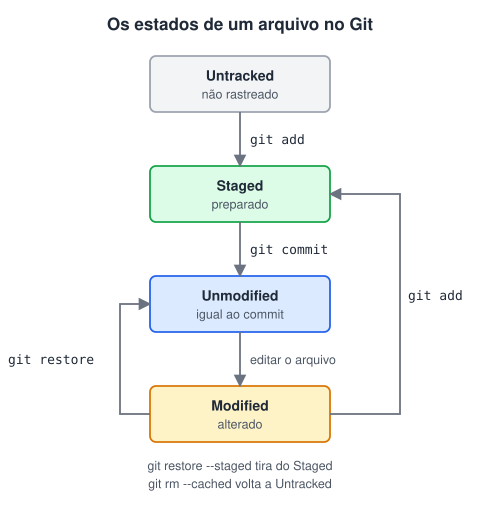
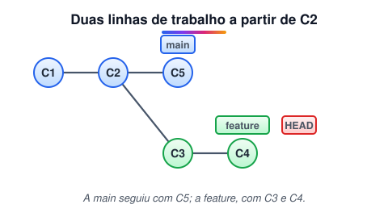

# Ciclo de vida dos commits e branches

> 🗺️ **Nesta aula:** os quatro estados de um arquivo no Git, a staging area e o que são branches, com os comandos para criar, trocar, renomear e excluir.

## De onde paramos

Na aula anterior você usou `git add` e `git commit` sem pensar no que acontecia por dentro. Entender os estados de um arquivo explica o que o `git status` mostra e por que existe uma etapa entre editar e salvar no histórico.

## Os 4 estados de um arquivo

Para o Git, todo arquivo do projeto está em um destes estados:

1. **Untracked (não rastreado)**: arquivo novo que o Git ainda não acompanha. Ele não entra em commits até ser adicionado com `git add`.
2. **Staged (preparado)**: alteração adicionada à **staging area** (também chamada de *index*), que vai entrar no próximo commit.
3. **Unmodified (não modificado)**: arquivo rastreado e idêntico ao último commit.
4. **Modified (modificado)**: arquivo rastreado que foi alterado desde o último commit, mas ainda não foi preparado.



> 💡 **Analogia:** a staging area é como o balcão dos Correios. Você edita várias cartas na sua mesa (modified), escolhe quais vão no próximo envio e as coloca no balcão (`git add`, staged), e só então o atendente sela o pacote (`git commit`). O que ficou na mesa vai num envio futuro.

A staging area existe para você **escolher** o que entra em cada commit. Se mexeu em cinco arquivos mas só três são da mesma tarefa, adicione só esses três e faça um commit com uma mensagem clara.

```bash
# mostra o estado de cada arquivo
git status
# resumido: ?? untracked, M modified, A added
git status -s
```

## Branches

**Uma branch é uma linha de desenvolvimento independente.** Você cria uma branch para desenvolver uma funcionalidade ou corrigir um bug sem mexer na `main`, que deve ficar sempre estável. Quando o trabalho fica pronto, a branch é integrada de volta com `merge`.



Por baixo dos panos, uma branch é só um **ponteiro leve para um commit**. Criar uma branch não copia arquivos, por isso é instantâneo. O `HEAD` indica em qual branch você está agora.

### Principais conceitos

- **Branch principal** (`main` ou `master`): a linha estável do projeto.
- **Criar e trocar de branch**: trabalhar em paralelo, sem afetar as outras.
- **Merge**: incorporar as alterações de uma branch em outra.
- **Branches remotas** (`origin/main`): a posição das branches no servidor, como GitHub ou GitLab.

## Principais comandos

```bash
# lista as branches (* marca a atual)
git branch
# cria uma branch
git branch nova-feature
# troca para ela (forma moderna)
git switch nova-feature
# troca para ela (forma antiga, ainda funciona)
git checkout nova-feature
# cria E troca, em um comando só
git switch -c nova-feature

# renomeia a branch atual
git branch -m novo-nome
# exclui (só se já foi integrada)
git branch -d nova-feature
# força a exclusão
git branch -D nova-feature

# traz as alterações da nova-feature para a main
git switch main
git merge nova-feature
```

> ⚠️ **Correção:** as anotações diziam que criar uma branch "copia o projeto". Ela é apenas um ponteiro para um commit, por isso é instantânea. A ordem dos estados também foi ajustada para seguir o ciclo real: untracked → staged → unmodified → modified → staged.

## Exercício

Crie a branch `rodape`, faça um commit alterando o rodapé do site, volte para a `main` e integre a mudança.

<details>
<summary>Ver resposta</summary>

```bash
git switch -c rodape
# edite o rodapé no index.html
git add index.html
git commit -m "Atualiza rodapé"
git switch main
git merge rodape
git branch -d rodape
```

Depois do merge, a branch `rodape` pode ser excluída com `-d`, porque já foi integrada.

</details>

## 🧠 Revisão rápida

**Um arquivo novo aparece como `??` no `git status -s`. Em que estado ele está?**

Untracked: o Git ainda não o acompanha.

**Para que serve a staging area?**

Para escolher exatamente quais alterações entram no próximo commit.

**Qual a diferença entre `git branch -d` e `-D`?**

O `-d` só exclui branches já integradas; o `-D` força a exclusão.

> ➡️ **Próximo passo:** antes de commitar, vale conferir o que mudou, e às vezes desfazer. Isso é **Diff e reset**.

## 📌 Resumo

| Item | Em uma frase |
| --- | --- |
| Untracked | arquivo novo, ainda não acompanhado |
| Staged | preparado para o próximo commit |
| Unmodified / Modified | igual / diferente do último commit |
| Branch | ponteiro leve para um commit |
| `HEAD` | indica a branch atual |
| `git switch -c` | cria uma branch e troca para ela |
| `git merge` | integra outra branch na atual |
