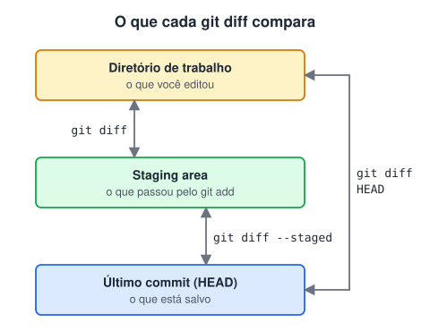
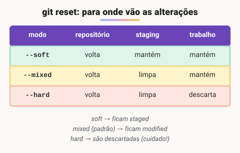

# Diff e reset

> 🗺️ **Nesta aula:** ver o que mudou com `git diff` (e o que cada variação compara) e voltar a branch para um commit anterior com `git reset` nos modos soft, mixed e hard.

## De onde paramos

Você já sabe mover arquivos entre os estados (modified, staged, commitado). Agora, duas perguntas do dia a dia: "o que exatamente eu mudei?" e "como desfaço um commit que fiz cedo demais?".

## `git diff`: o que mudou?

O `git diff` mostra, linha a linha, as diferenças entre duas versões: linhas com `+` (verde) foram adicionadas e com `-` (vermelho) foram removidas.

```
-<h1>Minha loja</h1>
+<h1>Loja Online</h1>
```

O ponto que mais confunde: **o** `git diff` **sem argumentos não compara com o último commit**. Ele compara o diretório de trabalho com a staging area, ou seja, mostra só o que você **ainda não** adicionou.



```bash
# trabalho × staging (o que falta dar git add)
git diff
# staging × último commit (o que vai entrar)
git diff --staged
# trabalho × último commit (tudo que mudou)
git diff HEAD

# diferença entre duas branches
git diff main feature
# diferença entre dois commits
git diff a1b2c3d e4f5a6b
# só o resumo: arquivos e linhas
git diff --stat
# só um arquivo
git diff index.html
```

Dica: no VS Code, a aba **Source Control** mostra o mesmo diff lado a lado, de forma visual.

## `git reset`: voltar a branch para um commit anterior

O `git reset` move a branch atual (e o `HEAD`) para outro commit. Os commits "à frente" deixam de fazer parte da branch. O que acontece com as **alterações** deles depende da opção:



```bash
# desfaz o último commit; alterações ficam staged
git reset --soft HEAD~1
# o mesmo que --mixed: alterações voltam a "modified"
git reset HEAD~1
# desfaz o commit E apaga as alterações (cuidado!)
git reset --hard HEAD~1
```

`HEAD~1` significa "um commit antes do atual"; `HEAD~3`, três commits antes. Você também pode usar o hash do commit (pegue com `git log --oneline`).

### Casos de uso comuns

| Situação | Comando |
| --- | --- |
| commitei cedo demais e quero juntar mais coisas | `git reset --soft HEAD~1` |
| fiz `git add` num arquivo por engano | `git restore --staged arquivo` |
| quero jogar fora tudo e voltar ao último commit | `git reset --hard HEAD` |

> ⚠️ O `reset` **reescreve o histórico**. Use só em commits que ainda não foram enviados (`push`). Para desfazer algo que já está no remoto, use `git revert`. Errou um `--hard`? O `git reflog` lista por onde o `HEAD` passou, e `git reset --hard <hash>` costuma recuperar o commit perdido, desde que ele tenha sido commitado.

> ⚠️ **Correção:** as anotações diziam que `git diff` sem argumentos compara o diretório de trabalho com o último commit. Na verdade, ele compara com a **staging area**. Para comparar com o último commit, use `git diff HEAD`.

## 🧠 Revisão rápida

**Você deu `git add` em tudo e o `git diff` não mostra nada. Por quê?**

Porque ele compara o trabalho com a staging area, e agora as duas estão iguais. Use `git diff --staged`.

**Qual modo de reset mantém as alterações prontas para um novo commit?**

O `--soft`.

**Por que não usar `reset` em commits já enviados?**

Porque ele reescreve o histórico e causa divergência com o remoto e com os colegas.

> ➡️ **Próximo passo:** até aqui tudo ficou no seu computador. Hora de enviar e receber commits de um servidor: **Push e pull**.

## 📌 Resumo

| Comando | Em uma frase |
| --- | --- |
| `git diff` | trabalho × staging |
| `git diff --staged` | staging × último commit |
| `git diff HEAD` | trabalho × último commit |
| `reset --soft` | desfaz o commit; alterações staged |
| `reset --mixed` | desfaz o commit; alterações modified |
| `reset --hard` | desfaz o commit e apaga as alterações |
| `git reflog` | rede de segurança para recuperar commits |
