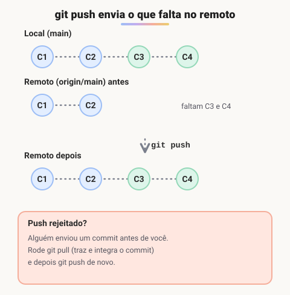
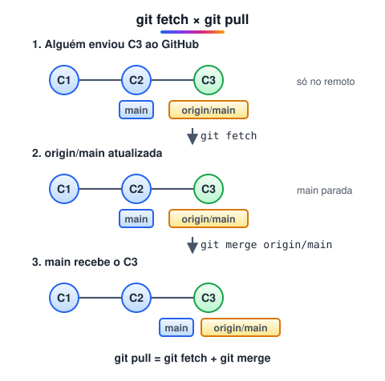

# Push e pull

> 🗺️ **Nesta aula:** repositórios remotos, enviar commits com `git push`, receber com `git fetch` e `git pull`, e como se autenticar no GitHub.

## De onde paramos

Até aqui o histórico só existia no seu computador. Para fazer backup, publicar o projeto ou trabalhar com outras pessoas, o repositório precisa de uma cópia num servidor, e os commits precisam ir e voltar entre as duas.

## Repositórios remotos

Um **remoto** é uma cópia do repositório hospedada em um servidor (GitHub, GitLab, Bitbucket). Por convenção, o remoto principal se chama `origin`.

```bash
# lista os remotos
git remote -v
# liga o repositório local a um remoto
git remote add origin \
  https://github.com/usuario/projeto.git
```

## `git push`: enviar seus commits

Envia para o remoto os commits que existem na sua branch local e ainda não estão lá.

```bash
git push origin main

# na primeira vez, -u liga a branch local
# à remota (upstream)
git push -u origin main
# a partir daí basta:
git push
```



> 💡 **Analogia:** o remoto é como uma pasta compartilhada na nuvem. O `push` é subir as suas páginas novas; o `fetch` é olhar o que os colegas subiram, sem misturar com as suas; o `pull` é baixar e já juntar ao seu caderno. Se alguém subiu páginas que você ainda não tem, a pasta recusa o seu envio até você baixar e juntar primeiro.

O push só funciona se o remoto **não tiver nada que você não tenha**. Se alguém enviou commits antes, faça `git pull` primeiro, resolva eventuais conflitos e depois `git push`.

> ⚠️ `git push --force` sobrescreve o remoto e pode **apagar o trabalho de outras pessoas**. Se realmente precisar (por exemplo, depois de um rebase na sua própria branch), prefira `git push --force-with-lease`, que recusa o envio se o remoto mudou desde o seu último fetch.

## `git fetch` e `git pull`: receber alterações

- `git fetch` baixa os commits novos do remoto e atualiza `origin/main`, **sem mexer nos seus arquivos**. Serve para ver o que chegou antes de integrar.
- `git pull` = `git fetch` + `git merge`: baixa e já integra na sua branch atual.



```bash
git fetch origin
# o que chegou e ainda não está na main
git log main..origin/main --oneline
# baixa e integra
git pull
# baixa e reaplica seus commits por cima
# (histórico linear)
git pull --rebase
```

## Autenticação

O GitHub **não aceita mais a senha da conta** em operações Git por HTTPS (desde 2021). Use uma destas opções:

- **Personal Access Token (PAT)** no lugar da senha;
- **Chave SSH** (`git@github.com:usuario/projeto.git`);
- **GitHub CLI** (`gh auth login`) ou o Git Credential Manager, que cuidam disso por você.

## Exercício

Você criou um repositório vazio no GitHub e tem um projeto local com dois commits. Quais comandos publicam o projeto?

<details>
<summary>Ver resposta</summary>

```bash
git remote add origin \
  https://github.com/usuario/meu-site.git
git branch -M main
git push -u origin main
```

O `-u` liga a `main` local à remota; depois disso, basta `git push` e `git pull`.

</details>

## 🧠 Revisão rápida

**Qual a diferença entre `git fetch` e `git pull`?**

O fetch só baixa e atualiza `origin/main`; o pull baixa e integra na sua branch.

**Seu push foi rejeitado. O que fazer?**

Rodar `git pull`, resolver conflitos se houver, e fazer o push de novo.

**Por que preferir `--force-with-lease` a `--force`?**

Porque ele recusa o envio se alguém mudou o remoto, evitando apagar o trabalho alheio.

> ➡️ **Próximo passo:** com o código no GitHub, a colaboração acontece por pull requests: **GitHub, pull requests e boas mensagens de commit**.

## 📌 Resumo

| Comando | Em uma frase |
| --- | --- |
| `git remote add origin URL` | liga o repositório a um remoto |
| `git push -u origin main` | primeiro envio, criando o upstream |
| `git fetch` | baixa sem mexer nos arquivos |
| `git pull` | fetch e merge |
| `git pull --rebase` | fetch e rebase (histórico linear) |
| `--force-with-lease` | força o envio só se ninguém mudou o remoto |
| Autenticação | token, SSH ou GitHub CLI |
