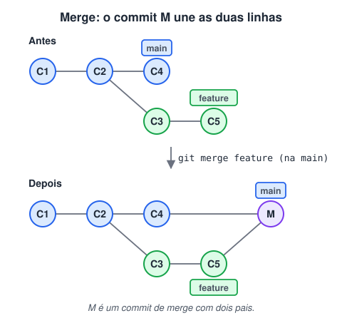
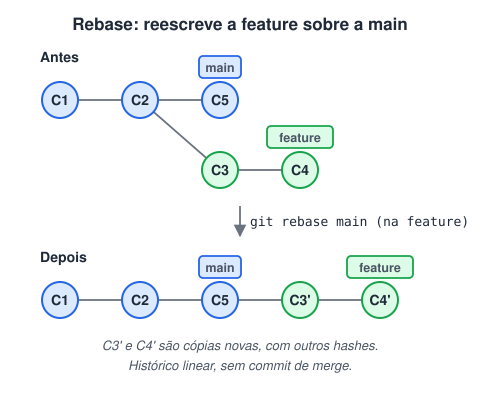

# Merge e rebase

> 🗺️ **Nesta aula:** as duas formas de trazer o trabalho de uma branch para outra (`merge` e `rebase`), o fast-forward, quando usar cada uma e o rebase interativo.

## De onde paramos

Você trabalhou numa branch `feature` e o PR foi aprovado. Agora o trabalho precisa entrar na `main`. Merge e rebase resolvem esse mesmo problema; a diferença está em **como o histórico fica depois**.

## `git merge`

O merge junta as alterações de outra branch **na branch atual**. Primeiro vá para a branch que vai receber o trabalho e depois chame o merge:

```bash
git switch main
git merge feature
```

### Merge de três vias (com commit de merge)

Quando as duas branches avançaram, o Git compara três versões (o ancestral comum e as duas pontas) e cria um **commit de merge** (M) com dois pais, unindo as duas linhas. Os commits originais ficam exatamente como aconteceram.



> 💡 **Analogia:** imagine duas estradas que saíram da mesma cidade. O merge constrói um trevo onde elas se encontram: as duas estradas continuam no mapa, e o trevo (o commit de merge) mostra a junção. O rebase é como reconstruir a segunda estrada a partir do fim da primeira: no mapa fica uma linha reta, como se ela sempre tivesse saído dali.

### Fast-forward (sem commit de merge)

Se a `main` **não recebeu nenhum commit** desde que a feature foi criada, não há o que unir: o Git só avança o ponteiro da `main` até o último commit da feature. Para forçar um commit de merge mesmo assim (e deixar registrado que houve uma branch), use `git merge --no-ff feature`.

## `git rebase`

O rebase **reaplica os commits da sua branch em cima de outra base**. Ele refaz cada commit, um a um, como se você tivesse começado o trabalho a partir da versão mais nova da `main`. Aqui você fica na branch que vai ser movida:

```bash
git switch feature
git rebase main
```



Depois do rebase, um `git merge feature` na `main` vira fast-forward, e o histórico fica uma **linha reta**, sem commits de merge.

## Qual usar?

|  | Merge | Rebase |
| --- | --- | --- |
| Histórico | real, com bifurcações | linear, mais fácil de ler |
| Commits originais | preservados | recriados (hashes novos) |
| Branch compartilhada | ✅ seguro | ⚠️ só se ninguém mais usa |
| Conflitos | resolvidos uma vez | podem surgir em cada commit |

> ⚠️ **Regra de ouro do rebase:** nunca faça rebase de commits que já foram enviados e que outras pessoas usam. O rebase cria commits novos, e quem tinha os antigos fica com um histórico divergente. Na sua própria branch, antes do PR, ele é ótimo para deixar o histórico limpo.

## Rebase interativo

Com `git rebase -i` você reescreve os últimos commits antes de enviá-los: juntar vários num só, reordenar, mudar mensagens ou descartar.

```bash
git rebase -i HEAD~3
```

O Git abre o editor com uma linha por commit. Troque a palavra do início para dizer o que fazer:

```
pick   a1b2c3d feat: cria formulário
squash e4f5a6b corrige typo
squash 9c8d7e6 ajusta espaçamento
```

- `pick`: mantém o commit;
- `reword`: mantém e muda a mensagem;
- `squash`: junta ao commit de cima;
- `drop`: descarta.

## Comandos úteis

```bash
# desiste de um merge com conflito
git merge --abort
# continua o rebase depois de resolver
git rebase --continue
# desiste do rebase e volta ao estado anterior
git rebase --abort
# visualiza as branches no terminal
git log --oneline --graph --all
```

> ⚠️ **Correção:** a aula dizia que o merge "sempre cria um novo commit de mesclagem". No **fast-forward** nenhum commit novo é criado; só o ponteiro da branch avança.

## Exercício

Você está na `feature`, com 2 commits. Enquanto isso, a `main` recebeu 3 commits de colegas. Você quer atualizar sua branch com a main e manter um histórico linear antes de abrir o PR. Quais comandos usar?

<details>
<summary>Ver resposta</summary>

```bash
git switch main
git pull
git switch feature
git rebase main
# se houver conflito: resolva, git add,
# e depois git rebase --continue
git push --force-with-lease
```

O `--force-with-lease` é necessário porque o rebase criou commits novos; como a branch é só sua, é seguro.

</details>

## 🧠 Revisão rápida

**Quando um merge vira fast-forward?**

Quando a branch de destino não recebeu commits desde que a outra foi criada.

**Por que o rebase muda os hashes dos commits?**

Porque ele recria cada commit sobre uma nova base, e o hash depende do commit pai.

**Em que situação o rebase é perigoso?**

Em commits já enviados que outras pessoas estão usando.

> ➡️ **Próximo passo:** e se você precisar trocar de branch no meio de um trabalho, sem commitar? É para isso que serve o **Stash**.

## 📌 Resumo

| Comando | Em uma frase |
| --- | --- |
| `git merge feature` | traz a feature para a branch atual |
| Merge de três vias | cria um commit com dois pais |
| Fast-forward | só avança o ponteiro, sem commit novo |
| `git rebase main` | reaplica a branch atual sobre a main |
| `git rebase -i HEAD~3` | reescreve os últimos 3 commits |
| `--abort` / `--continue` | desiste ou segue depois de um conflito |
