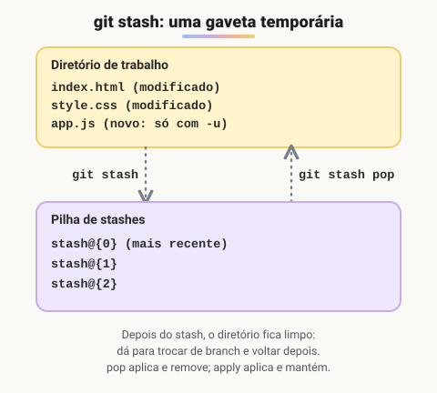

# Stash

> 🗺️ **Nesta aula:** guardar alterações não commitadas numa "gaveta" com `git stash`, trocar de branch com o diretório limpo e depois recuperar tudo.

## De onde paramos

Você já sabe trabalhar com branches. Mas o Git não deixa trocar de branch se houver alterações que entrariam em conflito, e fazer um commit pela metade só para sair dali suja o histórico. O stash resolve isso.

## O que é o stash?

**O** `git stash` **guarda temporariamente as alterações que você ainda não commitou e deixa o diretório de trabalho limpo.** É útil quando você está no meio de algo e precisa trocar de branch às pressas (um bug urgente, por exemplo).



> 💡 Por padrão, o stash guarda só os arquivos **rastreados** (modificados e staged). Arquivos novos (untracked) ficam para trás, a não ser que você use `-u`.

## Comandos

```bash
# guarda as alterações rastreadas
git stash
# guarda com uma descrição
git stash push -m "menu lateral"
# inclui arquivos untracked
git stash -u
```

```bash
# lista: stash@{0}, stash@{1}...
git stash list
# mostra o diff de um stash
git stash show -p stash@{0}
```

```bash
# aplica o mais recente E remove da lista
git stash pop
# aplica o mais recente e MANTÉM na lista
git stash apply
# aplica um específico
git stash apply stash@{2}
```

```bash
# apaga um específico
git stash drop stash@{1}
# apaga todos (sem volta!)
git stash clear
# cria uma branch a partir do stash
git stash branch nova-branch
```

## Exemplo de uso

```bash
# mexendo na feature, chega um bug urgente
git stash push -m "feature pela metade"
git switch main
# ... corrige, commita, faz push ...
git switch feature
# volta exatamente de onde parou
git stash pop
```

Se as alterações do stash conflitarem com o estado atual, o Git avisa e você resolve como em qualquer conflito. Nesse caso o `pop` **não remove** o stash da lista, para você não perder nada; depois de resolver, apague com `git stash drop`.

> ⚠️ **Correções:** `git stash aply` estava com erro de digitação (o certo é `apply`); `git stash save` está **obsoleto**, use `git stash push -m "mensagem"`; e o stash só guarda arquivos não rastreados com `-u`/`--include-untracked`.

## Exercício

Você editou `style.css` e criou `novo.js` (ainda não adicionado). Precisa ir para a `main` agora e quer levar tudo para a gaveta. Qual comando usar? E como voltar depois mantendo uma cópia do stash na lista?

<details>
<summary>Ver resposta</summary>

```bash
# -u para incluir o novo.js (untracked)
git stash push -u -m "estilos e novo.js"
git switch main
# ... trabalho na main ...
git switch feature
# apply mantém o stash na lista
git stash apply
```

</details>

## 🧠 Revisão rápida

**Qual a diferença entre `pop` e `apply`?**

O `pop` aplica e remove da lista; o `apply` aplica e mantém.

**Por que um arquivo novo não foi para o stash?**

Porque era untracked. Use `git stash -u`.

> ➡️ **Próximo passo:** alguns arquivos nunca devem entrar no repositório, nem no stash. Veja como avisar isso ao Git com o **Gitignore**.

## 📌 Resumo

| Comando | Em uma frase |
| --- | --- |
| `git stash push -m "..."` | guarda as alterações com descrição |
| `git stash -u` | inclui os arquivos untracked |
| `git stash list` | lista a pilha de stashes |
| `git stash pop` | aplica e remove da lista |
| `git stash apply` | aplica e mantém na lista |
| `git stash drop` / `clear` | apaga um ou todos |
