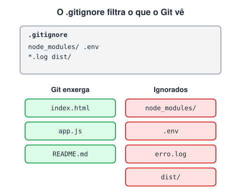

# Gitignore

> 🗺️ **Nesta aula:** o arquivo `.gitignore`, o que costuma ir nele, sua sintaxe e como parar de rastrear um arquivo que já foi commitado.

## De onde paramos

Com `git add .`, tudo que está na pasta entra no próximo commit. Mas dependências, arquivos gerados e senhas não devem ir para o repositório. É aqui que entra o `.gitignore`.

## O que é o `.gitignore`

**O** `.gitignore` **é um arquivo de texto, na raiz do projeto, que lista arquivos e pastas que o Git deve ignorar.** Eles continuam na sua máquina, mas não aparecem no `git status`, não entram no `git add .` e nunca vão para o repositório. O próprio `.gitignore` deve ser commitado, para valer para todo o time.



### O que costuma ir no `.gitignore`

- **Dependências** que podem ser baixadas de novo: `node_modules/`, `vendor/`, `.venv/`.
- **Arquivos gerados** pelo build: `dist/`, `build/`, `*.class`, `*.o`.
- **Segredos e configurações locais**: `.env`, chaves de API, senhas.
- **Logs e temporários**: `*.log`, `*.tmp`.
- **Lixo do sistema e do editor**: `.DS_Store`, `Thumbs.db`, `.vscode/` (quando for configuração pessoal).

## Sintaxe

| Padrão | O que ignora |
| --- | --- |
| `*.log` | qualquer arquivo `.log`, em qualquer pasta |
| `node_modules/` | a pasta e tudo dentro, em qualquer nível |
| `/config.ini` | só o `config.ini` da raiz |
| `docs/*.pdf` | PDFs diretamente dentro de `docs/` |
| `**/temp` | pasta `temp` em qualquer nível |
| `!importante.log` | exceção: este arquivo não é ignorado |

Linhas que começam com `#` são comentários.

### Exemplo para um projeto web com Node

```bash
# dependências
node_modules/

# build
dist/

# variáveis de ambiente (segredos!)
.env
.env.local

# logs
*.log
npm-debug.log*

# sistema
.DS_Store
Thumbs.db
```

O site gitignore.io e o repositório **github/gitignore** têm modelos prontos para cada linguagem e framework.

## Já commitei o arquivo… e agora?

O `.gitignore` só vale para arquivos **não rastreados**. Se o arquivo já foi commitado, colocá-lo no `.gitignore` não adianta: é preciso tirá-lo do controle de versão (sem apagar do disco).

```bash
# para de rastrear o arquivo
git rm --cached .env
# o mesmo para uma pasta
git rm -r --cached node_modules
git commit -m "chore: remove .env do repositório"
```

> ⚠️ Se você commitou uma **senha ou chave de API** e já fez push, removê-la agora não basta: ela continua no histórico. Considere a chave comprometida e **troque-a** (revogue e gere outra).

> 💡 Não sabe por que um arquivo está sendo ignorado? `git check-ignore -v arquivo.log` mostra qual regra (e de qual arquivo) está agindo.

## Exercício

Escreva um `.gitignore` que ignore: a pasta `dist/`, todos os `.log` exceto `auditoria.log`, e o arquivo `segredos.json` apenas na raiz.

<details>
<summary>Ver resposta</summary>

```bash
dist/
*.log
!auditoria.log
/segredos.json
```

A exceção `!` precisa vir **depois** da regra que ela contraria.

</details>

## 🧠 Revisão rápida

**Coloquei `.env` no `.gitignore`, mas ele continua aparecendo nas alterações. Por quê?**

Porque já estava rastreado. Rode `git rm --cached .env` e faça commit.

**Para que serve o `!` numa regra?**

Cria uma exceção: o arquivo deixa de ser ignorado.

> ➡️ **Próximo passo:** e quando um commit com problema já foi enviado? Veja como desfazê-lo com segurança em **Revert e reset**.

## 📌 Resumo

| Item | Em uma frase |
| --- | --- |
| `.gitignore` | lista o que o Git deve ignorar |
| `*.ext` | todos os arquivos com a extensão |
| `pasta/` | a pasta inteira |
| `/arquivo` | só na raiz |
| `!arquivo` | exceção a uma regra |
| `git rm --cached` | para de rastrear sem apagar do disco |
| Segredo vazado | trocar a chave, não só apagar |
