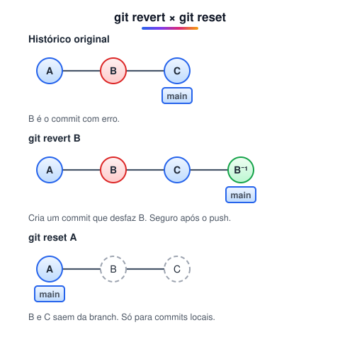

# Git revert

> 🗺️ **Nesta aula:** desfazer commits com segurança usando `git revert`, reverter intervalos de commits e saber quando usar revert ou reset.

## De onde paramos

Na aula de reset você viu como voltar a branch para trás, mas só em commits que ainda não foram enviados. E quando o commit com problema **já está no GitHub** e os colegas já baixaram? Aí a ferramenta é o revert.

## O que o `git revert` faz

**O** `git revert` **desfaz um commit criando um commit novo com as alterações inversas.** Se o commit original adicionou uma linha, o revert a remove; se apagou, o revert a devolve. O commit original continua no histórico, apenas anulado por outro. Por isso é a forma segura de desfazer algo já compartilhado.



> 💡 **Analogia:** o revert é como uma errata num jornal. A notícia errada já foi impressa e distribuída, então não dá para arrancar a página da casa de cada leitor (isso seria o reset). Em vez disso, a edição seguinte publica uma correção que anula o erro, e as duas ficam registradas.

## Como usar

```bash
# encontre o hash do commit a desfazer
git log --oneline
# cria um commit que desfaz o a1b2c3d
git revert a1b2c3d
# desfaz o último commit
git revert HEAD
```

```bash
# usa a mensagem padrão sem abrir o editor
git revert --no-edit a1b2c3d
# aplica a reversão sem commitar ainda
git revert -n a1b2c3d
```

```bash
# reverte os 2 últimos commits
git revert HEAD~2..HEAD
```

> 💡 Na notação `A..B`, o commit **A não entra**: são revertidos os commits depois de A até B. Para incluir A, use `A^..B`. O Git reverte do mais novo para o mais antigo, criando um commit para cada um (ou um só, se usar `-n` e commitar no fim).

## Revert × Reset

|  | `git revert` | `git reset` |
| --- | --- | --- |
| O que faz | cria um commit que desfaz outro | move a branch para trás |
| Histórico | preservado | reescrito |
| Commits já enviados | ✅ seguro | ⚠️ evite |
| Commit do meio | ✅ desfaz só ele | ❌ remove tudo depois |

Se as alterações revertidas conflitarem com commits mais recentes, o Git para e pede que você resolva o conflito. Depois, rode `git add` nos arquivos e `git revert --continue` (ou `git revert --abort` para desistir).

> ⚠️ **Correção:** `git revert inicial..final` **não** inclui o commit inicial, ao contrário do que a explicação dava a entender.

## Exercício

O histórico da `main` (já no GitHub) é: `C1 → C2 → C3 → C4`. Descobriram que o `C2` introduziu um bug, mas `C3` e `C4` estão corretos. Como desfazer só o `C2`?

<details>
<summary>Ver resposta</summary>

```bash
git revert <hash-do-C2>
git push
```

O histórico vira `C1 → C2 → C3 → C4 → C5`, onde C5 desfaz o C2. Um `reset` para o C1 apagaria também o C3 e o C4, e ainda reescreveria um histórico já compartilhado.

</details>

## 🧠 Revisão rápida

**O revert apaga o commit original?**

Não. Ele cria um commit novo com as alterações inversas; o original continua no histórico.

**Quando preferir revert a reset?**

Quando o commit já foi enviado ou quando você quer desfazer um commit do meio do histórico.

> ➡️ **Próximo passo:** merge, rebase, pull, stash pop e revert podem parar num conflito. Veja como resolvê-lo em **Resolvendo conflitos na prática**.

## 📌 Resumo

| Comando | Em uma frase |
| --- | --- |
| `git revert hash` | cria um commit que desfaz outro |
| `git revert HEAD` | desfaz o último commit |
| `--no-edit` | usa a mensagem padrão |
| `-n` | aplica sem commitar |
| `A..B` | intervalo que não inclui o A |
| `--continue` / `--abort` | segue ou desiste depois de um conflito |
