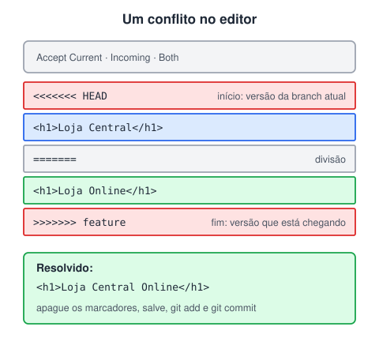

# Resolvendo conflitos na prática

> 🗺️ **Nesta aula:** por que conflitos acontecem, como ler os marcadores no arquivo, como resolver pelo VS Code e pelo terminal, e como evitar conflitos no dia a dia.

## De onde paramos

Merge, rebase, pull, stash pop e revert juntam alterações de lugares diferentes. Quase sempre o Git faz isso sozinho. Esta aula trata da exceção: quando ele não consegue decidir e pede a sua ajuda.

## Por que acontece um conflito?

Um conflito acontece quando **duas branches alteram as mesmas linhas de um arquivo** (ou uma apaga um arquivo que a outra editou) e o Git não tem como saber qual versão é a certa. Ele então pausa a operação e pede que **você** decida.

Alterações em partes diferentes do arquivo, ou em arquivos diferentes, o Git junta sozinho.

## Como o conflito aparece no arquivo



```html
<<<<<<< HEAD
<h1>Minha loja</h1>
=======
<h1>Loja Online</h1>
>>>>>>> feature
```

- de `<<<<<<< HEAD` até `=======`: a versão da **branch atual** (current);
- de `=======` até `>>>>>>> feature`: a versão que está **chegando** (incoming).

## As opções do VS Code

| Opção | Resultado |
| --- | --- |
| Accept Current Change | fica com a versão da branch atual |
| Accept Incoming Change | fica com a versão da outra branch |
| Accept Both Changes | mantém as duas, uma embaixo da outra |
| Editar à mão | escreve a combinação correta |

"Accept Both" nem sempre faz sentido: no exemplo, ficariam dois `<h1>`. Leia o código e decida o que o resultado deve ser; muitas vezes a resposta certa é uma mistura das duas versões.

## Passo a passo no terminal

```bash
git merge feature
# CONFLICT (content): Merge conflict
# in index.html

# lista os arquivos "both modified"
git status
```

1. Abra cada arquivo em conflito, escreva a versão final e apague **todos** os marcadores.
2. Marque o arquivo como resolvido com `git add`.
3. Finalize a operação.

```bash
git add index.html
# o Git já sugere "Merge branch 'feature'"
git commit

# ou, para desistir e voltar ao estado anterior:
git merge --abort
```

> 💡 No **rebase**, o passo 3 é `git rebase --continue`; no **revert**, `git revert --continue`. Antes de commitar, procure marcadores esquecidos: `git diff --check` avisa se sobrou algum.

> ⚠️ **Correção:** a aula dizia que "o Git irá criar um commit informando o conflito". Na verdade, o Git **não** cria commit nenhum durante o conflito: ele pausa a operação, e só o commit que **você** faz depois de resolver a finaliza.

## Como evitar conflitos

- Faça `git pull` com frequência para trabalhar sempre sobre a versão mais recente.
- Mantenha branches **curtas**: integre pequenas partes, em vez de semanas de trabalho de uma vez.
- Combine com a equipe quem está mexendo em quais arquivos.
- Evite reformatar arquivos inteiros (trocar espaços por tabs, por exemplo) junto com mudanças de lógica.

## Exercício

Na `main`, o título é `<h1>Minha loja</h1>`. Na `feature`, mudaram para `<h1>Loja Online</h1>`. O time decidiu que o título final deve ser "Minha Loja Online". Resolva o conflito.

<details>
<summary>Ver resposta</summary>

Edite o arquivo, removendo os marcadores e as duas versões antigas:

```html
<h1>Minha Loja Online</h1>
```

Depois:

```bash
git add index.html
git commit
```

Nem "current" nem "incoming": editar à mão foi o caminho certo.

</details>

## 🧠 Revisão rápida

**O que separa a versão atual da que está chegando?**

A linha `=======`.

**Como avisar ao Git que um arquivo foi resolvido?**

Com `git add arquivo`.

**Como desistir de um merge com conflito?**

`git merge --abort`.

> ➡️ **Próximo passo:** fim do módulo de Git. No próximo módulo começa a programação de verdade no navegador: **JavaScript**.

## 📌 Resumo

| Item | Em uma frase |
| --- | --- |
| Conflito | duas branches mudaram as mesmas linhas |
| `<<<<<<< HEAD` | início da versão atual |
| `=======` | separa atual e a que chega |
| `>>>>>>>` | fim da versão que chega |
| `git add` | marca o arquivo como resolvido |
| `git merge --abort` | desiste e volta ao estado anterior |
| Prevenção | pull frequente e branches curtas |
