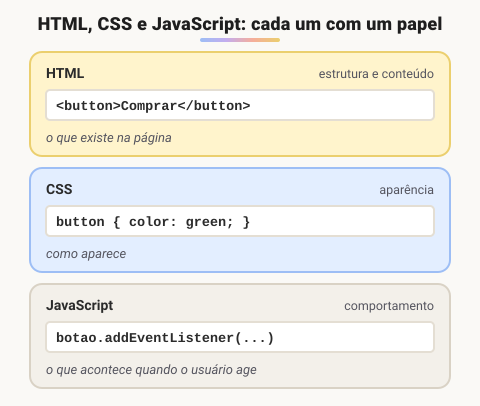

# Js em projetos web

> 🗺️ **Nesta aula:** de onde veio o JavaScript, o que é ECMAScript, as características da linguagem, o papel do JS ao lado de HTML e CSS e as formas de colocar um script na página.

## De onde paramos

Com HTML você monta a estrutura e com CSS a aparência. Mas a página ainda não **reage**: não valida um formulário, não abre um menu, não calcula nada. É isso que o JavaScript acrescenta.

## Linha do tempo do JavaScript

| Ano | Marco |
| --- | --- |
| 1995 | Brendan Eich cria a linguagem em **10 dias** na Netscape. Chamou-se Mocha, depois LiveScript e, por fim, **JavaScript**, para aproveitar a fama do Java |
| 1997 | Padronizada pela Ecma International com o nome **ECMAScript** (ES1) |
| 2009 | ES5 (modo estrito, JSON nativo) e lançamento do **Node.js**, que leva o JS para o servidor |
| 2015 | **ES6/ES2015**, a grande virada: `let`/`const`, arrow functions, classes, módulos, Promises, template strings |
| 2016 → hoje | Uma versão por ano, com `async/await`, `?.`, `??` e muito mais |

> 💡 **JavaScript ≠ Java.** Apesar do nome e de alguma semelhança na sintaxe, são linguagens completamente diferentes, criadas por empresas diferentes e com propósitos diferentes.

## ECMAScript e o TC39

**ECMAScript é a especificação; JavaScript é a implementação mais conhecida dela.** A especificação define a sintaxe e o comportamento da linguagem, e cada motor (V8 no Chrome e no Node, SpiderMonkey no Firefox, JavaScriptCore no Safari) a implementa.

Quem evolui o padrão é o **TC39** (Comitê Técnico 39 da Ecma), com representantes de empresas como Google, Apple, Mozilla e Microsoft. Cada funcionalidade nova passa por estágios (0 a 4) antes de entrar na especificação.

## Características principais

- **Roda no navegador** (sem instalar nada) e, com o Node.js, também no servidor, em apps desktop (Electron) e mobile (React Native).
- **Tipagem dinâmica**: a mesma variável pode guardar um número e depois um texto.
- **Multiparadigma**: aceita estilos imperativo, orientado a objetos e funcional.
- **Orientado a eventos e assíncrono**: reage a cliques, digitação e respostas de rede.
- **Interpretado com compilação JIT**: os motores modernos compilam o código durante a execução para ficar rápido.
- **Manipula o DOM**: lê e altera a página depois que ela foi carregada.

## O papel de cada tecnologia



> 💡 **Analogia:** pense num carro. O HTML é a carroceria e o chassi (o que existe); o CSS é a pintura e o acabamento interno (como parece); o JavaScript é o motor e a parte elétrica (o que acontece quando você gira a chave, aperta o pedal ou liga o pisca).

## Como colocar JavaScript na página

### 1. Dentro do HTML, na tag `<script>`

```html
<!DOCTYPE html>
<html lang="pt-BR">
<head>
  <meta charset="UTF-8">
  <title>Script interno</title>
</head>
<body>
  <h1>Introdução ao JavaScript</h1>

  <script>
    console.log("Olá! Seja bem-vindo!");
  </script>
</body>
</html>
```

Bom para testes rápidos, mas mistura conteúdo e comportamento.

### 2. Em um arquivo externo (recomendado)

```html
<!-- index.html -->
<!DOCTYPE html>
<html lang="pt-BR">
<head>
  <meta charset="UTF-8">
  <title>Script externo</title>
  <script src="index.js" defer></script>
</head>
<body>
  <h1>Introdução ao JavaScript</h1>
</body>
</html>
```

```jsx
// index.js
console.log("Este é um teste com JS externo");
alert("Olá! Seja bem-vindo!");
```

O arquivo externo pode ser reaproveitado em várias páginas e fica em cache no navegador.

### Onde colocar o `<script>`?

| Forma | Comportamento |
| --- | --- |
| No fim do `<body>` | o HTML carrega primeiro e depois o script roda (jeito clássico) |
| No `<head>` com `defer` | baixa em paralelo e só executa quando o HTML terminar (**recomendado**) |
| No `<head>` com `async` | executa assim que baixar, sem ordem garantida (bom para scripts independentes) |
| No `<head>` sem nada | trava a página e não encontra elementos que ainda não existem ❌ |

## Onde ver o resultado

Abra o **DevTools** (F12 ou Ctrl+Shift+I) e vá na aba **Console**: é ali que aparecem o `console.log` e os erros. No mesmo console você pode digitar JavaScript e ver o resultado na hora.

> ⚠️ **Correções:** "linguagem interpretada" é uma simplificação, pois os motores atuais usam **compilação JIT**. O exemplo original usava `document.write`, que é desaconselhado: se for chamado depois do carregamento, apaga a página inteira. Use `console.log` ou altere o DOM. A tag `<meta http-equiv="X-UA-Compatible">` só servia para o Internet Explorer e foi removida; o código de idioma correto é `pt-BR`.

## Exercício

Crie um `index.html` com um `<h1>` e um arquivo `app.js` que mostre no console a mensagem "Script carregado". O script deve ficar no `<head>` sem travar a página.

<details>
<summary>Ver resposta</summary>

```html
<head>
  <meta charset="UTF-8">
  <title>Teste</title>
  <script src="app.js" defer></script>
</head>
<body>
  <h1>Olá</h1>
</body>
```

```jsx
// app.js
console.log("Script carregado");
```

O `defer` faz o navegador baixar o script sem parar a leitura do HTML e executá-lo só no fim.

</details>

## 🧠 Revisão rápida

**Qual a diferença entre ECMAScript e JavaScript?**

ECMAScript é a especificação; JavaScript é a implementação usada nos navegadores e no Node.

**O que o `defer` faz?**

Baixa o script em paralelo e só o executa depois que o HTML foi todo lido.

**Onde aparecem as mensagens de `console.log`?**

Na aba Console do DevTools (F12).

> ➡️ **Próximo passo:** o primeiro passo de qualquer programa é guardar dados. Veja como em **Variáveis e constantes**.

## 📌 Resumo

| Item | Em uma frase |
| --- | --- |
| JavaScript | a linguagem do comportamento da página |
| ECMAScript | a especificação que o JS segue |
| ES2015 (ES6) | a grande atualização moderna da linguagem |
| Script externo | arquivo `.js` ligado com `<script src>` |
| `defer` | executa depois que o HTML carregou |
| `async` | executa assim que baixar, sem ordem |
| Console | onde ver logs e erros |
