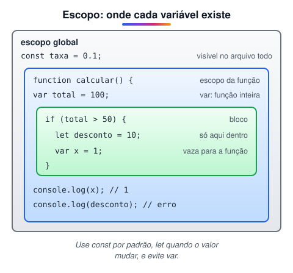

# Variáveis e constantes

> 🗺️ **Nesta aula:** o que é uma variável, as diferenças entre `let`, `const` e `var`, escopo de bloco e de função, hoisting e as regras e convenções de nomes.

## De onde paramos

Você já sabe colocar um script na página. Para ele fazer algo útil, precisa guardar dados: o nome do usuário, um preço, o resultado de uma conta.

## Variáveis

**Uma variável é um nome que aponta para um valor guardado na memória.** Em JavaScript não é preciso declarar o tipo: a mesma variável pode guardar um número e depois um texto (**tipagem dinâmica**).

```jsx
// declarada, ainda sem valor (undefined)
let x;
x = 10;
console.log(x);  // 10

// agora guarda uma string
x = "Hello world!";
console.log(x);  // "Hello world!"
```

## `let`, `const` e `var`

|  | `const` | `let` | `var` |
| --- | --- | --- | --- |
| Reatribuir? | ❌ | ✅ | ✅ |
| Escopo | bloco `{ }` | bloco `{ }` | **função** |
| Redeclarar? | ❌ | ❌ | ✅ (fonte de bugs) |
| Usar antes de declarar | erro | erro | `undefined` |
| Quando usar | **padrão** | valor muda | evite |



```jsx
if (true) {
  let a = 1;
  var b = 2;
}
console.log(b);  // 2 → var ignora o bloco
console.log(a);  // ReferenceError
```

### Hoisting

Antes de executar, o JavaScript "registra" todas as declarações do escopo. Com `var`, a variável já existe valendo `undefined` antes da linha da declaração. Com `let` e `const`, ela existe mas não pode ser usada até a declaração (a chamada *zona morta temporal*), e o acesso dá erro, o que evita bugs silenciosos.

```jsx
console.log(v);  // undefined
var v = 1;

console.log(l);  // ReferenceError
let l = 1;
```

## Constantes

`const` cria uma variável que **não pode receber outro valor**. Ela precisa ser inicializada na declaração.

```jsx
// comprimento da circunferência
// decimais usam PONTO, não vírgula
const PI = 3.1416;
let raio = 3;

const comprimento = 2 * PI * raio;
console.log(comprimento);  // 18.8496

// na prática, use a constante pronta: Math.PI
```

> 💡 `const` impede a **reatribuição**, não a alteração do conteúdo. Um objeto ou array declarado com `const` ainda pode ter itens alterados: `const lista = []; lista.push(1);` funciona.

## Regras para nomes

```jsx
// ✅ textos sempre entre aspas
let nome = "Carlos";
// ✅ números são permitidos, mas não no início
let cep1 = "21233-333";
// ❌ não pode começar com número
let 1nome = "x";
// ❌ palavra reservada
let function = 1;
// ❌ não pode ter espaço
let nome completo = "x";
// ✅ camelCase (padrão em JS)
let nomeCompleto = "x";
// ✅ $ e _ são os únicos símbolos permitidos
let $elemento, _interno;
```

- Maiúsculas e minúsculas são diferentes: `nome` e `Nome` são variáveis distintas.
- Escolha nomes que **descrevam o dado**: `precoTotal` é muito melhor que `x` ou `pt`.
- Convenções: `camelCase` para variáveis e funções, `PascalCase` para classes e `UPPER_SNAKE_CASE` para constantes fixas (`TAXA_JUROS`).

> ⚠️ **Correções:** `var` **não** cria variável global por si só: ela tem **escopo de função** (só é global se declarada fora de qualquer função). `const pi = 3,1416;` é erro de sintaxe, porque o separador decimal é o ponto. Textos como `Carlos` precisam de aspas; sem elas, o JS procura uma variável com esse nome. E `const $navi;` dá erro, pois toda `const` precisa de valor na declaração.

## Exercício

Qual será a saída de cada `console.log`? Algum deles dá erro?

```jsx
const taxa = 0.05;
let saldo = 1000;
saldo = saldo + saldo * taxa;
console.log(saldo);

taxa = 0.1;
console.log(taxa);
```

<details>
<summary>Ver resposta</summary>

O primeiro mostra `1050`. A linha `taxa = 0.1;` lança `TypeError: Assignment to constant variable`, e o segundo `console.log` nem chega a rodar. Se a taxa precisa mudar, declare-a com `let`.

</details>

## 🧠 Revisão rápida

**Qual declarar por padrão?**

`const`. Troque para `let` só se o valor precisar mudar.

**Qual o escopo de uma `var` declarada dentro de um `if` numa função?**

A função inteira, não só o bloco do `if`.

**Posso dar `push` num array declarado com `const`?**

Sim. `const` impede só a reatribuição da variável.

> ➡️ **Próximo passo:** com os dados guardados, vamos fazer contas e comparações com os **Operadores**.

## 📌 Resumo

| Item | Em uma frase |
| --- | --- |
| `const` | não pode ser reatribuída; use por padrão |
| `let` | pode mudar; escopo de bloco |
| `var` | escopo de função e hoisting confuso; evite |
| Escopo de bloco | a variável só existe dentro das chaves |
| Hoisting | declarações são registradas antes da execução |
| camelCase | convenção para variáveis e funções |
