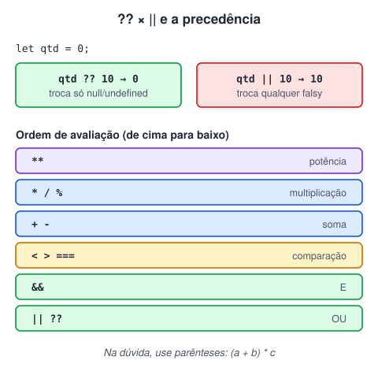

# Operadores

> 🗺️ **Nesta aula:** operadores aritméticos, de atribuição, incremento, comparação, lógicos, ternário e os operadores modernos para valores ausentes (`??` e `?.`).

## De onde paramos

Você já guarda valores em variáveis. Agora vamos operar sobre eles: somar, comparar e combinar condições.

## Aritméticos

As quatro operações funcionam como na matemática, e o `%` (resto da divisão) é o menos óbvio e o mais útil. `10 % 3` dá 1, porque 10 dividido por 3 tem resto 1. Com ele você descobre se um número é par (`n % 2 === 0`), faz um contador voltar ao começo depois de chegar a um limite e separa horas de minutos. Vale ver como a conta sai com valores de verdade: `x = 5` e `y = 2` dão 7, 3, 10 e 2,5 nas quatro primeiras operações.

```jsx
let x = 5;
let y = 2;

x + y;  // 7    soma
x - y;  // 3    subtração
x * y;  // 10   multiplicação
x / y;  // 2.5  divisão
x % y;  // 1    resto da divisão
x ** y;  // 25   potência (5²)
```

O `%` é ótimo para saber se um número é par (`n % 2 === 0`).

> ⚠️ Cuidado com `+` e strings: `"5" + 2` dá `"52"` (concatena), mas `"5" - 2` dá `3` (converte para número). Valores vindos de `input` são sempre texto: converta com `Number()` antes de somar.

## Atribuição

Os operadores de atribuição são atalhos para um padrão que você vai escrever o tempo todo: pegar o valor atual, mudá-lo e guardar de volta. Em vez de `total = total + preco`, escreva `total += preco`. O resultado é o mesmo, com menos chance de errar o nome da variável. No exemplo, `x` começa em 10 e vai sendo atualizado a cada linha, de modo que cada resultado serve de ponto de partida da próxima.

```jsx
let x = 10;
x += 5;  // x = x + 5  → 15
x -= 3;  // x = x - 3  → 12
x *= 2;  // x = x * 2  → 24
x /= 4;  // x = x / 4  → 6
x %= 4;  // x = x % 4  → 2
x **= 3;  // x = x ** 3  → 8
```

## Incremento e decremento

`i++` é o atalho de `i = i + 1`, e aparece em quase todo laço, para contar voltas. A posição do `++` muda o resultado quando ele está dentro de uma expressão: `a++` entrega o valor atual e só depois soma, e `++a` soma primeiro e entrega o valor novo. Se isso parece confuso, use o `++` sozinho em uma linha, onde não há diferença.

```jsx
let i = 5;
i++;  // 6
i--;  // 5

// pré × pós
let a = 5;
// usa o valor e DEPOIS soma (a vira 6)
console.log(a++);  // 5
// soma ANTES e depois usa
console.log(++a);  // 7
```

## Comparação

Comparar devolve sempre `true` ou `false`, e é o que alimenta todo `if` e todo laço. A escolha importante é entre `===` e `==`. O `===` compara o valor e o tipo, então `5 === "5"` é falso, como se espera. O `==` tenta converter antes, e passa a dizer que `0 == ""` é verdadeiro, o que costuma gerar bugs difíceis de achar. Por isso a regra é simples: use sempre `===` e `!==`.

| Operador | Significado | `5` comparado a `"5"` |
| --- | --- | --- |
| `===` | igual (valor **e** tipo) | `false` |
| `!==` | diferente (valor ou tipo) | `true` |
| `==` | igual, convertendo os tipos | `true` |
| `!=` | diferente, convertendo os tipos | `false` |

Também há `>`, `<`, `>=` e `<=`.

> ⚠️ **Use sempre** `===` **e** `!==`**.** O `==` converte os tipos antes de comparar e gera resultados estranhos: `0 == ""` é `true`, `null == undefined` é `true`, `"0" == false` é `true`.

## Lógicos

Os operadores lógicos combinam condições, como as palavras "e", "ou" e "não" numa frase. Para entrar num show, a pessoa precisa ter ingresso **e** ser maior de idade (`&&`). Para ganhar desconto, basta ser estudante **ou** idoso (`||`). O curto-circuito explica um truque comum: em `usuario && usuario.nome`, se `usuario` for `null`, o JavaScript nem tenta ler `.nome` e evita um erro.

```jsx
let x = 5, y = 3, z = 7;

// E: as duas precisam ser verdadeiras
x > y && y < z;  // true
// OU: basta uma ser verdadeira
x > y || y > z;  // true
// NÃO: inverte
!(x > y);  // false
```

O E e o OU param assim que sabem o resultado (**curto-circuito**). Por isso aparecem em atalhos como `usuario && usuario.nome`: se `usuario` for falsy, a segunda parte nem é avaliada.

## Ternário

Um `if/else` em uma linha, que **devolve um valor**:

```jsx
// operador ternário: condição ? se verdadeiro : se falso
let idade = 18;
let mensagem = idade >= 18
  ? "Maior de idade"
  : "Menor de idade";
```

## Operadores para valores ausentes

```jsx
// ?? usa o valor da direita só se o da
// esquerda for null ou undefined
let qtd = 0;
qtd ?? 10;  // 0  (0 é um valor válido)
// o OU troca qualquer valor falsy (0, "", false)
qtd || 10;  // 10

// ??= atribui só se for null/undefined
let x = null;
x ??= 5;  // x = 5
let y = 10;
y ??= 7;  // y continua 10

// ?. não quebra se algo no caminho não existir
const usuario = {};
// undefined, em vez de TypeError
usuario.endereco?.rua;
```

## Precedência



> 💡 **Analogia:** o `??` é como um garçom que só traz o prato padrão se a sua mesa estiver **sem pedido nenhum**; se você pediu "zero sobremesa", ele respeita. O OU lógico é um garçom apressado: qualquer pedido "vazio" (zero, texto em branco, false) ele troca pelo padrão.

Como na matemática, `**` vem primeiro, depois `*`, `/` e `%`, e por fim `+` e `-`. Comparações vêm depois das contas, e o E (`&&`) antes do OU. Na dúvida, **use parênteses**: `(a + b) * c`.

## Exercício

Sem rodar, diga o resultado de cada expressão:

```jsx
// pense na precedência e nos tipos antes de responder
2 + 3 * 4
(2 + 3) * 4
10 % 3
"10" + 1
"10" - 1
null ?? "padrão"
"" ?? "padrão"
```

<details>
<summary>Ver resposta</summary>

```
2 + 3 * 4  → 14
(2 + 3) * 4  → 20
10 % 3  → 1
"10" + 1  → "101"
"10" - 1  → 9
null ?? "padrão" → "padrão"
"" ?? "padrão"  → ""
```

O `""` não é `null` nem `undefined`, por isso o `??` o mantém (o OU lógico o trocaria).

</details>

## 🧠 Revisão rápida

**Por que `===` é preferível a `==`?**

Porque não converte tipos e evita resultados inesperados.

**Qual a diferença entre `??` e o OU lógico?**

O `??` só substitui `null` e `undefined`; o OU substitui qualquer valor falsy, inclusive `0` e `""`.

**O que `a++` mostra num `console.log`?**

O valor antigo; a soma acontece depois.

> ➡️ **Próximo passo:** os operadores se comportam de acordo com o tipo do valor. Conheça os **Principais tipos de dados do JS**.

## 📌 Resumo

| Operador | Em uma frase |
| --- | --- |
| `  • - * / % **` | contas; `%` é o resto |
| `+= -= *=` | operam e atribuem de uma vez |
| `++` / `--` | somam ou subtraem 1 |
| `===` / `!==` | comparação estrita (valor e tipo) |
| `&&`, OU, `!` | E, OU e NÃO lógicos |
| `cond ? a : b` | ternário: escolhe um de dois valores |
| `??` | valor padrão para null/undefined |
| `?.` | acessa sem quebrar se não existir |
