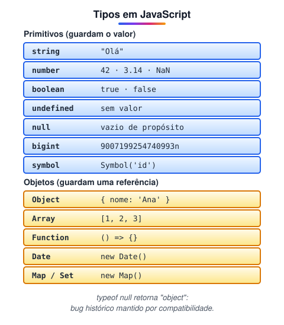

# Principais tipos de dados do JS

> 🗺️ **Nesta aula:** os 7 tipos primitivos e o tipo object, como trabalhar com number e string, truthy e falsy, `typeof`, conversão de tipos e a diferença entre valor e referência.

## De onde paramos

Na aula de operadores, `"5" + 2` deu `"52"` e `"5" - 2` deu `3`. Isso acontece por causa dos **tipos** dos valores. Entender os tipos evita boa parte dos bugs de JavaScript.

## Primitivos e objetos

O JavaScript tem **7 tipos primitivos** e um tipo para todo o resto: **object**. Arrays, funções e datas são, por baixo dos panos, objetos.



> 💡 **Analogia:** um primitivo é como uma nota de dinheiro: se você dá uma cópia a alguém, cada um tem a sua. Um objeto é como o endereço de uma casa escrito num papel: copiar o papel não cria outra casa; as duas pessoas vão à mesma casa, e se uma pintar a parede, a outra vê a parede pintada.

## Number

Inteiros e decimais são o mesmo tipo.

```jsx
let idade = 25;
let preco = 9.99;
// limite do ponto flutuante
0.1 + 0.2;  // 0.30000000000000004
10 / 0;  // Infinity
"abc" * 2;  // NaN (Not a Number)
(9.987).toFixed(2); // "9.99"
```

> 💡 Para dinheiro, trabalhe em **centavos** (inteiros) e converta só para exibir: `1999 / 100`. Para verificar se algo é NaN, use `Number.isNaN(x)`; `NaN === NaN` é `false`.

## String

Texto entre aspas simples, duplas ou **crases** (template string).

```jsx
let nome = "João";
let mensagem = 'Olá, seja bem-vindo!';
// crases interpolam valores com ${}
let saudacao =
  `Olá, ${nome}! Você tem ${2 + 3} mensagens.`;

nome.length;  // 4
nome.toUpperCase();  // "JOÃO"
"a,b,c".split(",");  // ["a", "b", "c"]
"  oi ".trim();  // "oi"
"banana".includes("nan");  // true
```

## Boolean

```jsx
let estaChovendo = true;
let temSol = false;
```

### Truthy e falsy

Em um `if`, qualquer valor vira booleano. São **falsy** apenas: `false`, `0`, `-0`, `0n`, `""`, `null`, `undefined` e `NaN`. **Todo o resto é truthy**, inclusive `"0"`, `"false"`, `[]` e `{}`.

## undefined e null

```jsx
// undefined: declarada, mas sem valor
let a;
// null: "vazio" de propósito, definido por você
let b = null;
```

## BigInt e Symbol

```jsx
// inteiros além de Number.MAX_SAFE_INTEGER
const grande = 9007199254740993n;
// identificador único, usado em chaves de objetos
const id = Symbol("id");
```

## Objetos: Object e Array

```jsx
let pessoa = { nome: "João", idade: 25 };
let cores = ["vermelho", "azul", "verde"];
```

## Descobrindo o tipo: `typeof`

```jsx
typeof 42;  // "number"
typeof "oi";  // "string"
typeof true;  // "boolean"
typeof undefined;  // "undefined"
typeof {};  // "object"
// arrays: use Array.isArray([])
typeof [];  // "object"
// bug histórico da linguagem
typeof null;  // "object"
typeof (() => {});  // "function"
```

## Convertendo tipos

```jsx
Number("42");  // 42
Number("42abc");  // NaN
parseInt("42px");  // 42 (lê até onde der)
parseFloat("3.5");  // 3.5
String(42);  // "42"
Boolean("");  // false
Boolean("texto");  // true
```

Valores de `input`, `prompt` e da URL chegam sempre como **string**: converta antes de fazer contas.

## Valor × referência

```jsx
let a = 10;
// copia o VALOR
let b = a;
b = 20;
console.log(a);  // 10

let obj1 = { x: 1 };
// copia a REFERÊNCIA: mesmo objeto
let obj2 = obj1;
obj2.x = 99;
console.log(obj1.x);  // 99

// cópia rasa: um objeto novo
let copia = { ...obj1 };
```

> ⚠️ **Correção:** a página listava Array e Object como tipos separados e omitia `undefined`, `null`, `BigInt` e `Symbol`. Na linguagem existem 7 primitivos e `object`; array é um tipo de objeto.

## Exercício

Diga o resultado de cada linha:

```jsx
typeof "42"
typeof 42
Number("3" + "4")
Boolean("0")
Boolean(0)
```

<details>
<summary>Ver resposta</summary>

```
typeof "42"  → "string"
typeof 42  → "number"
Number("3" + "4")  → 34  ("3" + "4" vira "34")
Boolean("0")  → true (string não vazia)
Boolean(0)  → false
```

</details>

## 🧠 Revisão rápida

**Quais são os valores falsy?**

`false`, `0`, `-0`, `0n`, `""`, `null`, `undefined` e `NaN`.

**Como saber se uma variável é um array?**

`Array.isArray(variavel)`, pois `typeof` devolve `"object"`.

**Por que alterar `obj2` mudou `obj1`?**

Porque objetos são copiados por referência: as duas variáveis apontam para o mesmo objeto.

> ➡️ **Próximo passo:** com valores e comparações em mãos, o programa pode tomar decisões: **Estrutura condicional**.

## 📌 Resumo

| Tipo | Em uma frase |
| --- | --- |
| number | inteiros e decimais, inclusive NaN e Infinity |
| string | texto; crases permitem `${}` |
| boolean | `true` ou `false` |
| undefined / null | sem valor / vazio de propósito |
| bigint / symbol | inteiros enormes / identificadores únicos |
| object | tudo o mais: objetos, arrays, funções |
| `typeof` | mostra o tipo de um valor |
| Referência | objetos são compartilhados, não copiados |
