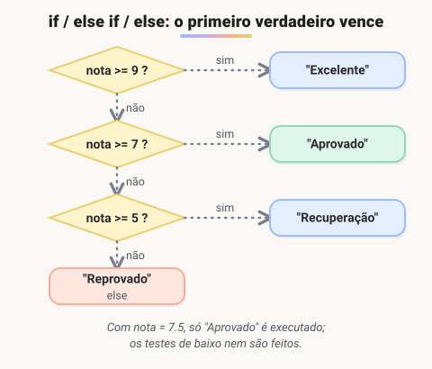

# Estrutura condicional (If-else/ switch case)

> 🗺️ **Nesta aula:** tomar decisões com `if`, `else if` e `else`, comparar um valor com vários casos usando `switch`, e alternativas mais curtas (ternário e objeto como tabela).

## De onde paramos

Você já sabe comparar valores (`===`, `>`, `&&`). Agora vamos usar o resultado dessas comparações para escolher qual código executar.

## `if`, `else if` e `else`

Executa blocos diferentes de acordo com uma condição. As condições são testadas **de cima para baixo** e só o **primeiro** bloco verdadeiro é executado.



> 💡 **Analogia:** uma cadeia de `if/else if` é como a triagem de um pronto-socorro: o atendente percorre a lista de perguntas de cima para baixo e encaminha o paciente para a **primeira** fila que se aplica, sem continuar perguntando. O `else` é o "atendimento geral" de quem não se encaixou em nada.

```jsx
const nota = 7.5;

if (nota >= 9) {
  console.log("Excelente");
} else if (nota >= 7) {
  // ← este é executado
  console.log("Aprovado");
} else if (nota >= 5) {
  console.log("Recuperação");
} else {
  console.log("Reprovado");
}
```

A ordem importa: se o teste `nota >= 5` viesse primeiro, uma nota 9,5 cairia em "Recuperação".

A condição não precisa ser um booleano: qualquer valor é convertido (veja **truthy e falsy** na aula de tipos).

```jsx
const nome = "";
if (nome) {
  console.log(`Olá, ${nome}`);
} else {
  // "" é falsy
  console.log("Digite seu nome");
}
```

### Boas práticas

- Use sempre chaves `{ }`, mesmo com uma linha só.
- Prefira `===` nas comparações.
- Evite muitos níveis de `if` aninhados. Uma técnica é o **retorno antecipado**: trate os casos inválidos primeiro e saia da função.

```jsx
function podeComprar(usuario) {
  if (!usuario) return false;
  if (usuario.idade < 18) return false;
  return usuario.saldo > 0;
}
```

## `switch`

Compara **um valor** com vários casos possíveis. É mais legível que uma sequência longa de `else if` testando a mesma variável.

```jsx
const diaDaSemana = 2;
let nomeDia;

switch (diaDaSemana) {
  case 1:
    nomeDia = "Domingo";
    break;
  case 2:
    nomeDia = "Segunda-feira";
    break;
  case 3:
    nomeDia = "Terça-feira";
    break;
  // ... casos 4 a 7 ...
  default:
    nomeDia = "Dia inválido";
}

console.log(`Hoje é ${nomeDia}`);
```

- O `switch` compara com `===`: `case "2"` **não** casa com o número `2`.
- O `default` roda quando nenhum caso casa (como o `else`).
- Sem o `break`, a execução **continua no próximo case** (fall-through). Às vezes isso é útil para agrupar casos:

```jsx
switch (dia) {
  case 1:
  case 7:
    console.log("Fim de semana");
    break;
  default:
    console.log("Dia útil");
}
```

> ⚠️ Esquecer o `break` é o erro mais comum com `switch`: o código de todos os casos seguintes também roda, até encontrar um `break` ou o fim.

## Alternativas mais curtas

```jsx
// ternário: escolher entre dois valores
const status = idade >= 18 ? "adulto" : "menor";

// objeto como "tabela": substitui um switch
// que só mapeia valores
const dias = {
  1: "Domingo",
  2: "Segunda-feira",
  3: "Terça-feira",
};
const nome = dias[diaDaSemana] ?? "Dia inválido";
```

## Exercício

Escreva uma função `calcularFrete(valor)` que retorne: frete grátis (0) para compras a partir de R$ 200; R$ 15 para compras a partir de R$ 100; R$ 25 para as demais. Valores negativos devem retornar `null`.

<details>
<summary>Ver resposta</summary>

```jsx
function calcularFrete(valor) {
  if (valor < 0) return null;
  if (valor >= 200) return 0;
  if (valor >= 100) return 15;
  return 25;
}

calcularFrete(250);  // 0
calcularFrete(150);  // 15
calcularFrete(50);  // 25
```

O retorno antecipado dispensa os `else`: cada `return` já encerra a função. Repare que os testes vão do maior valor para o menor.

</details>

## 🧠 Revisão rápida

**Se duas condições de um `if/else if` forem verdadeiras, quantos blocos rodam?**

Só um: o da primeira condição verdadeira.

**O que acontece se faltar o `break` num case?**

A execução continua nos cases seguintes (fall-through).

**Quando preferir `switch` a `if/else`?**

Quando você compara a mesma variável com vários valores exatos.

> ➡️ **Próximo passo:** além de escolher caminhos, um programa precisa repetir tarefas. Veja os **Blocos de repetição**.

## 📌 Resumo

| Estrutura | Em uma frase |
| --- | --- |
| `if / else if / else` | executa o primeiro bloco verdadeiro |
| Retorno antecipado | trata exceções primeiro e evita aninhamento |
| `switch` | compara um valor com vários casos (com `===`) |
| `break` | encerra o case; sem ele há fall-through |
| `default` | roda se nenhum case casar |
| Ternário | escolhe entre dois valores em uma linha |
| Objeto-tabela | mapeia valores sem `switch` |
