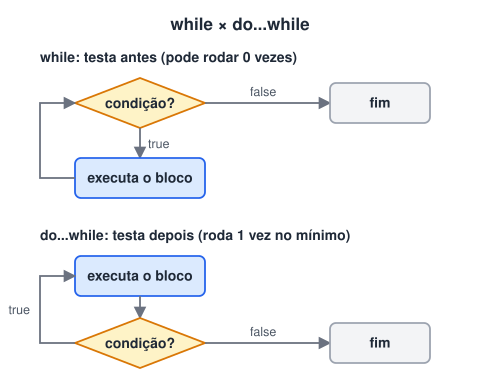

# Blocos de repetição (While, do while e for)

> 🗺️ **Nesta aula:** repetir código com `while`, `do...while` e `for`, percorrer coleções com `for...of` e `for...in`, e controlar laços com `break` e `continue`.

## De onde paramos

Com condicionais o programa escolhe um caminho. Mas muitas tarefas são repetitivas: mostrar cada produto de uma lista, somar várias notas, pedir uma senha até ela estar certa. Para isso servem os laços.

## O que são laços de repetição

**Laços repetem um bloco de código enquanto uma condição for verdadeira, ou uma vez para cada item de uma coleção.** Cada repetição é chamada de **iteração**.

A condição precisa, em algum momento, ficar falsa. Caso contrário, temos um **loop infinito**, que trava a aba do navegador.

## `while`

Testa a condição **antes** de cada repetição. Se ela já começar falsa, o bloco não roda nenhuma vez.

```jsx
let contador = 1;

while (contador <= 5) {
  console.log(`Contador: ${contador}`);
  // sem esta linha, o loop seria infinito
  contador++;
}
```

## `do...while`

Executa o bloco **primeiro** e testa depois: roda **pelo menos uma vez**.

```jsx
let contador = 1;

do {
  console.log(`Contador: ${contador}`);
  contador++;
} while (contador <= 5);
```



## `for`

Junta início, condição e passo em uma linha. Ideal quando você sabe **quantas vezes** quer repetir.

```jsx
// início; condição; passo
for (let i = 1; i <= 5; i++) {
  console.log(`Contador: ${i}`);
}
```

A ordem de execução é: início (uma vez) → testa a condição → executa o bloco → passo → testa a condição de novo, e assim por diante.

## `for...of`: percorrer os valores

A forma mais legível de percorrer arrays, strings, Map e Set.

```jsx
const frutas = ["maçã", "uva", "kiwi"];

for (const fruta of frutas) {
  console.log(fruta);
}
```

## `for...in`: percorrer as chaves de um objeto

```jsx
const pessoa = { nome: "Ana", idade: 28 };

for (const chave in pessoa) {
  console.log(`${chave}: ${pessoa[chave]}`);
}
```

> ⚠️ Evite `for...in` em arrays: ele percorre as chaves como texto (`"0"`, `"1"`…) e pode incluir propriedades herdadas. Para arrays, use `for...of`.

## `break` e `continue`

```jsx
for (let i = 1; i <= 10; i++) {
  // pula para a próxima iteração
  if (i % 2 === 0) continue;
  // encerra o laço
  if (i > 7) break;
  console.log(i);  // 1, 3, 5, 7
}
```

## Qual usar?

| Situação | Laço |
| --- | --- |
| Número de repetições conhecido | `for` |
| Repetir até algo acontecer | `while` |
| Rodar pelo menos uma vez (ex.: menu) | `do...while` |
| Percorrer os itens de um array | `for...of` (ou `forEach`) |
| Percorrer as propriedades de um objeto | `for...in` ou `Object.entries()` |

## Exercício

Usando um laço, calcule a soma dos números pares de 1 a 100 e mostre o resultado no console.

<details>
<summary>Ver resposta</summary>

```jsx
let soma = 0;
for (let i = 2; i <= 100; i += 2) {
  soma += i;
}
console.log(soma);  // 2550
```

Começar em 2 e andar de 2 em 2 dispensa o teste `i % 2 === 0`.

</details>

## 🧠 Revisão rápida

**Qual laço sempre executa pelo menos uma vez?**

O `do...while`.

**Qual a diferença entre `break` e `continue`?**

`break` encerra o laço; `continue` pula só a iteração atual.

**Qual laço usar para percorrer os itens de um array?**

`for...of` (ou métodos como `forEach` e `map`).

> ➡️ **Próximo passo:** laços brilham quando há uma lista de valores para percorrer. Conheça o **Array**.

## 📌 Resumo

| Laço | Em uma frase |
| --- | --- |
| `while` | testa antes; pode rodar 0 vezes |
| `do...while` | testa depois; roda no mínimo 1 vez |
| `for` | início, condição e passo em uma linha |
| `for...of` | percorre os valores de um array ou string |
| `for...in` | percorre as chaves de um objeto |
| `break` / `continue` | encerra o laço / pula a iteração |
