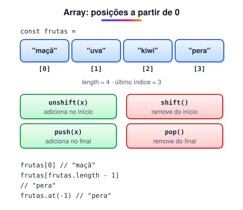

# Array

> 🗺️ **Nesta aula:** o que é um array, como criar, acessar e modificar itens, os métodos básicos (e quais alteram o original), como percorrer, matrizes, desestruturação e spread.

## De onde paramos

Os laços repetem tarefas, e quase sempre essas tarefas são sobre uma **lista** de coisas: produtos, notas, mensagens. Guardar cada item numa variável separada não escala. O array resolve isso.

## O que é um array

**Um array é uma lista ordenada de valores guardada em uma única variável.** Cada valor ocupa uma posição numerada, o **índice**, que começa em **0**.



> 💡 **Analogia:** um array é como uma fileira de armários numerados num vestiário, mas a numeração começa no 0. Para pegar algo, você diz o número do armário (`lista[2]`). Se a fileira tem 5 armários, o último é o de número 4.

## Criando e acessando

```jsx
const numeros = [1, 2, 3, 4, 5];
const nomes = ["João", "Maria", "José"];
// aceita qualquer tipo
const misturado = [1, "texto", true, null];

numeros[0];  // 1
nomes[1];  // "Maria"
// não dá erro, só undefined
nomes[10];  // undefined
// último item
nomes[nomes.length - 1];  // "José"
nomes.at(-1);  // "José"
```

## Modificando

```jsx
numeros[2] = 10;
console.log(numeros);  // [1, 2, 10, 4, 5]
```

Mesmo declarado com `const`, o conteúdo do array pode mudar. O que não pode é atribuir **outro array** à variável.

## Métodos básicos

| Método | O que faz | Altera o original? |
| --- | --- | --- |
| `push(x)` / `pop()` | adiciona / remove no **final** | sim |
| `unshift(x)` / `shift()` | adiciona / remove no **início** | sim |
| `splice(i, n)` | remove `n` itens a partir de `i` (e pode inserir) | sim |
| `slice(i, f)` | copia de `i` até `f`, sem incluir `f` | não |
| `includes(x)` | `true` se o valor existe | não |
| `indexOf(x)` | posição do valor (ou `-1`) | não |
| `join(sep)` | junta tudo em uma string | não |
| `concat(arr)` | junta arrays | não |
| `reverse()` / `sort()` | inverte / ordena | **sim** |

```jsx
const numeros = [1, 2, 3, 4, 5];

numeros.length;  // 5
numeros.push(6);  // [1, 2, 3, 4, 5, 6]
numeros.pop();  // remove o 6
numeros.join("-");  // "1-2-3-4-5"
numeros.includes(3);  // true
numeros.slice(1, 3);  // [2, 3]
// remove 1 item no índice 0
numeros.splice(0, 1); // numeros = [2, 3, 4, 5]
```

> ⚠️ `sort()` sem argumento ordena como **texto**: `[10, 9, 1].sort()` vira `[1, 10, 9]`. Para números, passe uma função de comparação: `numeros.sort((a, b) => a - b)`.

## Percorrendo

```jsx
const numeros = [1, 2, 3];

// clássico, com índice
for (let i = 0; i < numeros.length; i++) {
  console.log(numeros[i]);
}
// mais legível
for (const n of numeros) console.log(n);
// com índice, em estilo funcional
numeros.forEach((n, i) => console.log(i, n));
```

Métodos como `map`, `filter`, `find` e `reduce`, que transformam arrays sem laços manuais, estão na próxima aula.

## Arrays multidimensionais

Arrays podem conter outros arrays, formando uma matriz:

```jsx
const matriz = [
  [1, 2, 3],
  [4, 5, 6],
  [7, 8, 9],
];

matriz[0][1];  // 2 → linha 0, coluna 1
matriz[2][0];  // 7
```

## Desestruturação e spread

```jsx
const [primeiro, segundo, ...resto] = [10, 20, 30, 40];
// primeiro = 10, segundo = 20, resto = [30, 40]

// cópia rasa
const copia = [...numeros];
// junta dois arrays
const todos = [...numeros, ...outros];
```

## Exercício

Dado `const notas = [7, 9.5, 4, 8];`, escreva o código que: (a) adicione a nota 6 no final; (b) calcule a média; (c) mostre a maior nota.

<details>
<summary>Ver resposta</summary>

```jsx
const notas = [7, 9.5, 4, 8];
notas.push(6);

let soma = 0;
for (const n of notas) soma += n;
const media = soma / notas.length;
console.log(media);  // 6.9

// spread transforma o array em argumentos
console.log(Math.max(...notas));  // 9.5
```

</details>

## 🧠 Revisão rápida

**Qual o índice do último item de um array de 10 itens?**

9 (`length - 1`), ou use `at(-1)`.

**Qual a diferença entre `slice` e `splice`?**

`slice` copia um trecho sem alterar o original; `splice` remove ou insere itens no próprio array.

**Por que `[10, 9, 1].sort()` dá `[1, 10, 9]`?**

Porque, sem função de comparação, o `sort` compara como texto.

> ➡️ **Próximo passo:** filtrar, transformar e somar listas sem escrever laços: **Métodos de array**.

## 📌 Resumo

| Item | Em uma frase |
| --- | --- |
| Índice | posição do item, começando em 0 |
| `length` | quantidade de itens |
| `push` / `pop` | adiciona / remove no final |
| `unshift` / `shift` | adiciona / remove no início |
| `slice` / `splice` | copia trecho / altera o array |
| `sort((a, b) => a - b)` | ordena números corretamente |
| Matriz | array de arrays: `m[linha][coluna]` |
| Spread `...` | copia ou junta arrays |
